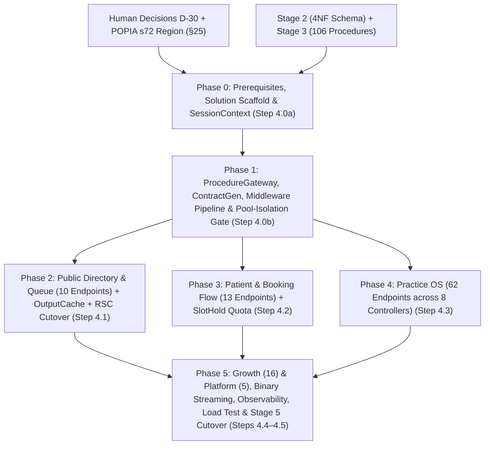

# BabyBlue API Implementation Plan — Review & Phase Index

**Companion to:** [`API_LAYER_SPEC.md`](API_LAYER_SPEC.md) · [`IMPLEMENTATION_PLAN.md`](IMPLEMENTATION_PLAN.md) · [`STORED_PROCEDURES.md`](STORED_PROCEDURES.md) · [`DATABASE_SCHEMA_4NF.md`](DATABASE_SCHEMA_4NF.md) · [`MULTITENANCY_PLAN.md`](MULTITENANCY_PLAN.md) · [`IMPROVEMENT_PLAN.md`](IMPROVEMENT_PLAN.md)

This document contains:
1. **A technical review of [`API_LAYER_SPEC.md`](API_LAYER_SPEC.md)** cross-checked against its five companion specifications and the existing repository (`supabase/migrations/*`, `src/local/db.ts`, `tests/db/harness.ts`).
2. **The master phase breakdown**, linking to the six self-contained phase implementation plans under [`plans/api/`](plans/api/).

---

## 1. Review of `API_LAYER_SPEC.md`

### 1.1 What the specification gets right

- **Zero-authority ("no confused deputy") posture (§1, §3, §4):** Connecting as `bb_api` (`noinherit`, `nobypassrls`, zero table ownership, zero direct table privileges) and applying `set local search_path`, `set local role`, `set local statement_timeout`, and `set_config('request.jwt.claim.sub', ..., true)` inside an explicit transaction preserves D-03, D-04, and D-26 intact. Forgetting `set local role` fails closed (`42501 permission denied for function`) rather than succeeding with elevated rights.
- **Explicit per-transaction `statement_timeout` (§3 detail 2):** Catching that PostgreSQL's `ALTER ROLE authenticated SET statement_timeout` only fires at login (and is inert on `SET LOCAL ROLE authenticated` when logging in as `bb_api`) prevents a silent regression of `IMPROVEMENT_PLAN.md` §6.
- **Catalogue-driven code generation (§5, §6):** Generating `Procedures.g.cs` and `Contracts.g.cs` from `pg_proc` using `CommandType.Text` (`select * from <fn>(...)` with `=>` named-argument notation) avoids Npgsql's `CommandType.StoredProcedure` (`CALL`) incompatibility with `CREATE FUNCTION ... RETURNS TABLE` and enforces compile-time parity with the 106 procedures.
- **Single-source error prose (§10, §21):** Returning machine error codes (`ProblemDetails.extensions["code"]`) from C# while keeping user-facing prose in [`src/local/db.ts`](src/local/db.ts) `MESSAGES` prevents split copy across deployments.

---

### 1.2 Fifteen technical findings & adjustments incorporated into the phase plans

Cross-checking [`API_LAYER_SPEC.md`](API_LAYER_SPEC.md) against [`STORED_PROCEDURES.md`](STORED_PROCEDURES.md), [`MULTITENANCY_PLAN.md`](MULTITENANCY_PLAN.md), and the codebase surfaced fifteen concrete items. **F-01 to F-07** came from reading the specifications against each other; **F-08 to F-15** came from checking every route table against the actual procedure signatures and the live repository, and each of those would have failed a phase's own exit gate. Findings marked *Applied* have already been written into the source document; the rest are resolved in the phase plans.

Verified mechanically rather than by inspection: the Phase 2–5 route tables reference **106 procedures, each exactly once**, with no omissions and no duplicates (`10 + 13 + 62 + 21`), matching the 106 non-helper functions in [`STORED_PROCEDURES.md`](STORED_PROCEDURES.md) (plus the three `_require_*` helpers, correctly excluded).

| # | Finding | Where in `API_LAYER_SPEC.md` | Resolution in Phase Plans |
|---|---|---|---|
| **F-01** | **Schema-per-brand (`bb_babyblue`) vs Stage 4 sequencing:** `SessionContext.ApplyAsync` (§3) enforces `^bb_[a-z][a-z0-9_]{1,28}$`, `BrandResolutionMiddleware` (§14) calls `public.resolve_brand(@host)`, and `BabyBlue.ContractGen` (§6) reads `:schema = 'bb_babyblue'`. However, `IMPLEMENTATION_PLAN.md` places Stage 7 (moving from `public` to `bb_babyblue`) *after* Stage 4. Running §3 against `public` would throw `InvalidOperationException("invalid_schema")`. | §3, §6, §14, §22 | **Split the two halves.** The registry (`public.tenant_brands`, `public.tenant_brand_domains`, `public.resolve_brand`) is cheap and lands in Phase 0, because brand resolution, CORS and theming need it. The **schema move does not**: Phases 0–5 target `public`, and `SessionContext` accepts `^(public\|bb_[a-z][a-z0-9_]{1,28})$`. See §1.3 for why folding the move into Phase 0 was rejected. |
| **F-02** | **Single-row vs list-row `TABLE` return shapes:** In §5, `ProcedureGateway` only defines `QueryAsync<TRow>` returning `IReadOnlyList<TRow>`, `ScalarAsync<T>`, and `ExecuteAsync`. Yet §9 ("Status codes") specifies: *"Read of a single resource the procedure returns no row for → `404`"*. Twelve procedures (`public_practitioner_get`, `public_queue_info`, `public_queue_status`, `patient_profile_get`, `patient_appointment_get`, `patient_hold_get`, `practice_setup_progress`, `practice_client_get`, `practice_appointment_get`, `practice_settings_get`, `growth_request_get`, `growth_asset_download`) return 0-or-1 row via `returns table (...)`. | §5, §6, §9 | Add `QuerySingleOrDefaultAsync<TRow>` and `QuerySingleAsync<TRow>` (which raises/maps `not_found` → `404` when zero rows return) to `ProcedureGateway` and emit single-object return types in `BabyBlue.ContractGen` via a deterministic single-row suffix/manifest rule. |
| **F-03** | **`growth_asset_download` metadata gap:** §15 states `GET /v1/growth/assets/{id}/content` returns a `FileContentResult` using `mime` and `file_name` from `growth_assets_list`. However, `growth_assets_list(p_request uuid)` requires `p_request`, which is not in the `/v1/growth/assets/{id}/content` route, and calling two procedures violates §1's one-procedure-per-endpoint rule. | §8, §15 | **Applied in [`STORED_PROCEDURES.md`](STORED_PROCEDURES.md) §15:** `growth_asset_download(p_asset uuid)` now returns `table (file_name text, mime text, content bytea)`. Because PostgreSQL cannot change a return type in place, the definition is preceded by `drop function if exists public.growth_asset_download(uuid)`. The change sits with the Stage 3 procedure set, **not** in Phase 5, so `ContractGen` sees the final shape on its first run. |
| **F-04** | **Practice endpoint count discrepancy (62 vs 60):** §22 Step 4.3 says `"practice/* — 60 endpoints"`, whereas the eight Practice route tables in §8 sum to **62** (`11 + 12 + 5 + 6 + 9 + 5 + 7 + 7 = 62`), which together with Public (`10`), Patient (`13`), Growth (`16`), and Platform (`5`) equals the exact **106** procedures. | §8, §22 | Phase 4 tracks all **62** Practice endpoints across the 8 controllers (`10 + 13 + 62 + 16 + 5 = 106`). **Note on the label:** by procedure prefix the catalogue holds **61** `practice_*` and **6** `platform_*` functions. `platform_my_role` is routed as `GET /v1/me/platform-role` on `PracticeContextController`, so it counts in Phase 4's 62 and `PlatformController` carries the other 5. The arithmetic to 106 is right; the word "Practice" means "routed in Phase 4", not "named `practice_*`". |
| **F-05** | **`ctx.Items["procedure"]` is read by `ProblemDetailsExceptionHandler` (§10) and the request logger (§16), but never set in `ProcedureGateway` (§5):** Without setting it before `run(...)`, failed and succeeded requests log `proc=null`, masking which procedure triggered a `42501` grant/RLS error. | §5, §10, §16 | `ICallerAccessor` / `ProcedureGateway.RunAsync` writes `ProcedureName.Name` into `CallerContext` / `HttpContext.Items["procedure"]` before executing the command and tags the OpenTelemetry child span. |
| **F-06** | **JWT `401` ProblemDetails & `token_expired` code (§10, §11):** §11 states that an expired JWT returns `401` with `code: "token_expired"`, and missing/invalid tokens return `401` with `ProblemDetails` (§20). Default ASP.NET Core `JwtBearerHandler` writes an empty 401 response without invoking `IExceptionHandler`. | §10, §11, §20 | Configure `JwtBearerEvents.OnChallenge` in Phase 1 to suppress the default empty response and emit a standard `ProblemDetails` payload with `code: "token_expired"` (when `AuthenticateFailure is SecurityTokenExpiredException`) or `code: "not_authenticated"`. |
| **F-07** | **Brand host resolution across Next.js Server Components and browser CORS calls (§14, §19, §21):** If the browser or a Next.js Server Component calls a shared API hostname (`api.babyblue.co.za`) while serving a white-label brand (`book.smilegroup.co.za`), `ctx.Request.Host` is the API host unless either custom API domains or a tenant host signal is used. | §14, §19, §21 | Support primary resolution via `X-Tenant-Host` (validated against `tenant_brand_domains`) / `Origin` host fallback when `ctx.Request.Host` is the configured platform API host, or per-brand API subdomains. Because RLS inside every brand schema evaluates `auth.uid()` (§3), `X-Tenant-Host` cannot escalate privileges across brands. |

**F-07 as built (2026-11-01).** The first implementation honoured `X-Tenant-Host` on *every* host, not only on a shared platform host, so a request arriving at `book.smilegroup.co.za` could reselect its brand by header, and the `Origin` fallback keyed off a hardcoded `api.` prefix rather than configuration. Corrected: `Network:PlatformApiHosts` lists the shared hostnames, `BrandResolutionMiddleware.IsPlatformApiHost` gates both signals on it, and the `api.` label convention remains only as the fallback when the list is empty. Recorded as part of D-33.

| **F-08** | **`patient_appointment_get` was `returns setof record`:** `pg_proc` carries no OUT columns for a `setof record` function, so `BabyBlue.ContractGen` could not derive a row type, and `select * from patient_appointment_get(...)` fails at runtime with *"a column definition list is required for functions returning record"*. It was the only such procedure in the catalogue. | §6, §8 | **Applied in [`STORED_PROCEDURES.md`](STORED_PROCEDURES.md) §6:** changed to `returns table (...)` mirroring `patient_appointments_list`'s 16 columns. |
| **F-09** | **`numeric` was absent from the §6 type map:** `growth_reports_list` returns `metric_value numeric`. Generator assertion 4 ("prohibited / unmapped PostgreSQL type") would have failed the Phase 1 build on the first run against the real catalogue. | §6 | Phase 1's type-mapping table now carries `numeric` → `decimal` (`decimal?`). |
| **F-10** | **Four error codes were declared but never raised, so the 3-way parity gate could not pass:** [`STORED_PROCEDURES.md`](STORED_PROCEDURES.md) §2 lists `has_records`, `last_practitioner`, `consent_required` and `price_required`, but no procedure body raised them. Worse, `patient_account_delete` had **dropped** the `exception when foreign_key_violation then raise exception 'has_records'` handler that ships today at `supabase/migrations/0004_app_functions.sql:90-91` — so Phase 3's own exit gate (`DELETE /v1/me` → `409 has_records`) would have failed, with the FK violation arriving as `23503` → generic `409 conflict`. | §10, §20, §26 | **Applied in [`STORED_PROCEDURES.md`](STORED_PROCEDURES.md):** `has_records` handler restored on `patient_account_delete`; `price_required` guard added to `practice_service_upsert` (an active service needs a price); `last_practitioner` guard added to `practice_service_practitioners_set` (cannot empty the set while future bookings exist); `consent_required` guard added to `practice_appointment_create` (POPIA s11 — latest `client_consents` event for `record_storage` must be `granted`). `patient_appointment_book` now writes its own `record_storage` consent event with `channel = 'app'` when it auto-creates a client row, which both closes a real consent-trail gap and means `consent_required` has exactly one raise site. |
| **F-11** | **Error-mapping precedence was unstated, and SQLSTATE `22023` was missing from the §10 fallback list:** eleven semantic codes raise `22023` (`hold_expired`, `invalid_name`, `invalid_range`, `invalid_registration`, `invalid_transition`, `not_cancellable`, `not_checkin_able`, `not_reschedulable`, `too_early_to_check_in`, `too_late_to_cancel`, `asset_too_large`) and `22023` appeared nowhere in the fallback table, so an unrecognised message would fall through to `500`. SQLSTATEs are also **not** unique per code: `P0002` serves `not_found` (`404`), `queue_closed` (`409`) and `user_not_found` (`409`); `23503` serves `service_in_use` (`409`) and `metric_unknown` (`400`); `23P01` serves `slot_unavailable` and `overlapping_availability`. | §10 | Phase 1 now states the resolution order explicitly — `MessageText` → `ConstraintName` → `SqlState` — and adds `22023` → `400 invalid_input` as the terminal fallback. |
| **F-12** | **Five route-table contracts contradicted the actual procedure signatures:** `public_queue_status` returns `(status, queue_position, practice_name)`, not `position` + a non-existent `estimated_wait_min`; `public_queue_join` takes `(p_practice_slug, p_name, p_phone, p_urgency)` and `returns text`, so the DTO's `Note` had no parameter and `Urgency` was missing; `patient_appointment_book` takes only `(p_hold uuid)`, so the DTO's `Notes` and `MarketingOptIn` had no parameters; `patient_appointment_reschedule` and `practice_queue_call_next` return `void` and `uuid`, not the row shapes declared. | §8, §9 | All five corrected in Phases 2–4. Each route table now mirrors the procedure signature exactly, because `ContractGen` derives the C# from `pg_proc` and any divergence becomes a compile error rather than a design discussion. |
| **F-13** | **`growth_asset_add` trusted the caller's declared size:** the guard read `p_size_bytes > 5242880` — a client-supplied form field — not the actual payload, so the database limit could be bypassed by understating the size. | §15 | **Applied in [`STORED_PROCEDURES.md`](STORED_PROCEDURES.md) §15:** the guard is now `octet_length(p_content) > 5242880`. Phase 5 additionally computes `size_bytes` in C# from the real byte count and never forwards a client-supplied length. |
| **F-14** | **`src/lib/api/http.ts` could not import `MESSAGES` from [`src/local/db.ts`](src/local/db.ts):** that module is `"use client"` and imports `@electric-sql/pglite/worker`, so Phase 1's client helper and Phase 2's Server Component migration would have pulled PGlite and a `Worker` into the server bundle. | §21 | **Applied:** the contract moved to [`src/lib/api/messages.ts`](src/lib/api/messages.ts) — zero dependencies, all 28 codes plus the `profiles_phone_international` constraint name — and `src/local/db.ts` re-exports it so the existing demo screens keep importing from `@/local/db`. `friendlyError` now prefers `ApiError.code` over substring matching, and matches longest-key-first so a short code cannot shadow a longer one. |
| **F-15** | **`bb_api connection limit 60` vs `MaxPoolSize = 40`:** safe for exactly one API instance. Two instances exhaust the role's limit and trip the `53300` alert that Phase 5 §4.3 provisions for precisely this failure. | §4, §16, §17 | Phase 0 now states the invariant `instances x MaxPoolSize + reserve <= connection limit` and sets the limit from it, rather than leaving two unrelated numbers in two documents. |

---

### 1.3 Why the `bb_babyblue` schema move is **not** folded into Phase 0

The first draft of F-01 resolved the sequencing conflict by pulling `MULTITENANCY_PLAN.md` Phase 1 forward into Phase 0, so that the 106 procedures would be written into `bb_babyblue` once rather than migrated later. That was rejected on measurement:

- All 106 procedures are declared `create function public.<name> ... set search_path = public`, and the document carries **618 `public.`-qualified references**. A `security definer` function sitting in `bb_babyblue` but still saying `public.appointments` reads the `public` tables — the isolation would be decorative.
- [`MULTITENANCY_PLAN.md`](MULTITENANCY_PLAN.md) §13 sizes this move itself: **Large** for `supabase/migrations/` ("touches every file"), and **Medium** for the helpers, the RLS policies, the 106 procedures, `tests/db/harness.ts` and `src/local/seed.ts`.
- [`MULTITENANCY_PLAN.md`](MULTITENANCY_PLAN.md) §14 sequences the move **after** its own Phase 0, which includes table-grant revocation — i.e. after `IMPLEMENTATION_PLAN.md` Stage 5, not before Stage 4.
- The stated benefit — not generating twice — is small. `BabyBlue.ContractGen` already takes `--schema` as an argument, `Generated/` is a derived artifact behind a `git diff --exit-code` gate, and regenerating is one command.

**Decision:** Phase 0 creates the registry and `public.resolve_brand` (needed for brand resolution, dynamic CORS and theming, and cheap to build). `SessionContext` validates against `^(public|bb_[a-z][a-z0-9_]{1,28})$` so the same `set local` preamble serves both layouts unchanged. The schema move keeps its place as `MULTITENANCY_PLAN.md` Phase 1, after the API layer is complete and under test — at which point it is a rename verified by an existing cross-brand isolation suite rather than a rewrite performed blind. Record this as **D-31** (§3).

---

## 2. Phase Breakdown & Document Map

The implementation is divided into **six phased documents** corresponding to `API_LAYER_SPEC.md` §22 Steps `4.0` through `4.5`:

| Phase Document | Spec Step | Endpoints | Core Deliverables | Hard Exit Gate |
|---|---|---|---|---|
| **[Phase 0: Prerequisites, Solution Scaffold & `SessionContext`](plans/api/PHASE_0_PREREQUISITES_AND_FOUNDATION.md)** | `4.0a` | `resolve_brand` | `DECISIONS.md` D-30 & D-31; `bb_api` role (`noinherit`, `nobypassrls`, connection limit derived from `instances x MaxPoolSize`); brand registry & `public.resolve_brand`; `.NET 10` solution (`BabyBlue.Api`, `BabyBlue.Data`, `BabyBlue.Contracts`, `BabyBlue.ContractGen`); `DataSourceFactory`; `SessionContext.ApplyAsync` (`set local` preamble); Testcontainers Supabase bootstrap. | Startup role self-check passes; `SessionContext` unit + Testcontainers tests prove `set local` unwinds on commit/rollback. |
| **[Phase 1: Gateway, Code Generator, Pipeline & Isolation Gate](plans/api/PHASE_1_GATEWAY_GENERATOR_AND_PIPELINE.md)** | `4.0b` | 2 (`cities`, `practices`) | `ProcedureGateway` (table list, single row, scalar, void + read retry); `BabyBlue.ContractGen` emitting all 106 procedures; middleware pipeline in exact §7 order; `GET /v1/directory/cities` + `GET /v1/practices` vertical slices; Next.js `src/lib/api/http.ts`. | **Single-connection (`MaxPoolSize=1`) cross-brand/cross-user pool-isolation test passes**; `git diff --exit-code` on `Generated/`. |
| **[Phase 2: Public Directory & Queue + Output Caching](plans/api/PHASE_2_PUBLIC_DIRECTORY_AND_QUEUE.md)** | `4.1` | 10 Public | `PublicDirectoryController` (6) & `PublicQueueController` (4); `OutputCache` (`Facets` 1h, `Listing` 60s, `Profile` 5m, `QueueInfo` 10s, `slots` & `tokens` never); `DirectorySearch` & `QueueJoin` IP rate limiters; Next.js Server Component migration. | Zero personal fields on `anon` responses; no request with `Authorization` is ever cached; `/v1/queue/tokens/*` excluded from access logs. |
| **[Phase 3: Patient Endpoints & Concurrency-Safe Booking Flow](plans/api/PHASE_3_PATIENT_AND_BOOKING_FLOW.md)** | `4.2` | 13 Patient | `PatientController` (profile, appointments, holds, book/cancel/reschedule/check-in, POPIA s23 export & s14 delete); `SlotHold` rate limiter (10/hr/user); `23P01` (`no_double_booking` → `409 slot_unavailable`) & `has_records` → `409`; `src/app/patient/*` migration. | 11th rapid hold returns `429`; concurrent holds on same slot yield one `201` and one `409 slot_unavailable`; zero SQL in `src/app/patient/*`. |
| **[Phase 4: Practice OS Endpoints (8 Controllers)](plans/api/PHASE_4_PRACTICE_OS_ENDPOINTS.md)** | `4.3` | 62 Practice | `PracticeContextController` (11), `PracticeTeamController` (12), `PracticeServicesController` (5), `PracticeAvailabilityController` (6), `PracticeClientsController` (9), `PracticeQueueController` (5), `PracticeAppointmentsController` (7), `PracticeSettingsController` (7); `src/app/practice/*` migration. | `sole_owner` demotion returns `409`; two concurrent `POST /queue/call-next` return distinct entries; consent withdrawal preserves original grant; zero SQL in `src/app/practice/*`. |
| **[Phase 5: Growth, Platform Admin, Observability & Cutover](plans/api/PHASE_5_GROWTH_PLATFORM_AND_CUTOVER.md)** | `4.4` & `4.5` | 16 Growth + 5 Platform (Total: 106) | `GrowthController` (16, incl. `bytea` upload/download streaming & module flag `404`), `PlatformController` (5, keyset audit log); PII-free Serilog + OpenTelemetry + 6 alerts; 3-way error-code equality test; 640-practitioner load test; Stage 5 `revoke` readiness. | `grep -rE "select \|insert \|update \|delete " src/app src/components` returns empty; all 106 endpoints pass happy + denial tests; load test p99 within budget. |

---

## 3. Pre-Build Human Decisions Checklist (§25)

Before Phase 0 code is merged to `dev`, record the following in [`DECISIONS.md`](DECISIONS.md):

- [ ] **Decision 1 (Blocks go-live):** Hosting provider and region for `BabyBlue.Api` co-located with the Supabase region under the POPIA s72 determination.
- [x] **Decision 2 (Blocks Phase 0):** Commit **D-30** in [`DECISIONS.md`](DECISIONS.md) recording the .NET 10 API layer addition and amending [`ARCHITECTURE.md`](ARCHITECTURE.md).
- [x] **Decision 3 (Before Phase 1):** Confirm asymmetric JWKS (`ES256`/`RS256`) vs legacy `HS256` for Supabase JWT validation (recorded in D-30: JWKS default, symmetric only for local/test harnesses).
- [x] **Decision 4 (Before Phase 0):** Confirm `/api/leads` remains in Next.js (`src/app/api/leads/route.ts`) so the Supabase `service_role` key never enters `BabyBlue.Api` (recorded in D-30).
- [x] **Decision 5 (Before Phase 0):** Confirm direct Postgres endpoint (recommended) vs Supavisor session mode for `NpgsqlDataSource` (recorded in D-30).
- [x] **Decision 6 — D-31 (Blocks Phase 0):** Record that Phases 0–5 target the `public` schema and that the `bb_babyblue` move stays as [`MULTITENANCY_PLAN.md`](MULTITENANCY_PLAN.md) Phase 1, after the API layer is complete (§1.3). The brand registry and `public.resolve_brand` still land in Phase 0.
- [x] **Decision 7 (Before Phase 0):** Set `instances x MaxPoolSize + reserve` and therefore `bb_api`'s `connection limit` (F-15). Two API instances at `MaxPoolSize = 40` need at least 85, not 60 (recorded in D-30 and `0006_api_role_and_brand_registry.sql`).
- [x] **Decision 8 (Before Phase 3):** Resolve the phone-format divergence. `DECISIONS.md` D-21 says the number "must be a mobile that works on WhatsApp ... is stored as `+27`... and is enforced by a database check (migration 0005)", but migration `0005` enforces only E.164 (`^\+[1-9][0-9]{7,14}$`). Either tighten the constraint to match D-21 or loosen D-21 to match the constraint — decide in one place, because Phase 3's request validation has to mirror whichever wins. **Resolved as D-32 (2026-11-01):** D-21 was loosened to match the constraint; `UpdateProfileRequest.Phone` mirrors E.164 exactly and South African landline refusal stays client-side UI guidance.
- [x] **Decision 9 (Before deployment) — D-33:** Set the proxy boundary (`Network:TrustForwardedHeaders`, `Network:KnownProxies` / `Network:KnownNetworks`, `Network:ForwardLimit`) and the shared API hostnames (`Network:PlatformApiHosts`), and supply `Observability:UserHashSalt` and `Supabase:Url`. The API refuses to start in a deployed environment without them (recorded in D-33). Note this interacts with **Decision 1**: the hosting provider determines the balancer addresses.
