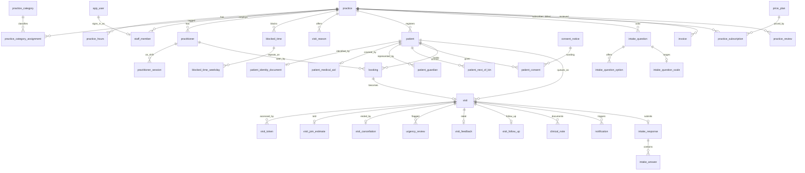

# BabyBlue Database Implementation Spec

PostgreSQL 15+ · 4NF · Version 1.0 · Owner: Apex Motus · Status: pre-pilot

This document is the database design for BabyBlue, the clinic queue and patient-flow product described in `BabyBlue-Design-Implementation-Spec.md` (v2) and `README.md`. It defines the tables, the rules the database enforces on its own, and one stored function or procedure for every query the 28 screens need (P1 to P15 on the patient app, S1 to S13 in the staff portal), plus the background jobs.

**What was tested.** All SQL in sections 12 to 17 was loaded into a clean PostgreSQL 16.15 database and a smoke test (section 18) was run against it. The test exercises practice approval, patient self-join, a minor with a guardian, the urgent-flag review, the ID gate on Mark seen, walk-in, booking, intake, outbound messaging, billing and the nightly jobs. It is not a load test and not a substitute for your own test suite: expect to add cases for permissions, concurrency and every error code. The SQL has not been run on PostgreSQL 15 or 17.

---

## 1. How to read this document

| Section | What it gives you |
|---|---|
| 2 | Design decisions and what the database does and does not do |
| 3 | Entity relationship diagram |
| 4 | Table dictionary, group by group, with the 4NF reasoning |
| 5 | 4NF verification: the multi-valued facts and how each is separated |
| 6 | Conventions for functions, procedures, parameters and errors |
| 7 | Error codes |
| 8 | Screen to routine catalogue (the "specific queries per screen") |
| 9 | Security: roles, grants, encryption, tokens, audit |
| 10 | Background jobs and the messaging outbox |
| 11 | Open decisions and known limits |
| 12 to 17 | The SQL, in the order it must be run |
| 18 | Smoke test |
| 19 | Routine index (generated from the database) |

---

## 2. Design decisions

**PostgreSQL only, logic in the database.** Every query the screens need is a named function (reads) or procedure (writes). The .NET application calls them with Npgsql or Dapper and does not write ad hoc SQL against the tables. This keeps rules such as the ID gate, the last-Admin guard and the urgent-review flow in one place whichever client calls them.

**Multi-tenancy.** Every clinic-owned table carries `practice_id`. Child rows reference their parent with a composite foreign key `(child_id, practice_id)` pointing at `UNIQUE (id, practice_id)` on the parent, so a row from practice A can never point at a row from practice B, even with a bug in the application. Routines take `p_practice_id` and `p_staff_id` and check them against each other (`_assert_staff`) before doing anything.

**Time.** All instants are `timestamptz`. Opening hours are local `time` values per practice time zone (`practice.timezone`, default `Africa/Johannesburg`). Weekdays are ISO 1 (Monday) to 7 (Sunday).

**Queue position and wait estimates are derived, never stored.** Position comes from `fn_queue_snapshot`, which orders waiting visits by `queue_sort_key, joined_at, visit_id`. Every screen reads the same function, so the patient app, the dashboard and the SMS text can never disagree. The estimate shown at join time is stored once in `visit_join_estimate` so accuracy can be measured later (`fn_estimate_accuracy`).

**Sensitive fields are encrypted by the application, not by Postgres.** ID numbers, medical-aid member numbers and clinical note bodies arrive as `bytea` ciphertext (AES-GCM). ID lookup uses an HMAC blind index (`id_number_hash`). The database never sees the key. See section 9.

**Addresses are single text fields.** A structured address (street, suburb, city, postal code) would create a transitive dependency (postal code determines city), which is a normal-form problem, and BabyBlue only displays addresses and links to a map. If you later need to filter by suburb or city, add a `locality` reference table and point to it.

**Prices are placeholders.** `price_plan` is seeded with R2,000 installation and R200 per month, in cents, as an "illustrative, to be updated" plan, matching your note. The billing routines read whatever plan is current.

---

## 3. Entity relationship diagram

Core entities only. Every clinic-owned table also carries `practice_id`, omitted here for readability.



---

## 4. Table dictionary

Column-level detail is in the DDL (section 12), which carries inline comments on the non-obvious tables and columns. This section explains what each table is for and why it is shaped the way it is.

### 4.1 Identity and platform

| Table | Purpose |
|---|---|
| `app_user` | A person who can sign in (email, verification time). Passwords and sessions are handled by the identity layer in the .NET app; the database stores no password hash. |
| `platform_admin` | Users who may review practices (S13), see leads and billing. One row per user. |
| `staff_session` | One row per signed-in device, so S12 can list devices and sign one out. |

### 4.2 Practice and its facts

| Table | Purpose |
|---|---|
| `practice` | The tenant. Status `draft`, `pending`, `approved`, `declined`, `suspended`. Only `approved` practices appear in search and accept patients. |
| `practice_slug_history` | Old slugs, so printed QR codes keep working after a rename. |
| `practice_category`, `practice_category_assignment` | A practice can be a GP and a clinic at once. Separate table because categories are a multi-valued fact. |
| `practice_hours` | One row per practice per weekday. Hours are separate from categories and practitioners: three independent multi-valued facts about a practice never share a table. |
| `practice_review` | One row per submission to platform review, with decision, decider and mandatory reason. A partial unique index allows only one pending review per practice. |
| `terms_acceptance` | Who accepted which version of the operator agreement and when. |

### 4.3 Staff and practitioners

| Table | Purpose |
|---|---|
| `staff_member` | A user's role (`admin`, `reception`, `clinician`) at exactly one practice. |
| `staff_alert_preference` | One row per staff member per alert kind, instead of boolean columns. |
| `staff_invitation` | Hashed invitation tokens with expiry, acceptance and revocation. |
| `practitioner` | A person who sees patients, optionally linked to a staff member. A practitioner can exist without a login (a locum, say). |
| `practitioner_session` | "On shift" intervals. The wait estimate divides by the number of practitioners with an open session. |
| `blocked_time`, `blocked_time_weekday` | One-off or weekly blocks (lunch, surgery). The weekdays of a weekly block are a multi-valued fact, so they live in their own table. |
| `visit_reason` | The reasons a patient can pick, managed per practice. |

### 4.4 Patients

| Table | Purpose |
|---|---|
| `patient` | Name, date of birth, phone, email, address text. `_upsert_patient` matches a returning patient (by ID blind index, then by guardian phone for dependants, then by phone and name for adults) instead of creating a duplicate. |
| `patient_identity_document` | ID type, nationality, encrypted number and blind index. Separate so most queries never touch it, and so the "ID missing" flag is just the absence of a row. |
| `medical_scheme`, `medical_scheme_plan`, `patient_medical_aid` | Scheme and plan are reference data; the membership (encrypted member number, dependant code) belongs to the patient. |
| `patient_guardian` | Parent or guardian, with a primary flag. Required when the patient is under 18 (decision 5). Notifications go to the primary guardian. |
| `patient_next_of_kin` | Emergency contact. Separate from guardians because the two facts are independent and can each repeat. |
| `consent_notice`, `patient_consent`, `messaging_opt_out` | Versioned consent wording, each consent given or withdrawn, and numbers that replied STOP. `patient_consent` carries `kind` and uses the composite foreign key `(notice_id, kind)` so the kind cannot disagree with the notice it points to. |

### 4.5 Bookings and visits

| Table | Purpose |
|---|---|
| `booking` | A time slot with one practitioner. A GiST exclusion constraint makes double-booking impossible at the database level, whatever the application does. |
| `visit` | One queue entry from joining to done, cancelled or no-show. A CHECK constraint ties status to its timestamps, so a "done" visit cannot lack a `called_at`. Partial unique indexes allow only one active visit per patient. |
| `visit_cancellation` | Who cancelled, when and any note. Separate so the visit row stays narrow and the fact is stored once. |
| `visit_token` | Hash of the secret in the patient's status link, with an encrypted copy for the messaging worker, expiry and revocation. A visit can have several tokens over time. |
| `visit_join_estimate` | What the patient was told at join time. |
| `urgency_review` | The admin review of an urgent flag (decision 2): requested by, decided by, outcome, reason. |
| `visit_feedback` | 1 to 5 stars and an optional comment. Goes to reception, not the clinical record. |
| `visit_follow_up` | Optional follow-up interval chosen at the end of a visit. |
| `clinical_note` | Note body stored encrypted; kind is `clinical` or `administrative`. |

### 4.6 Intake

| Table | Purpose |
|---|---|
| `intake_question` | Question prompt and type (`choice`, `scale`, `yes_no`, `free_text`). Editing a question that already has answers retires it and creates a new version, so past answers keep their original wording. |
| `intake_question_option` | Options of a choice question. |
| `intake_question_scale` | Range and end labels of a scale question. Only scale questions have a row here, so no scale column is ever NULL on a non-scale question. |
| `intake_response` | One submission per visit. |
| `intake_answer` | One row per answered question. Exactly one value column is used, enforced by CHECK against the question type. |

### 4.7 Messaging, audit, billing and sales

| Table | Purpose |
|---|---|
| `notification` | The outbox. A row is created in the same transaction as the event that causes it. A unique index per visit and template makes enqueueing idempotent. |
| `audit_log` | Append-only record of sensitive actions (ID reveal, export, consent withdrawal, approvals, role changes). |
| `price_plan`, `practice_subscription`, `invoice` | Plan prices, which practice is on which plan from when, and invoices (installation, monthly, usage). |
| `lead` | Landing-page enquiries before a practice exists. |

---

## 5. 4NF verification

A table is in 4NF when it is in BCNF and has no non-trivial multi-valued dependency that is not a key dependency. In practice: if two or more independent lists hang off the same entity, each list needs its own table. The places where BabyBlue has this shape, and how each is handled:

| Entity | Independent multi-valued facts | Resolution |
|---|---|---|
| `practice` | Categories, weekly hours, practitioners, visit reasons, blocked times | Five separate tables: `practice_category_assignment`, `practice_hours`, `practitioner`, `visit_reason`, `blocked_time`. A single "practice details" table would force a row for every combination. |
| `patient` | Guardians, next of kin, medical aid, identity document, consents | `patient_guardian`, `patient_next_of_kin`, `patient_medical_aid`, `patient_identity_document`, `patient_consent`. A patient's guardians and next of kin are independent lists. |
| `blocked_time` | Weekdays on which a weekly block applies | `blocked_time_weekday (blocked_time_id, weekday)`. No array or bitmask column. |
| `intake_question` | Options (choice only), scale definition (scale only) | `intake_question_option` and `intake_question_scale`. Type-specific columns never sit on the parent as nullable columns. |
| `staff_member` | Alert preferences | `staff_alert_preference (staff_id, kind)`. |
| `visit` | Tokens, notifications, urgency reviews, notes | Each in its own child table. |

**BCNF and transitive dependencies.** Two spots would have created one and were designed around it:

1. `patient_consent` stores `kind`, and the notice also has a `kind`. Without care, `notice_id` would determine `kind`, a non-key determinant. The composite foreign key `(notice_id, kind)` to `consent_notice (notice_id, kind)` makes the two provably equal,.
2. Addresses are single text, not `(street, postal_code, city)`, to avoid postal code to city (section 2).

**Honest caveats.**

- Arrays appear only as function parameters and outputs (for example `p_weekdays smallint[]`), never as stored columns.
- `practice.avg_consult_minutes` is a configured default, not a derived value; the measured median is computed on demand by `_estimate_params`.
- `visit.queue_sort_key` is intentionally a stored value: it equals `joined_at` unless an urgent move-up was approved. It is a state, not a derivable fact, so it does not violate normalisation.
- `notification.recipient_phone` snapshots where a message went at the time. That is a deliberate historical fact (the patient may change number later), not redundancy.
- 4NF is a property of the design on paper. The test that matters is the smoke test and your own tests of the application.

---

## 6. Conventions

| Prefix | Meaning | How the application calls it |
|---|---|---|
| `fn_*` | A read query. Returns rows (or one value). Marked `STABLE` where it only reads. | `SELECT * FROM bb.fn_queue_list(@practice, @staff, 'all', NULL)` |
| `sp_*` | A write. Implemented as a procedure. Output values come back as `INOUT` parameters, placed last. | `CALL bb.sp_visit_call_next(@practice, @staff, @practitioner, NULL)` with the last argument as the output. |
| `sp_*` returning an integer | Scheduled jobs that must return a count (for example `sp_monthly_invoices_generate`) are functions, because procedures cannot return a value. | `SELECT bb.sp_stale_visits_close()` |
| `_*` | Internal helpers. Not granted to the application role. | Never called directly. |

**Parameters.** `p_practice_id` and `p_staff_id` come first in every staff routine. The application takes them from the signed-in session, never from the request body. Routines that serve the anonymous patient take a SHA-256 token hash instead (`p_token_hash`), and resolve it with `_visit_by_token`.

**INOUT on create.** To create, pass `NULL` in the INOUT id parameter; to update, pass the existing id (for example `sp_practitioner_save`, `sp_intake_question_save`). Note that `sp_intake_question_save` may return a new id when it versions a question.

**Transactions.** Each routine is one transaction. Routines that change the queue also enqueue notifications in the same transaction, so a patient is never told something that was rolled back.

**Concurrency.** `sp_visit_call_next` picks the head of the queue with `FOR UPDATE SKIP LOCKED`; the outbox worker uses `FOR UPDATE SKIP LOCKED`; bookings rely on the exclusion constraint. In a test with a single session none of this is exercised: add a concurrent test before pilot.

---

## 7. Error codes

Every business-rule failure raises an exception with a custom five-character SQLSTATE. The application maps the code to an HTTP status and a message.

| Code | Meaning | Suggested HTTP |
|---|---|---|
| `BB001` | Not permitted for this user or role | 403 |
| `BB002` | Practice is not active (not approved, or suspended) | 403 |
| `BB003` | Not found, or a precondition failed (unverified email, wrong invitation) | 404 or 422 |
| `BB101` | Practice is closed, cannot join | 409 |
| `BB102` | Guardian required for a patient under 18 | 422 |
| `BB103` | Patient is already in the queue | 409 |
| `BB104` | Invalid input (missing label, empty list, unknown filter) | 422 |
| `BB201` | State conflict (already submitted, nothing pending, wrong status) | 409 |
| `BB202` | A practitioner must be chosen to call a patient | 422 |
| `BB203` | Urgency review already decided | 409 |
| `BB301` | ID number needed before Mark seen (Admin may override with a reason) | 422 |
| `BB401` | Booking slot has just been taken | 409 |
| `BB402` | Booking falls in blocked time | 422 |
| `BB403` | Check-in only allowed on the day of the appointment | 422 |
| `BB501` | Required intake question unanswered | 422 |
| `BB502` | Intake question definition invalid | 422 |
| `BB504` | Intake already submitted | 409 |
| `BB601` | Patient link (slug) unavailable | 409 |
| `BB602` | A practice must keep at least one active Admin | 409 |
| `BB603` | Invitation invalid, expired, or account already belongs to a practice | 422 |

Codes are grouped by area: 0xx general, 1xx queue rules, 2xx state, 3xx identity, 4xx booking, 5xx intake, 6xx staff and settings. A few codes are reused for neighbouring cases and carry a specific message; the application should show the message. If you want one code per case, split them when you write the API error map.

---

## 8. Screen to routine catalogue

Argument lists are in section 19. "Tab" names refer to the screens in the design spec.

### 8.1 Patient app (P1 to P15)

The patient is anonymous. Everything after joining is addressed by the secret token in the status link.

| Screen | Needs | Routine |
|---|---|---|
| P1, P2, P3 Landing pages | Contact or demo request from the CTA | `sp_lead_create` (the rest is static content) |
| P4 Find a clinic | Search by name, category, open now, distance; open status, next opening, queue size, estimate | `fn_clinic_search` (uses `fn_practice_is_open`, `fn_next_opening`, `fn_estimate_for_new_joiner`) |
| P5 Clinic page | Clinic by slug (also follows old slugs), hours, practitioners with on-shift flag, reasons | `fn_clinic_by_slug`, `fn_clinic_hours`, `fn_clinic_practitioners`, `fn_visit_reasons` |
| P6 Join the queue | Current consent notice; join, with duplicate-phone idempotency, guardian rule, optional ID, closed-practice rule | `fn_consent_notice_current`, `sp_visit_join_self` |
| P7 Waiting, P8 Waiting offline, P9 Called, P10 Done, P11 Cancelled | One call returns status, position, estimate, practitioner and room, who cancelled, intake state, whether feedback was given, masked notification number | `fn_visit_status_by_token` (clients poll or subscribe to this) |
| P10 Done (feedback) | Star rating and comment, only after the visit is done | `sp_feedback_submit` |
| P12 Leave the queue | Confirm leave; idempotent | `sp_visit_leave_by_token` |
| P13 Quick intake | Active questions with options and scale; save one answer at a time; final submit with required-question check | `fn_intake_for_token`, `sp_intake_answer_save`, `sp_intake_submit` |
| P14 Intake submitted | Live position | `fn_visit_status_by_token` |
| P15 Notification preview | The messages this visit generated and their delivery state | `fn_notifications_for_token` |

### 8.2 Staff portal (S1 to S13)

| Screen | Needs | Routine |
|---|---|---|
| S1 Sign in | Create or refresh the user row after the identity layer authenticates; load role, practice and status; start, refresh and end sessions | `sp_app_user_upsert`, `fn_staff_context`, `sp_staff_session_start`, `sp_staff_session_touch`, `sp_staff_session_revoke` |
| S2 Onboarding 1 | Live slug availability; save draft (autosave) | `fn_slug_available`, `sp_practice_save_draft` |
| S3 Onboarding 2 | Create the Admin staff row, record terms, set pending, open a review | `sp_onboarding_submit` |
| S4 Queue dashboard | Four stat cards and tab counts; the table with position, estimate, urgency, ID-missing; call, call next, cancel, no-show, mark seen; urgent flag and the Needs review banner | `fn_queue_dashboard`, `fn_queue_list`, `sp_visit_call`, `sp_visit_call_next`, `sp_visit_cancel`, `sp_visit_mark_no_show`, `sp_visit_mark_seen`, `sp_visit_set_urgency`, `fn_urgency_reviews_pending`, `sp_urgency_review_decide`, `sp_practitioner_set_on_shift` |
| S5 Add walk-in | Find an existing patient; add a new or existing patient to the queue with ID and guardian rules; optional status link | `fn_patient_search`, `sp_visit_add_walk_in` |
| S6 New booking | Slot grid from hours, blocked time and existing bookings; create and cancel; day list; check in | `fn_booking_slots`, `sp_booking_create`, `sp_booking_cancel`, `fn_bookings_for_day`, `sp_booking_check_in` |
| S7 Appointment detail | Visit with patient, estimate, consent; intake answers; timeline; notes; follow-up | `fn_visit_detail`, `fn_visit_intake_answers`, `fn_visit_timeline`, `fn_patient_notes`, `sp_note_save`, `sp_visit_set_follow_up` |
| S8 Patients list | Counts; search, filter, paging; add or edit patient; plan list | `fn_patient_counts`, `fn_patient_list`, `sp_patient_save`, `fn_medical_plans` |
| S9 Patient file | Header and details; visit history (hidden without consent); pattern; record consent; withdraw (Admin); export (Admin); reveal ID (Admin) | `fn_patient_file`, `fn_patient_visit_history`, `fn_patient_visit_pattern`, `sp_consent_record`, `sp_consent_withdraw`, `fn_patient_export`, `fn_patient_id_reveal` |
| S10 Settings, hours and blocked time | Hours; blocked list; QR slug; practice details; slug change with history | `fn_practice_settings`, `sp_practice_hours_set`, `fn_blocked_time_list`, `sp_blocked_time_save`, `sp_blocked_time_delete`, `fn_practice_qr`, `sp_practice_update_details`, `sp_practice_change_slug` |
| S10 Settings, staff and practitioners | Staff list; invite, look up, accept, revoke; change role or deactivate (last-Admin guard); practitioners; visit reasons | `fn_staff_list`, `fn_staff_invitations_pending`, `sp_staff_invite_create`, `fn_staff_invite_lookup`, `sp_staff_invite_accept`, `sp_staff_invite_revoke`, `sp_staff_update`, `fn_practitioner_list`, `sp_practitioner_save`, `sp_practitioner_set_on_shift`, `sp_visit_reason_save` |
| S11 Intake builder | Question list for editing; add or edit with versioning; activate; reorder; remove | `fn_intake_questions_admin`, `sp_intake_question_save`, `sp_intake_question_set_active`, `sp_intake_questions_reorder`, `sp_intake_question_remove` |
| S12 My profile | Profile; update; alert toggles; devices; sign out another device | `fn_staff_profile`, `sp_staff_profile_update`, `fn_staff_alert_prefs`, `sp_staff_alert_pref_set`, `fn_staff_sessions`, `sp_staff_session_revoke` |
| S13 Practice approvals (platform admin) | Pending list; detail; approve or decline with reason (approval seeds defaults, starts the subscription and raises the installation invoice); suspend; leads | `fn_practice_review_list`, `fn_practice_review_get`, `sp_practice_review_decide`, `sp_practice_set_suspended`, `fn_leads_list`, `sp_lead_set_status` |

### 8.3 Not tied to one screen

| Need | Routine |
|---|---|
| Billing page for the practice Admin | `fn_practice_invoices` |
| Platform: mark invoice paid; monthly usage by practice | `sp_invoice_mark_paid`, `fn_practice_usage` |
| Estimate accuracy (how often the shown range held) | `fn_estimate_accuracy` |
| Messaging worker, reminders, nightly clean-up | section 10 |

**Deviation from the design spec.** The design spec says the visit timeline comes from a `queue_event` table. This schema derives the timeline from timestamps on `visit`, `visit_cancellation` and `urgency_review` (`fn_visit_timeline`), which avoids a second source of truth. If you want a full event log (for example every reorder), add `queue_event` as an append-only table and have `fn_visit_timeline` read it.

---

## 9. Security

**Roles.** Three database roles: a migration owner, `bb_app` (the web API) and `bb_worker` (messaging worker and scheduler). Section 17 contains the grant script; it was run and tested: `bb_app` can call `fn_*` and `sp_*` routines, is denied direct table access, and is denied the `_*` helpers; `bb_worker` can call only the outbox and job routines. Routines are `SECURITY DEFINER` with a fixed `search_path`, which is why they can touch tables the caller cannot. Because they run with the owner's privileges, the staff and token checks inside each routine are the access control. Treat any change to those checks as a security change and review it.

**Row-level security.** Not included. The composite foreign keys and the in-routine staff checks isolate tenants. RLS keyed on `current_setting('app.practice_id')` is a sensible second layer, but it was not written or tested here, so it is not claimed.

**Encryption and blind index.** The application encrypts with AES-GCM before sending: ID numbers (`id_number_enc`), medical-aid member numbers (`member_number_enc`) and note bodies (`body_enc`). It also computes an HMAC-SHA-256 of the normalised ID number with a separate key (`id_number_hash`) so a returning patient can be matched without decrypting anything. Keep both keys outside the database (a secrets manager). Rotating the encryption key means re-encrypting those columns; plan a key-version byte at the start of each ciphertext.

**Visit tokens.** The app generates 128 bits of randomness, stores only SHA-256 in `visit_token.token_hash` and uses the raw value in the status link. Because the messaging worker must build that link later, an encrypted copy (`token_enc`) is kept and is returned only by `fn_notification_claim_batch`. A staff cancel does not revoke the token (the patient must still see the cancelled screen); `sp_visit_token_purge` removes expired or revoked tokens after a retention window.

**Audit.** `_audit` writes to `audit_log` for ID reveal, export, consent record and withdrawal, note reads and writes, ID override on Mark seen, role and active changes, slug change, practice approve, decline and suspend, and urgent-review decisions. The table has no update or delete routines; add database-level protection (revoke UPDATE and DELETE from every role) before go-live.

**POPIA.** Consent is optional for joining (it is not a condition of service) and is recorded with the notice version. Withdrawal hides history from daily use and stops new history being kept, but it does not delete clinical or billing records. Your retention period for those is an open decision (section 11). Have a South African privacy lawyer review the notice wording and the retention rule before the pilot.

---

## 10. Background jobs and the messaging outbox

**Outbox pattern.** A routine that changes the queue inserts a `notification` row in the same transaction. The worker then:

1. Calls `fn_notification_claim_batch(50)`. This marks due rows `sending` using `FOR UPDATE SKIP LOCKED`, so several workers can run side by side without sending twice. It returns everything needed to build the message (practice name, first name, position, estimate range, booking time, the encrypted token the worker decrypts, reception phone).
2. Sends through the messaging provider.
3. Calls `sp_notification_mark_sent` with the provider's message id, or `sp_notification_mark_failed`. A failure retries with back-off up to 3 attempts, then a WhatsApp message falls back once to SMS.
4. On the provider's delivery webhook, calls `sp_notification_apply_status`. On a STOP reply, calls `sp_messaging_opt_out`.

**Provider caveat.** SendGrid is an email provider. It cannot send WhatsApp or SMS. The outbox is channel-agnostic, so the provider is a worker concern only, but you will need a WhatsApp and SMS provider (for example Twilio, or a local SMS gateway such as Clickatell or BulkSMS) in addition to SendGrid for staff email.

**Schedule.**

| Job | Routine | When |
|---|---|---|
| Release stuck messages | `sp_notification_release_stuck` | every minute |
| Enqueue booking reminders | `sp_booking_reminders_enqueue` | every 5 minutes |
| Close stale waiting visits | `sp_stale_visits_close` | nightly, after close |
| Purge old tokens | `sp_visit_token_purge` | nightly |
| Monthly invoices | `sp_monthly_invoices_generate` | first day of the month |

Run them from the .NET host (Hangfire, Quartz or a hosted service) or `pg_cron`. They are idempotent, so running one twice is safe.

---

## 11. Open decisions and known limits

1. **Retention after consent withdrawal.** The database hides history but keeps records. Decide what is deleted and when (clinical records have professional retention duties that may override a deletion request).
2. **Message cost versus the monthly fee.** `fn_practice_usage` reports messages by channel so you can measure it. At R200 per month a busy practice could cost more in WhatsApp and SMS than it pays. The numbers are not in this spec because they depend on your provider's rates; check them before fixing the price.
3. **Timeline source.** Derived from timestamps today (section 8.3).
4. **Multi-room clinics and dentists (Phase 5).** Queues per stream or per chair are not modelled. `practice.accepts_queue` exists for appointment-only practices; per-stream queues will need a `queue` table between practice and visit.
5. **Row-level security** and **append-only audit protection** are recommended hardening steps, not yet implemented.
6. **Distance search.** `fn_clinic_search` uses latitude and longitude with a spherical-law-of-cosines distance. If you expect thousands of practices, add PostGIS and a spatial index.
7. **Not tested.** PostgreSQL 15 and 17, concurrent callers, large data volumes, and any client code.

---

## 12. SQL part 1: schema (tables, enums, constraints, reference data)

Run first. Creates the `bb` schema, extensions (`btree_gist`, `citext`), enums, tables, indexes and seed reference data.

```sql
-- =====================================================================
-- BabyBlue database schema  |  PostgreSQL 15+ (tested on 16)
-- =====================================================================
CREATE EXTENSION IF NOT EXISTS btree_gist;   -- exclusion constraints on bookings
CREATE EXTENSION IF NOT EXISTS citext;       -- case-insensitive email

CREATE SCHEMA IF NOT EXISTS bb;
SET search_path = bb, public;

-- ---------------------------------------------------------------------
-- 1. Enumerated types (small, stable sets that drive the state machines)
-- ---------------------------------------------------------------------
CREATE TYPE practice_status      AS ENUM ('draft','pending','approved','declined','suspended');
CREATE TYPE review_decision      AS ENUM ('pending','approved','declined','withdrawn');
CREATE TYPE staff_role           AS ENUM ('admin','reception','clinician');
CREATE TYPE visit_status         AS ENUM ('waiting','in_consultation','done','cancelled','no_show');
CREATE TYPE visit_source         AS ENUM ('walk_in','qr','booking');
CREATE TYPE urgency_level        AS ENUM ('routine','soon','urgent');
CREATE TYPE booking_status       AS ENUM ('booked','checked_in','cancelled','no_show');
CREATE TYPE id_document_type     AS ENUM ('rsa_id','passport','other');
CREATE TYPE consent_kind         AS ENUM ('record_storage');
CREATE TYPE intake_question_type AS ENUM ('choice','scale','yes_no','free_text');
CREATE TYPE note_kind            AS ENUM ('clinical','administrative');
CREATE TYPE notification_channel AS ENUM ('whatsapp','sms');
CREATE TYPE notification_status  AS ENUM ('queued','sending','sent','delivered','failed','skipped');
CREATE TYPE notification_template AS ENUM ('queue_joined','nearly_up','called','cancelled',
                                           'booking_confirmed','booking_reminder');
CREATE TYPE cancel_actor         AS ENUM ('patient','staff');
CREATE TYPE staff_alert_kind     AS ENUM ('urgent_walk_in','daily_summary');
CREATE TYPE blocked_repeat       AS ENUM ('once','weekly');
CREATE TYPE practice_segment     AS ENUM ('gp','dentist','clinic');
CREATE TYPE lead_status          AS ENUM ('new','contacted','pilot','customer','lost');
CREATE TYPE invoice_kind         AS ENUM ('installation','monthly','usage');

-- ---------------------------------------------------------------------
-- 2. Identity and platform
-- ---------------------------------------------------------------------
-- app_user mirrors the ASP.NET Core Identity user (same uuid). Passwords and
-- security stamps stay in the Identity tables; this table is the FK anchor.
CREATE TABLE app_user (
    user_id           uuid        PRIMARY KEY,
    email             citext      NOT NULL UNIQUE,
    email_verified_at timestamptz,
    created_at        timestamptz NOT NULL DEFAULT now()
);

CREATE TABLE platform_admin (
    user_id    uuid        PRIMARY KEY REFERENCES app_user(user_id),
    created_at timestamptz NOT NULL DEFAULT now()
);

CREATE TABLE staff_session (
    session_id   uuid        PRIMARY KEY DEFAULT gen_random_uuid(),
    user_id      uuid        NOT NULL REFERENCES app_user(user_id),
    device_label text        NOT NULL,
    user_agent   text,
    created_at   timestamptz NOT NULL DEFAULT now(),
    last_seen_at timestamptz NOT NULL DEFAULT now(),
    revoked_at   timestamptz
);
CREATE INDEX ix_staff_session_user ON staff_session (user_id) WHERE revoked_at IS NULL;

-- ---------------------------------------------------------------------
-- 3. Practice (tenant) and the facts that hang off it
-- ---------------------------------------------------------------------
CREATE TABLE practice (
    practice_id          uuid            PRIMARY KEY DEFAULT gen_random_uuid(),
    name                 text            NOT NULL CHECK (length(btrim(name)) BETWEEN 2 AND 120),
    slug                 text            NOT NULL UNIQUE
                         CHECK (slug ~ '^[a-z0-9]+(-[a-z0-9]+)*$' AND length(slug) BETWEEN 3 AND 40),
    status               practice_status NOT NULL DEFAULT 'draft',
    address_text         text            NOT NULL,
    latitude             numeric(9,6)    CHECK (latitude  BETWEEN -90  AND 90),
    longitude            numeric(9,6)    CHECK (longitude BETWEEN -180 AND 180),
    reception_phone      text            NOT NULL,
    timezone             text            NOT NULL DEFAULT 'Africa/Johannesburg',
    avg_consult_minutes  smallint        NOT NULL DEFAULT 15 CHECK (avg_consult_minutes BETWEEN 1 AND 120),
    allow_free_text_intake boolean       NOT NULL DEFAULT false,
    accepts_queue        boolean         NOT NULL DEFAULT true,   -- false = appointment-only (dentist variant, Phase 5)
    is_listed            boolean         NOT NULL DEFAULT true,
    created_by_user_id   uuid            REFERENCES app_user(user_id),
    created_at           timestamptz     NOT NULL DEFAULT now(),
    updated_at           timestamptz     NOT NULL DEFAULT now(),
    CHECK ((latitude IS NULL) = (longitude IS NULL))
);
CREATE INDEX ix_practice_status ON practice (status);

CREATE TABLE practice_slug_history (
    old_slug    text        PRIMARY KEY,
    practice_id uuid        NOT NULL REFERENCES practice(practice_id),
    changed_at  timestamptz NOT NULL DEFAULT now()
);

CREATE TABLE practice_category (
    category_id smallint PRIMARY KEY,
    code        text     NOT NULL UNIQUE,
    label       text     NOT NULL
);
INSERT INTO practice_category VALUES (1,'gp','General practice'),(2,'dentist','Dentist'),(3,'clinic','Clinic');

-- MVD example: categories are independent of hours and practitioners, so each lives in its own table.
CREATE TABLE practice_category_assignment (
    practice_id uuid     NOT NULL REFERENCES practice(practice_id) ON DELETE CASCADE,
    category_id smallint NOT NULL REFERENCES practice_category(category_id),
    PRIMARY KEY (practice_id, category_id)
);

CREATE TABLE practice_hours (
    practice_id uuid     NOT NULL REFERENCES practice(practice_id) ON DELETE CASCADE,
    weekday     smallint NOT NULL CHECK (weekday BETWEEN 1 AND 7),   -- ISO: 1 = Monday ... 7 = Sunday
    is_open     boolean  NOT NULL DEFAULT true,
    opens       time     NOT NULL,
    closes      time     NOT NULL,
    PRIMARY KEY (practice_id, weekday),
    CHECK (closes > opens)
);

CREATE TABLE practice_review (
    review_id          uuid            PRIMARY KEY DEFAULT gen_random_uuid(),
    practice_id        uuid            NOT NULL REFERENCES practice(practice_id),
    submitted_at       timestamptz     NOT NULL DEFAULT now(),
    decision           review_decision NOT NULL DEFAULT 'pending',
    decided_by_user_id uuid            REFERENCES platform_admin(user_id),
    decided_at         timestamptz,
    decision_reason    text,
    CHECK (decision IN ('pending','withdrawn')
           OR (decided_by_user_id IS NOT NULL AND decided_at IS NOT NULL AND length(btrim(coalesce(decision_reason,''))) > 0))
);
CREATE UNIQUE INDEX ux_practice_review_one_pending ON practice_review (practice_id) WHERE decision = 'pending';

CREATE TABLE terms_acceptance (
    acceptance_id    uuid        PRIMARY KEY DEFAULT gen_random_uuid(),
    practice_id      uuid        NOT NULL REFERENCES practice(practice_id),
    user_id          uuid        NOT NULL REFERENCES app_user(user_id),
    document_kind    text        NOT NULL CHECK (document_kind IN ('operator_agreement','terms_of_service')),
    document_version text        NOT NULL,
    accepted_at      timestamptz NOT NULL DEFAULT now()
);

-- ---------------------------------------------------------------------
-- 4. Staff and practitioners
-- ---------------------------------------------------------------------
CREATE TABLE staff_member (
    staff_id      uuid        PRIMARY KEY DEFAULT gen_random_uuid(),
    practice_id   uuid        NOT NULL REFERENCES practice(practice_id),
    user_id       uuid        NOT NULL UNIQUE REFERENCES app_user(user_id),   -- one practice per user
    first_name    text        NOT NULL,
    last_name     text        NOT NULL,
    mobile        text        NOT NULL,
    hpcsa_number  text,
    role          staff_role  NOT NULL,
    is_active     boolean     NOT NULL DEFAULT true,
    created_at    timestamptz NOT NULL DEFAULT now(),
    UNIQUE (staff_id, practice_id)
);
CREATE INDEX ix_staff_practice ON staff_member (practice_id);

CREATE TABLE staff_alert_preference (       -- one row per alert kind instead of one boolean column per kind
    staff_id   uuid             NOT NULL REFERENCES staff_member(staff_id) ON DELETE CASCADE,
    kind       staff_alert_kind NOT NULL,
    is_enabled boolean          NOT NULL,
    PRIMARY KEY (staff_id, kind)
);

CREATE TABLE staff_invitation (
    invitation_id       uuid        PRIMARY KEY DEFAULT gen_random_uuid(),
    practice_id         uuid        NOT NULL REFERENCES practice(practice_id),
    email               citext      NOT NULL,
    role                staff_role  NOT NULL,
    token_hash          bytea       NOT NULL UNIQUE,
    invited_by_staff_id uuid        NOT NULL REFERENCES staff_member(staff_id),
    expires_at          timestamptz NOT NULL,
    accepted_at         timestamptz,
    revoked_at          timestamptz,
    created_at          timestamptz NOT NULL DEFAULT now()
);

CREATE TABLE practitioner (
    practitioner_id uuid        PRIMARY KEY DEFAULT gen_random_uuid(),
    practice_id     uuid        NOT NULL REFERENCES practice(practice_id),
    staff_id        uuid,
    display_name    text        NOT NULL,          -- e.g. 'Dr N. Mokoena'
    room_label      text,                          -- e.g. 'Room 2'
    is_active       boolean     NOT NULL DEFAULT true,
    created_at      timestamptz NOT NULL DEFAULT now(),
    UNIQUE (practitioner_id, practice_id),
    FOREIGN KEY (staff_id, practice_id) REFERENCES staff_member (staff_id, practice_id)
);

-- "On shift" is a fact about a practitioner over time, so it is its own table.
CREATE TABLE practitioner_session (
    session_id      uuid        PRIMARY KEY DEFAULT gen_random_uuid(),
    practice_id     uuid        NOT NULL,
    practitioner_id uuid        NOT NULL,
    started_at      timestamptz NOT NULL DEFAULT now(),
    ended_at        timestamptz,
    FOREIGN KEY (practitioner_id, practice_id) REFERENCES practitioner (practitioner_id, practice_id),
    CHECK (ended_at IS NULL OR ended_at >= started_at)
);
CREATE UNIQUE INDEX ux_practitioner_one_open_session ON practitioner_session (practitioner_id) WHERE ended_at IS NULL;

CREATE TABLE blocked_time (
    blocked_time_id uuid           PRIMARY KEY DEFAULT gen_random_uuid(),
    practice_id     uuid           NOT NULL,
    practitioner_id uuid,                          -- NULL = whole practice (queue pauses)
    label           text           NOT NULL,
    repeat_kind     blocked_repeat NOT NULL,
    start_date      date           NOT NULL,
    end_date        date,                          -- once: required; weekly: NULL = open ended
    start_time      time,                          -- both NULL = all day
    end_time        time,
    created_at      timestamptz    NOT NULL DEFAULT now(),
    UNIQUE (blocked_time_id, practice_id),
    FOREIGN KEY (practice_id) REFERENCES practice(practice_id),
    FOREIGN KEY (practitioner_id, practice_id) REFERENCES practitioner (practitioner_id, practice_id),
    CHECK ((start_time IS NULL) = (end_time IS NULL)),
    CHECK (start_time IS NULL OR end_time > start_time),
    CHECK (end_date IS NULL OR end_date >= start_date),
    CHECK (repeat_kind = 'weekly' OR end_date IS NOT NULL)
);

-- MVD example: the set of weekdays a rule repeats on is multi-valued and independent of its times.
CREATE TABLE blocked_time_weekday (
    blocked_time_id uuid     NOT NULL REFERENCES blocked_time(blocked_time_id) ON DELETE CASCADE,
    weekday         smallint NOT NULL CHECK (weekday BETWEEN 1 AND 7),
    PRIMARY KEY (blocked_time_id, weekday)
);

CREATE TABLE visit_reason (
    reason_id   uuid     PRIMARY KEY DEFAULT gen_random_uuid(),
    practice_id uuid     NOT NULL REFERENCES practice(practice_id),
    label       text     NOT NULL,
    sort_order  smallint NOT NULL DEFAULT 0,
    is_active   boolean  NOT NULL DEFAULT true,
    UNIQUE (practice_id, label),
    UNIQUE (reason_id, practice_id)
);

-- ---------------------------------------------------------------------
-- 5. Patients (every multi-valued fact has its own table)
-- ---------------------------------------------------------------------
CREATE TABLE patient (
    patient_id        uuid        PRIMARY KEY DEFAULT gen_random_uuid(),
    practice_id       uuid        NOT NULL REFERENCES practice(practice_id),
    first_name        text        NOT NULL,
    last_name         text        NOT NULL,
    date_of_birth     date,
    phone_e164        text        CHECK (phone_e164 ~ '^\+[1-9][0-9]{7,14}$'),
    phone_is_whatsapp boolean     NOT NULL DEFAULT false,
    email             citext,
    address_text      text,
    created_at        timestamptz NOT NULL DEFAULT now(),
    updated_at        timestamptz NOT NULL DEFAULT now(),
    UNIQUE (patient_id, practice_id)
);
CREATE INDEX ix_patient_phone ON patient (practice_id, phone_e164);
CREATE INDEX ix_patient_name  ON patient (practice_id, lower(last_name), lower(first_name));

CREATE TABLE patient_identity_document (
    patient_id      uuid             PRIMARY KEY,
    practice_id     uuid             NOT NULL,
    id_type         id_document_type NOT NULL,
    nationality_code char(2)         NOT NULL CHECK (nationality_code ~ '^[A-Z]{2}$'),
    id_number_enc   bytea            NOT NULL,   -- encrypted in the .NET app (AES-GCM, key outside the DB)
    id_number_hash  bytea            NOT NULL,   -- HMAC-SHA256 blind index for lookups and duplicate checks
    FOREIGN KEY (patient_id, practice_id) REFERENCES patient (patient_id, practice_id) ON DELETE CASCADE,
    UNIQUE (practice_id, id_type, id_number_hash)
);

CREATE TABLE medical_scheme (
    scheme_id smallint PRIMARY KEY,
    name      text     NOT NULL UNIQUE
);
CREATE TABLE medical_scheme_plan (
    plan_id   smallint PRIMARY KEY,
    scheme_id smallint NOT NULL REFERENCES medical_scheme(scheme_id),
    name      text     NOT NULL,
    UNIQUE (scheme_id, name)
);
CREATE TABLE patient_medical_aid (
    patient_id         uuid     PRIMARY KEY,
    practice_id        uuid     NOT NULL,
    plan_id            smallint NOT NULL REFERENCES medical_scheme_plan(plan_id),
    member_number_enc  bytea,
    dependent_code     text,
    FOREIGN KEY (patient_id, practice_id) REFERENCES patient (patient_id, practice_id) ON DELETE CASCADE
);

CREATE TABLE patient_next_of_kin (
    kin_id       uuid PRIMARY KEY DEFAULT gen_random_uuid(),
    patient_id   uuid NOT NULL,
    practice_id  uuid NOT NULL,
    full_name    text NOT NULL,
    phone_e164   text NOT NULL CHECK (phone_e164 ~ '^\+[1-9][0-9]{7,14}$'),
    FOREIGN KEY (patient_id, practice_id) REFERENCES patient (patient_id, practice_id) ON DELETE CASCADE
);

CREATE TABLE patient_guardian (
    guardian_id       uuid    PRIMARY KEY DEFAULT gen_random_uuid(),
    patient_id        uuid    NOT NULL,
    practice_id       uuid    NOT NULL,
    full_name         text    NOT NULL,
    relationship      text    NOT NULL,
    phone_e164        text    NOT NULL CHECK (phone_e164 ~ '^\+[1-9][0-9]{7,14}$'),
    phone_is_whatsapp boolean NOT NULL DEFAULT false,
    is_primary        boolean NOT NULL DEFAULT true,
    UNIQUE (guardian_id, patient_id),
    FOREIGN KEY (patient_id, practice_id) REFERENCES patient (patient_id, practice_id) ON DELETE CASCADE
);
CREATE UNIQUE INDEX ux_guardian_one_primary ON patient_guardian (patient_id) WHERE is_primary;

CREATE TABLE consent_notice (
    notice_id    uuid         PRIMARY KEY DEFAULT gen_random_uuid(),
    kind         consent_kind NOT NULL,
    version      text         NOT NULL,
    body_url     text         NOT NULL,
    published_at timestamptz  NOT NULL DEFAULT now(),
    UNIQUE (kind, version),
    UNIQUE (notice_id, kind)
);

CREATE TABLE patient_consent (
    consent_id           uuid         PRIMARY KEY DEFAULT gen_random_uuid(),
    patient_id           uuid         NOT NULL,
    practice_id          uuid         NOT NULL,
    kind                 consent_kind NOT NULL,
    notice_id            uuid         NOT NULL,
    given_at             timestamptz  NOT NULL DEFAULT now(),
    given_by_guardian_id uuid,
    withdrawn_at         timestamptz,
    withdrawn_by_staff_id uuid,
    FOREIGN KEY (patient_id, practice_id) REFERENCES patient (patient_id, practice_id) ON DELETE CASCADE,
    FOREIGN KEY (notice_id, kind) REFERENCES consent_notice (notice_id, kind),
    FOREIGN KEY (given_by_guardian_id, patient_id) REFERENCES patient_guardian (guardian_id, patient_id),
    CHECK (withdrawn_at IS NULL OR withdrawn_at >= given_at)
);
CREATE UNIQUE INDEX ux_consent_one_active ON patient_consent (patient_id, kind) WHERE withdrawn_at IS NULL;

CREATE TABLE messaging_opt_out (
    practice_id  uuid        NOT NULL REFERENCES practice(practice_id),
    phone_e164   text        NOT NULL,
    opted_out_at timestamptz NOT NULL DEFAULT now(),
    PRIMARY KEY (practice_id, phone_e164)
);

-- ---------------------------------------------------------------------
-- 6. Bookings and visits (the queue)
-- ---------------------------------------------------------------------
CREATE TABLE booking (
    booking_id          uuid           PRIMARY KEY DEFAULT gen_random_uuid(),
    practice_id         uuid           NOT NULL,
    patient_id          uuid           NOT NULL,
    practitioner_id     uuid           NOT NULL,
    reason_id           uuid,
    starts_at           timestamptz    NOT NULL,
    ends_at             timestamptz    NOT NULL,
    status              booking_status NOT NULL DEFAULT 'booked',
    created_by_staff_id uuid,
    created_at          timestamptz    NOT NULL DEFAULT now(),
    UNIQUE (booking_id, practice_id),
    FOREIGN KEY (patient_id, practice_id)      REFERENCES patient (patient_id, practice_id),
    FOREIGN KEY (practitioner_id, practice_id) REFERENCES practitioner (practitioner_id, practice_id),
    FOREIGN KEY (reason_id, practice_id)       REFERENCES visit_reason (reason_id, practice_id),
    FOREIGN KEY (created_by_staff_id, practice_id) REFERENCES staff_member (staff_id, practice_id),
    CHECK (ends_at > starts_at),
    EXCLUDE USING gist (practitioner_id WITH =, tstzrange(starts_at, ends_at) WITH &&)
        WHERE (status IN ('booked','checked_in'))
);
CREATE INDEX ix_booking_day ON booking (practice_id, starts_at);

CREATE TABLE visit (
    visit_id            uuid         PRIMARY KEY DEFAULT gen_random_uuid(),
    practice_id         uuid         NOT NULL,
    patient_id          uuid         NOT NULL,
    booking_id          uuid         UNIQUE,
    practitioner_id     uuid,
    reason_id           uuid,
    source              visit_source NOT NULL,
    status              visit_status NOT NULL DEFAULT 'waiting',
    urgency             urgency_level NOT NULL DEFAULT 'routine',
    joined_at           timestamptz  NOT NULL DEFAULT now(),
    queue_sort_key      timestamptz  NOT NULL DEFAULT now(),  -- = joined_at unless an urgent move-up was approved
    called_at           timestamptz,
    consult_ended_at    timestamptz,
    created_by_staff_id uuid,
    UNIQUE (visit_id, practice_id),
    FOREIGN KEY (patient_id, practice_id)      REFERENCES patient (patient_id, practice_id),
    FOREIGN KEY (booking_id, practice_id)      REFERENCES booking (booking_id, practice_id),
    FOREIGN KEY (practitioner_id, practice_id) REFERENCES practitioner (practitioner_id, practice_id),
    FOREIGN KEY (reason_id, practice_id)       REFERENCES visit_reason (reason_id, practice_id),
    FOREIGN KEY (created_by_staff_id, practice_id) REFERENCES staff_member (staff_id, practice_id),
    CHECK (
        (status = 'waiting'         AND called_at IS NULL     AND consult_ended_at IS NULL) OR
        (status = 'in_consultation' AND called_at IS NOT NULL AND consult_ended_at IS NULL AND practitioner_id IS NOT NULL) OR
        (status = 'done'            AND called_at IS NOT NULL AND consult_ended_at IS NOT NULL) OR
        (status IN ('cancelled','no_show') AND consult_ended_at IS NULL)
    )
);
CREATE INDEX ix_visit_queue    ON visit (practice_id, queue_sort_key) WHERE status = 'waiting';
CREATE INDEX ix_visit_day      ON visit (practice_id, joined_at);
CREATE INDEX ix_visit_patient  ON visit (patient_id, joined_at DESC);
CREATE INDEX ix_visit_consults ON visit (practice_id, consult_ended_at DESC) WHERE status = 'done';
CREATE UNIQUE INDEX ux_visit_one_active_per_patient ON visit (patient_id) WHERE status IN ('waiting','in_consultation');
CREATE UNIQUE INDEX ux_visit_one_consult_per_practitioner ON visit (practitioner_id) WHERE status = 'in_consultation';

CREATE TABLE visit_cancellation (
    visit_id     uuid          PRIMARY KEY,
    practice_id  uuid          NOT NULL,
    cancelled_at timestamptz   NOT NULL DEFAULT now(),
    cancelled_by cancel_actor  NOT NULL,
    staff_id     uuid,
    note         text,
    FOREIGN KEY (visit_id, practice_id) REFERENCES visit (visit_id, practice_id) ON DELETE CASCADE,
    FOREIGN KEY (staff_id, practice_id) REFERENCES staff_member (staff_id, practice_id),
    CHECK ((cancelled_by = 'staff') = (staff_id IS NOT NULL))
);

CREATE TABLE visit_token (
    token_id    uuid        PRIMARY KEY DEFAULT gen_random_uuid(),
    visit_id    uuid        NOT NULL,
    practice_id uuid        NOT NULL,
    token_hash  bytea       NOT NULL UNIQUE,     -- SHA-256 of a 128-bit random token; used for every lookup
    token_enc   bytea,                           -- the same token encrypted with the app key, readable only by the messaging worker to build status links
    created_at  timestamptz NOT NULL DEFAULT now(),
    expires_at  timestamptz NOT NULL,
    revoked_at  timestamptz,
    FOREIGN KEY (visit_id, practice_id) REFERENCES visit (visit_id, practice_id) ON DELETE CASCADE
);
CREATE INDEX ix_visit_token_visit ON visit_token (visit_id);

CREATE TABLE visit_join_estimate (       -- what the patient was told at join time (for accuracy metrics)
    visit_id         uuid     PRIMARY KEY,
    practice_id      uuid     NOT NULL,
    position_at_join integer  NOT NULL,
    est_low_minutes  smallint NOT NULL,
    est_high_minutes smallint NOT NULL,
    FOREIGN KEY (visit_id, practice_id) REFERENCES visit (visit_id, practice_id) ON DELETE CASCADE
);

CREATE TABLE urgency_review (
    review_id            uuid            PRIMARY KEY DEFAULT gen_random_uuid(),
    practice_id          uuid            NOT NULL,
    visit_id             uuid            NOT NULL,
    requested_by_staff_id uuid           NOT NULL,
    requested_at         timestamptz     NOT NULL DEFAULT now(),
    decision             review_decision NOT NULL DEFAULT 'pending',
    decided_by_staff_id  uuid,
    decided_at           timestamptz,
    decision_reason      text,
    FOREIGN KEY (visit_id, practice_id)   REFERENCES visit (visit_id, practice_id) ON DELETE CASCADE,
    FOREIGN KEY (requested_by_staff_id, practice_id) REFERENCES staff_member (staff_id, practice_id),
    FOREIGN KEY (decided_by_staff_id, practice_id)   REFERENCES staff_member (staff_id, practice_id),
    CHECK (decision = 'pending'
           OR (decided_at IS NOT NULL AND length(btrim(coalesce(decision_reason,''))) > 0))
);
CREATE UNIQUE INDEX ux_urgency_one_pending ON urgency_review (visit_id) WHERE decision = 'pending';
CREATE INDEX ix_urgency_pending ON urgency_review (practice_id) WHERE decision = 'pending';

CREATE TABLE visit_feedback (
    visit_id     uuid        PRIMARY KEY,
    practice_id  uuid        NOT NULL,
    rating       smallint    NOT NULL CHECK (rating BETWEEN 1 AND 5),
    comment      text,
    submitted_at timestamptz NOT NULL DEFAULT now(),
    FOREIGN KEY (visit_id, practice_id) REFERENCES visit (visit_id, practice_id) ON DELETE CASCADE
);

CREATE TABLE visit_follow_up (
    visit_id           uuid        PRIMARY KEY,
    practice_id        uuid        NOT NULL,
    suggested_in_days  smallint    NOT NULL CHECK (suggested_in_days BETWEEN 1 AND 365),
    set_by_staff_id    uuid        NOT NULL,
    created_at         timestamptz NOT NULL DEFAULT now(),
    FOREIGN KEY (visit_id, practice_id) REFERENCES visit (visit_id, practice_id) ON DELETE CASCADE,
    FOREIGN KEY (set_by_staff_id, practice_id) REFERENCES staff_member (staff_id, practice_id)
);

CREATE TABLE clinical_note (
    note_id         uuid        PRIMARY KEY DEFAULT gen_random_uuid(),
    practice_id     uuid        NOT NULL,
    patient_id      uuid        NOT NULL,
    visit_id        uuid,
    author_staff_id uuid        NOT NULL,
    kind            note_kind   NOT NULL,
    body_enc        bytea       NOT NULL,       -- encrypted in the .NET app
    created_at      timestamptz NOT NULL DEFAULT now(),
    updated_at      timestamptz NOT NULL DEFAULT now(),
    FOREIGN KEY (patient_id, practice_id) REFERENCES patient (patient_id, practice_id),
    FOREIGN KEY (visit_id, practice_id)   REFERENCES visit (visit_id, practice_id),
    FOREIGN KEY (author_staff_id, practice_id) REFERENCES staff_member (staff_id, practice_id)
);
CREATE INDEX ix_note_patient ON clinical_note (patient_id, created_at DESC);

-- ---------------------------------------------------------------------
-- 7. Intake questions and answers
-- ---------------------------------------------------------------------
CREATE TABLE intake_question (
    question_id uuid                 PRIMARY KEY DEFAULT gen_random_uuid(),
    practice_id uuid                 NOT NULL REFERENCES practice(practice_id),
    qtype       intake_question_type NOT NULL,
    prompt      text                 NOT NULL,
    is_required boolean              NOT NULL DEFAULT true,
    is_active   boolean              NOT NULL DEFAULT true,
    sort_order  smallint             NOT NULL DEFAULT 0,
    retired_at  timestamptz,                       -- retired, not deleted, once answers exist
    created_at  timestamptz          NOT NULL DEFAULT now(),
    UNIQUE (question_id, practice_id),
    UNIQUE (question_id, qtype)
);
CREATE INDEX ix_intake_question_practice ON intake_question (practice_id, sort_order) WHERE retired_at IS NULL;

-- Subtype tables: the qtype column pins each row to the right kind of question.
CREATE TABLE intake_question_scale (
    question_id uuid                 PRIMARY KEY,
    qtype       intake_question_type NOT NULL DEFAULT 'scale' CHECK (qtype = 'scale'),
    scale_min   smallint             NOT NULL,
    scale_max   smallint             NOT NULL,
    low_label   text                 NOT NULL,
    high_label  text                 NOT NULL,
    FOREIGN KEY (question_id, qtype) REFERENCES intake_question (question_id, qtype) ON DELETE CASCADE,
    CHECK (scale_max > scale_min)
);

CREATE TABLE intake_question_option (
    option_id   uuid                 PRIMARY KEY DEFAULT gen_random_uuid(),
    question_id uuid                 NOT NULL,
    qtype       intake_question_type NOT NULL DEFAULT 'choice' CHECK (qtype = 'choice'),
    label       text                 NOT NULL,
    sort_order  smallint             NOT NULL DEFAULT 0,
    UNIQUE (question_id, label),
    UNIQUE (option_id, question_id),
    FOREIGN KEY (question_id, qtype) REFERENCES intake_question (question_id, qtype) ON DELETE CASCADE
);

CREATE TABLE intake_response (
    response_id  uuid        PRIMARY KEY DEFAULT gen_random_uuid(),
    visit_id     uuid        NOT NULL UNIQUE,
    practice_id  uuid        NOT NULL,
    started_at   timestamptz NOT NULL DEFAULT now(),
    submitted_at timestamptz,
    FOREIGN KEY (visit_id, practice_id) REFERENCES visit (visit_id, practice_id) ON DELETE CASCADE
);

CREATE TABLE intake_answer (
    response_id    uuid     NOT NULL REFERENCES intake_response(response_id) ON DELETE CASCADE,
    question_id    uuid     NOT NULL REFERENCES intake_question(question_id),
    option_id      uuid,
    scale_value    smallint,
    yes_no_value   boolean,
    free_text      text,
    PRIMARY KEY (response_id, question_id),
    FOREIGN KEY (option_id, question_id) REFERENCES intake_question_option (option_id, question_id),
    CHECK (num_nonnulls(option_id, scale_value, yes_no_value, free_text) = 1)
);

-- ---------------------------------------------------------------------
-- 8. Messaging outbox
-- ---------------------------------------------------------------------
CREATE TABLE notification (
    notification_id     uuid                  PRIMARY KEY DEFAULT gen_random_uuid(),
    practice_id         uuid                  NOT NULL REFERENCES practice(practice_id),
    visit_id            uuid,
    booking_id          uuid,
    template            notification_template NOT NULL,
    channel             notification_channel  NOT NULL,
    recipient_phone     text                  NOT NULL,   -- snapshot of where it was sent
    status              notification_status   NOT NULL DEFAULT 'queued',
    fallback_of_id      uuid REFERENCES notification(notification_id),
    provider_message_id text,
    error_code          text,
    attempts            smallint              NOT NULL DEFAULT 0,
    send_after          timestamptz           NOT NULL DEFAULT now(),
    created_at          timestamptz           NOT NULL DEFAULT now(),
    sent_at             timestamptz,
    delivered_at        timestamptz,
    FOREIGN KEY (visit_id, practice_id)   REFERENCES visit (visit_id, practice_id),
    FOREIGN KEY (booking_id, practice_id) REFERENCES booking (booking_id, practice_id),
    CHECK (num_nonnulls(visit_id, booking_id) >= 1)
);
CREATE UNIQUE INDEX ux_notification_visit_once   ON notification (visit_id, template)   WHERE fallback_of_id IS NULL AND visit_id IS NOT NULL;
CREATE UNIQUE INDEX ux_notification_booking_once ON notification (booking_id, template) WHERE fallback_of_id IS NULL AND booking_id IS NOT NULL;
CREATE INDEX ix_notification_outbox ON notification (send_after) WHERE status = 'queued';
CREATE INDEX ix_notification_provider ON notification (provider_message_id) WHERE provider_message_id IS NOT NULL;

-- ---------------------------------------------------------------------
-- 9. Audit, billing, sales
-- ---------------------------------------------------------------------
CREATE TABLE audit_log (
    audit_id      bigint      GENERATED ALWAYS AS IDENTITY PRIMARY KEY,
    practice_id   uuid,
    actor_user_id uuid,
    action        text        NOT NULL,
    entity_type   text        NOT NULL,
    entity_id     uuid,
    occurred_at   timestamptz NOT NULL DEFAULT now(),
    detail        jsonb
);
CREATE INDEX ix_audit_practice_time ON audit_log (practice_id, occurred_at DESC);
CREATE INDEX ix_audit_entity ON audit_log (entity_type, entity_id);

CREATE TABLE price_plan (
    plan_id               smallint PRIMARY KEY,
    name                  text     NOT NULL UNIQUE,
    installation_fee_cents integer NOT NULL CHECK (installation_fee_cents >= 0),
    monthly_fee_cents     integer  NOT NULL CHECK (monthly_fee_cents >= 0),
    valid_from            date     NOT NULL
);
INSERT INTO price_plan VALUES (1,'Launch (to be updated)',200000,20000,'2026-10-01');

CREATE TABLE practice_subscription (
    subscription_id uuid     PRIMARY KEY DEFAULT gen_random_uuid(),
    practice_id     uuid     NOT NULL REFERENCES practice(practice_id),
    plan_id         smallint NOT NULL REFERENCES price_plan(plan_id),
    started_on      date     NOT NULL,
    ended_on        date,
    CHECK (ended_on IS NULL OR ended_on >= started_on)
);
CREATE UNIQUE INDEX ux_subscription_one_current ON practice_subscription (practice_id) WHERE ended_on IS NULL;

CREATE TABLE invoice (
    invoice_id   uuid         PRIMARY KEY DEFAULT gen_random_uuid(),
    practice_id  uuid         NOT NULL REFERENCES practice(practice_id),
    kind         invoice_kind NOT NULL,
    amount_cents integer      NOT NULL CHECK (amount_cents >= 0),
    reference    text         NOT NULL UNIQUE,
    issued_on    date         NOT NULL,
    due_on       date         NOT NULL,
    paid_on      date
);

CREATE TABLE lead (
    lead_id       uuid             PRIMARY KEY DEFAULT gen_random_uuid(),
    contact_name  text             NOT NULL,
    practice_name text,
    phone_e164    text,
    email         citext,
    segment       practice_segment,
    source        text             NOT NULL DEFAULT 'landing',
    message       text,
    status        lead_status      NOT NULL DEFAULT 'new',
    created_at    timestamptz      NOT NULL DEFAULT now(),
    CHECK (phone_e164 IS NOT NULL OR email IS NOT NULL)
);

-- Reference data: the first POPIA consent notice (the body text lives at body_url; replace with the real policy page).
INSERT INTO consent_notice (kind, version, body_url, published_at)
VALUES ('record_storage', '2026-10', 'https://babyblue.example/privacy/patient-consent', '2026-10-01');
```

## 13. SQL part 2: internal helpers and the estimate engine

```sql
-- =====================================================================
-- Internal helpers and the queue / estimate engine
-- Functions starting with an underscore are internal: the app never calls them.
-- =====================================================================
SET search_path = bb, public;

-- ---------------------------------------------------------------------
-- Errors. Every business-rule failure uses a custom SQLSTATE so the .NET
-- layer can map it (see section "Error codes" in the spec).
-- ---------------------------------------------------------------------
CREATE FUNCTION _fail(p_code text, p_message text) RETURNS void
LANGUAGE plpgsql AS $$
BEGIN
    RAISE EXCEPTION '%', p_message USING ERRCODE = p_code;
END $$;

-- Confirms the staff member belongs to the practice, is active, has one of the
-- allowed roles (NULL = any role), and the practice is approved (unless told otherwise).
CREATE FUNCTION _assert_staff(p_staff_id uuid, p_practice_id uuid,
                              p_roles staff_role[] DEFAULT NULL,
                              p_require_approved boolean DEFAULT true)
RETURNS staff_role LANGUAGE plpgsql STABLE AS $$
DECLARE v_role staff_role; v_status practice_status;
BEGIN
    SELECT s.role, p.status INTO v_role, v_status
    FROM staff_member s
    JOIN practice p ON p.practice_id = s.practice_id
    WHERE s.staff_id = p_staff_id AND s.practice_id = p_practice_id AND s.is_active;
    IF NOT FOUND THEN
        PERFORM _fail('BB001', 'Staff member not found for this practice');
    END IF;
    IF p_require_approved AND v_status <> 'approved' THEN
        PERFORM _fail('BB002', 'This practice is not active');
    END IF;
    IF p_roles IS NOT NULL AND NOT (v_role = ANY (p_roles)) THEN
        PERFORM _fail('BB001', 'Your role is not allowed to do this');
    END IF;
    RETURN v_role;
END $$;

CREATE FUNCTION _audit(p_practice_id uuid, p_staff_id uuid, p_action text,
                       p_entity_type text, p_entity_id uuid, p_detail jsonb DEFAULT NULL)
RETURNS void LANGUAGE sql AS $$
    INSERT INTO audit_log (practice_id, actor_user_id, action, entity_type, entity_id, detail)
    VALUES (p_practice_id, (SELECT user_id FROM staff_member WHERE staff_id = p_staff_id),
            p_action, p_entity_type, p_entity_id, p_detail);
$$;

CREATE FUNCTION _mask_phone(p_phone text) RETURNS text
LANGUAGE sql IMMUTABLE AS $$
    SELECT CASE WHEN p_phone IS NULL THEN NULL
                ELSE left(p_phone, 3) || ' ••• ••• ' || right(p_phone, 4) END;
$$;

CREATE FUNCTION _age_years(p_dob date, p_on date DEFAULT current_date) RETURNS integer
LANGUAGE sql IMMUTABLE AS $$
    SELECT CASE WHEN p_dob IS NULL THEN NULL ELSE date_part('year', age(p_on, p_dob))::int END;
$$;

CREATE FUNCTION _practice_local_date(p_practice_id uuid, p_at timestamptz DEFAULT now()) RETURNS date
LANGUAGE sql STABLE AS $$
    SELECT (p_at AT TIME ZONE timezone)::date FROM practice WHERE practice_id = p_practice_id;
$$;

-- Start and end instants of a local calendar day at the practice.
CREATE FUNCTION _practice_day_bounds(p_practice_id uuid, p_day date)
RETURNS TABLE (day_start timestamptz, day_end timestamptz) LANGUAGE sql STABLE AS $$
    SELECT p_day::timestamp AT TIME ZONE timezone, (p_day + 1)::timestamp AT TIME ZONE timezone
    FROM practice WHERE practice_id = p_practice_id;
$$;

-- ---------------------------------------------------------------------
-- Blocked time and opening hours
-- ---------------------------------------------------------------------
-- Expands one-off and weekly blocked-time rules into concrete intervals inside [p_from, p_to).
-- p_practitioner_id NULL = practice-wide blocks only; otherwise practice-wide plus that practitioner's.
CREATE FUNCTION _blocked_intervals(p_practice_id uuid, p_from timestamptz, p_to timestamptz,
                                   p_practitioner_id uuid DEFAULT NULL)
RETURNS TABLE (b_start timestamptz, b_end timestamptz) LANGUAGE sql STABLE AS $$
    WITH tz AS (SELECT timezone AS name FROM practice WHERE practice_id = p_practice_id),
    days AS (
        SELECT ((p_from AT TIME ZONE tz.name)::date - 1 + n) AS d
        FROM tz,
             generate_series(0, (p_to AT TIME ZONE tz.name)::date - (p_from AT TIME ZONE tz.name)::date + 1) AS n
    ),
    occ AS (
        SELECT days.d, b.start_time, b.end_time
        FROM blocked_time b
        JOIN days ON days.d >= b.start_date AND (b.end_date IS NULL OR days.d <= b.end_date)
        WHERE b.practice_id = p_practice_id
          AND (b.practitioner_id IS NULL
               OR (p_practitioner_id IS NOT NULL AND b.practitioner_id = p_practitioner_id))
          AND (b.repeat_kind = 'once'
               OR EXISTS (SELECT 1 FROM blocked_time_weekday w
                          WHERE w.blocked_time_id = b.blocked_time_id
                            AND w.weekday = extract(isodow FROM days.d)))
    ),
    spans AS (
        SELECT ((occ.d + coalesce(occ.start_time, time '00:00')) AT TIME ZONE tz.name) AS s,
               CASE WHEN occ.end_time IS NULL
                    THEN ((occ.d + 1)::timestamp AT TIME ZONE tz.name)
                    ELSE ((occ.d + occ.end_time) AT TIME ZONE tz.name) END AS e
        FROM tz, occ
    )
    SELECT greatest(s, p_from), least(e, p_to)
    FROM spans
    WHERE greatest(s, p_from) < least(e, p_to);
$$;

-- Minutes of practice-wide blocked time inside the window (overlaps are merged, never double counted).
CREATE FUNCTION fn_blocked_minutes(p_practice_id uuid, p_from timestamptz, p_to timestamptz)
RETURNS numeric LANGUAGE sql STABLE AS $$
    SELECT coalesce(sum(extract(epoch FROM upper(r) - lower(r))) / 60, 0)
    FROM (SELECT unnest(range_agg(tstzrange(b_start, b_end))) AS r
          FROM _blocked_intervals(p_practice_id, p_from, p_to)) m;
$$;

CREATE FUNCTION fn_practice_is_open(p_practice_id uuid, p_at timestamptz DEFAULT now())
RETURNS boolean LANGUAGE sql STABLE AS $$
    SELECT EXISTS (
               SELECT 1
               FROM practice p
               JOIN practice_hours h ON h.practice_id = p.practice_id
               WHERE p.practice_id = p_practice_id
                 AND p.status = 'approved'
                 AND h.is_open
                 AND h.weekday = extract(isodow FROM (p_at AT TIME ZONE p.timezone))
                 AND (p_at AT TIME ZONE p.timezone)::time >= h.opens
                 AND (p_at AT TIME ZONE p.timezone)::time <  h.closes)
       AND fn_blocked_minutes(p_practice_id, p_at, p_at + interval '1 minute') = 0;
$$;

-- Next instant the practice opens after p_from (opening hours only; ignores one-off holidays).
CREATE FUNCTION fn_next_opening(p_practice_id uuid, p_from timestamptz DEFAULT now())
RETURNS timestamptz LANGUAGE sql STABLE AS $$
    SELECT min(((l.d + n) + h.opens) AT TIME ZONE p.timezone)
    FROM practice p
    CROSS JOIN LATERAL (SELECT (p_from AT TIME ZONE p.timezone)::date AS d) l
    CROSS JOIN generate_series(0, 7) n
    JOIN practice_hours h ON h.practice_id = p.practice_id AND h.is_open
                         AND h.weekday = extract(isodow FROM (l.d + n))
    WHERE p.practice_id = p_practice_id
      AND ((l.d + n) + h.opens) AT TIME ZONE p.timezone > p_from;
$$;

-- ---------------------------------------------------------------------
-- Estimate engine (see spec section "Queue, estimates, messaging")
-- ---------------------------------------------------------------------
-- Tunable constants live here, in one place.
--   * 20 real consults are needed before the rolling median replaces the practice average
--   * the median uses the last 30 completed consults
--   * the default spread is 35% of the practice average, never below 5 minutes
CREATE FUNCTION _estimate_params(p_practice_id uuid)
RETURNS TABLE (median_minutes numeric, spread_minutes numeric, sample_size integer)
LANGUAGE sql STABLE AS $$
    WITH recent AS (
        SELECT extract(epoch FROM consult_ended_at - called_at) / 60 AS m
        FROM visit
        WHERE practice_id = p_practice_id AND status = 'done'
        ORDER BY consult_ended_at DESC
        LIMIT 30
    ),
    valid AS (SELECT m FROM recent WHERE m BETWEEN 1 AND 180),
    stats AS (
        SELECT count(*)::int AS n,
               percentile_cont(0.5)  WITHIN GROUP (ORDER BY m) AS p50,
               percentile_cont(0.25) WITHIN GROUP (ORDER BY m) AS p25,
               percentile_cont(0.75) WITHIN GROUP (ORDER BY m) AS p75
        FROM valid
    ),
    pr AS (SELECT avg_consult_minutes::numeric AS avg_m FROM practice WHERE practice_id = p_practice_id)
    SELECT CASE WHEN stats.n >= 20 THEN stats.p50 ELSE pr.avg_m END,
           greatest(5, CASE WHEN stats.n >= 20 THEN (stats.p75 - stats.p25) / 2 ELSE pr.avg_m * 0.35 END),
           stats.n
    FROM stats, pr;
$$;

-- Practitioners currently on shift (open practitioner_session); never less than 1.
CREATE FUNCTION _active_practitioner_count(p_practice_id uuid) RETURNS integer
LANGUAGE sql STABLE AS $$
    SELECT greatest(1, count(*))::int
    FROM practitioner_session s
    JOIN practitioner pr ON pr.practitioner_id = s.practitioner_id AND pr.is_active
    WHERE s.practice_id = p_practice_id AND s.ended_at IS NULL;
$$;

-- W(n) = ((n-1) * median) / k + blocked minutes; range = W +/- max(5, spread * sqrt(n-1)),
-- low rounded down and high rounded up to 5-minute steps.
-- Position 1 yields low 0 and high <= 10, which the UI shows as "Under 10 min".
CREATE FUNCTION _estimate_range(p_practice_id uuid, p_position integer,
                                p_median numeric, p_spread numeric, p_k integer)
RETURNS TABLE (est_low integer, est_high integer) LANGUAGE sql STABLE AS $$
    WITH w0 AS (SELECT ((p_position - 1) * p_median / p_k) AS base),
    w AS (SELECT base + fn_blocked_minutes(p_practice_id, now(), now() + make_interval(mins => ceil(base)::int)) AS wait
          FROM w0),
    sp AS (SELECT greatest(5, p_spread * sqrt(greatest(p_position - 1, 1))) AS s)
    SELECT (floor(greatest(0, w.wait - sp.s) / 5) * 5)::int,
           (ceil((w.wait + sp.s) / 5) * 5)::int
    FROM w, sp;
$$;

-- Estimate for a person who would join the back of the queue now (used on P4 and P5).
CREATE FUNCTION fn_estimate_for_new_joiner(p_practice_id uuid)
RETURNS TABLE (waiting_count integer, queue_position integer, est_low integer, est_high integer)
LANGUAGE sql STABLE AS $$
    WITH q AS (SELECT count(*)::int AS n FROM visit WHERE practice_id = p_practice_id AND status = 'waiting'),
    prm AS (SELECT * FROM _estimate_params(p_practice_id)),
    k AS (SELECT _active_practitioner_count(p_practice_id) AS k)
    SELECT q.n, q.n + 1, e.est_low, e.est_high
    FROM q, prm, k, LATERAL _estimate_range(p_practice_id, q.n + 1, prm.median_minutes, prm.spread_minutes, k.k) e;
$$;

-- Position and estimate for every waiting visit in a practice. The single source of truth for
-- P7 (patient card), S4 (queue table) and S7 (appointment detail).
CREATE FUNCTION fn_queue_snapshot(p_practice_id uuid)
RETURNS TABLE (visit_id uuid, queue_position integer, est_low integer, est_high integer)
LANGUAGE sql STABLE AS $$
    WITH w AS (
        SELECT v.visit_id,
               row_number() OVER (ORDER BY v.queue_sort_key, v.joined_at, v.visit_id)::int AS pos
        FROM visit v
        WHERE v.practice_id = p_practice_id AND v.status = 'waiting'
    ),
    prm AS (SELECT * FROM _estimate_params(p_practice_id)),
    k AS (SELECT _active_practitioner_count(p_practice_id) AS k)
    SELECT w.visit_id, w.pos, e.est_low, e.est_high
    FROM w, prm, k, LATERAL _estimate_range(p_practice_id, w.pos, prm.median_minutes, prm.spread_minutes, k.k) e;
$$;

-- ---------------------------------------------------------------------
-- Notifications (the table doubles as the outbox)
-- ---------------------------------------------------------------------
-- Where messages for a patient go: the primary guardian if there is one, otherwise the patient.
CREATE FUNCTION _notify_target(p_patient_id uuid)
RETURNS TABLE (phone text, is_whatsapp boolean) LANGUAGE sql STABLE AS $$
    SELECT coalesce(g.phone_e164, p.phone_e164), coalesce(g.phone_is_whatsapp, p.phone_is_whatsapp)
    FROM patient p
    LEFT JOIN patient_guardian g ON g.patient_id = p.patient_id AND g.is_primary
    WHERE p.patient_id = p_patient_id;
$$;

-- Queues one message. Safe to call twice: a visit gets each template at most once.
CREATE FUNCTION _enqueue_notification(p_practice_id uuid, p_patient_id uuid, p_visit_id uuid,
                                      p_booking_id uuid, p_template notification_template,
                                      p_send_after timestamptz DEFAULT now())
RETURNS void LANGUAGE plpgsql AS $$
DECLARE v_phone text; v_wa boolean; v_opted_out boolean;
BEGIN
    SELECT t.phone, t.is_whatsapp INTO v_phone, v_wa FROM _notify_target(p_patient_id) t;
    IF v_phone IS NULL THEN RETURN; END IF;
    SELECT EXISTS (SELECT 1 FROM messaging_opt_out o
                   WHERE o.practice_id = p_practice_id AND o.phone_e164 = v_phone) INTO v_opted_out;
    INSERT INTO notification (practice_id, visit_id, booking_id, template, channel, recipient_phone, status, send_after)
    VALUES (p_practice_id, p_visit_id, p_booking_id, p_template,
            CASE WHEN v_wa THEN 'whatsapp'::notification_channel ELSE 'sms'::notification_channel END,
            v_phone,
            CASE WHEN v_opted_out THEN 'skipped'::notification_status ELSE 'queued'::notification_status END,
            p_send_after)
    ON CONFLICT DO NOTHING;
END $$;

-- "Two away": queue a nearly_up message for anyone who is now in the first 3 places but did not join there.
CREATE FUNCTION _enqueue_nearly_up(p_practice_id uuid) RETURNS void
LANGUAGE sql AS $$
    SELECT _enqueue_notification(p_practice_id, v.patient_id, v.visit_id, NULL, 'nearly_up')
    FROM fn_queue_snapshot(p_practice_id) s
    JOIN visit v ON v.visit_id = s.visit_id
    JOIN visit_join_estimate j ON j.visit_id = v.visit_id
    WHERE s.queue_position <= 3 AND j.position_at_join > 3;
$$;

-- ---------------------------------------------------------------------
-- Visit tokens
-- ---------------------------------------------------------------------
-- Resolves a hashed token to its visit. Returns no row if the token is unknown, revoked or expired.
CREATE FUNCTION _visit_by_token(p_token_hash bytea)
RETURNS TABLE (visit_id uuid, practice_id uuid, patient_id uuid) LANGUAGE sql STABLE AS $$
    SELECT v.visit_id, v.practice_id, v.patient_id
    FROM visit_token t
    JOIN visit v ON v.visit_id = t.visit_id
    WHERE t.token_hash = p_token_hash AND t.revoked_at IS NULL AND t.expires_at > now();
$$;
```

## 14. SQL part 3: patient app (P1 to P15)

```sql
-- =====================================================================
-- Patient surface (P1 - P15) and shared patient/visit internals
-- Naming: fn_* = read (SELECT * FROM bb.fn_x(...)), sp_* = write (CALL bb.sp_x(...)).
-- =====================================================================
SET search_path = bb, public;

-- ---------------------------------------------------------------------
-- Internal: shared by patient self-join (P6), walk-in (S5) and patient save (S8/S9)
-- ---------------------------------------------------------------------
CREATE FUNCTION _upsert_patient(
    p_practice_id uuid, p_first_name text, p_last_name text, p_date_of_birth date,
    p_phone text, p_phone_is_whatsapp boolean, p_email citext,
    p_id_type id_document_type, p_nationality_code char, p_id_number_enc bytea, p_id_number_hash bytea,
    p_is_dependent boolean,
    p_guardian_name text, p_guardian_relationship text, p_guardian_phone text, p_guardian_is_whatsapp boolean)
RETURNS uuid LANGUAGE plpgsql AS $$
DECLARE v_patient_id uuid;
BEGIN
    IF length(btrim(coalesce(p_first_name,''))) = 0 OR length(btrim(coalesce(p_last_name,''))) = 0 THEN
        PERFORM _fail('BB104', 'First and last name are required');
    END IF;

    IF p_is_dependent THEN
        IF p_date_of_birth IS NULL OR p_date_of_birth > current_date THEN
            PERFORM _fail('BB102', 'A valid date of birth is required for a dependent');
        END IF;
        IF length(btrim(coalesce(p_guardian_name,''))) = 0
           OR length(btrim(coalesce(p_guardian_relationship,''))) = 0
           OR p_guardian_phone IS NULL THEN
            PERFORM _fail('BB102', 'Guardian name, relationship and phone are required');
        END IF;
    ELSE
        IF p_phone IS NULL THEN PERFORM _fail('BB104', 'A phone number is required'); END IF;
        IF _age_years(p_date_of_birth) < 18 THEN
            PERFORM _fail('BB102', 'A guardian is required for patients under 18');
        END IF;
    END IF;

    -- 1. match on identity document, 2. match a dependent by guardian phone, 3. match an adult by phone and name
    IF p_id_number_hash IS NOT NULL THEN
        SELECT patient_id INTO v_patient_id FROM patient_identity_document
        WHERE practice_id = p_practice_id AND id_type = p_id_type AND id_number_hash = p_id_number_hash;
    END IF;
    IF v_patient_id IS NULL AND p_is_dependent THEN
        SELECT p.patient_id INTO v_patient_id
        FROM patient p JOIN patient_guardian g ON g.patient_id = p.patient_id
        WHERE p.practice_id = p_practice_id AND g.phone_e164 = p_guardian_phone
          AND lower(p.first_name) = lower(btrim(p_first_name))
          AND lower(p.last_name)  = lower(btrim(p_last_name))
          AND p.date_of_birth = p_date_of_birth
        LIMIT 1;
    ELSIF v_patient_id IS NULL THEN
        SELECT patient_id INTO v_patient_id FROM patient
        WHERE practice_id = p_practice_id AND phone_e164 = p_phone
          AND lower(first_name) = lower(btrim(p_first_name))
          AND lower(last_name)  = lower(btrim(p_last_name))
        LIMIT 1;
    END IF;

    IF v_patient_id IS NULL THEN
        INSERT INTO patient (practice_id, first_name, last_name, date_of_birth, phone_e164, phone_is_whatsapp, email)
        VALUES (p_practice_id, btrim(p_first_name), btrim(p_last_name), p_date_of_birth,
                CASE WHEN p_is_dependent THEN NULL ELSE p_phone END,
                CASE WHEN p_is_dependent THEN false ELSE coalesce(p_phone_is_whatsapp, false) END,
                p_email)
        RETURNING patient_id INTO v_patient_id;
    ELSE
        UPDATE patient
        SET date_of_birth     = coalesce(date_of_birth, p_date_of_birth),
            phone_is_whatsapp = CASE WHEN p_is_dependent THEN phone_is_whatsapp
                                     ELSE coalesce(p_phone_is_whatsapp, phone_is_whatsapp) END,
            email             = coalesce(email, p_email),
            updated_at        = now()
        WHERE patient_id = v_patient_id;
    END IF;

    IF p_id_number_hash IS NOT NULL THEN
        INSERT INTO patient_identity_document (patient_id, practice_id, id_type, nationality_code, id_number_enc, id_number_hash)
        VALUES (v_patient_id, p_practice_id, p_id_type, upper(p_nationality_code), p_id_number_enc, p_id_number_hash)
        ON CONFLICT (patient_id) DO NOTHING;
    END IF;

    IF p_is_dependent AND NOT EXISTS (SELECT 1 FROM patient_guardian WHERE patient_id = v_patient_id) THEN
        INSERT INTO patient_guardian (patient_id, practice_id, full_name, relationship, phone_e164, phone_is_whatsapp, is_primary)
        VALUES (v_patient_id, p_practice_id, btrim(p_guardian_name), btrim(p_guardian_relationship),
                p_guardian_phone, coalesce(p_guardian_is_whatsapp, false), true);
    END IF;

    RETURN v_patient_id;
END $$;

-- Creates the visit, its token, the join estimate and the first message.
-- Returns the new visit id; the caller handles the "already in the queue" case before calling.
CREATE FUNCTION _create_visit(p_practice_id uuid, p_patient_id uuid, p_source visit_source,
                              p_reason_id uuid, p_urgency urgency_level, p_staff_id uuid,
                              p_booking_id uuid, p_token_hash bytea, p_token_enc bytea, p_token_expires_at timestamptz,
                              p_send_link boolean)
RETURNS uuid LANGUAGE plpgsql AS $$
DECLARE v_visit_id uuid; v_pos integer; v_low integer; v_high integer;
BEGIN
    INSERT INTO visit (practice_id, patient_id, booking_id, reason_id, source, urgency, created_by_staff_id)
    VALUES (p_practice_id, p_patient_id, p_booking_id, p_reason_id, p_source, p_urgency, p_staff_id)
    RETURNING visit_id INTO v_visit_id;

    IF p_token_hash IS NOT NULL THEN
        INSERT INTO visit_token (visit_id, practice_id, token_hash, token_enc, expires_at)
        VALUES (v_visit_id, p_practice_id, p_token_hash, p_token_enc, p_token_expires_at);
    END IF;

    SELECT s.queue_position, s.est_low, s.est_high INTO v_pos, v_low, v_high
    FROM fn_queue_snapshot(p_practice_id) s WHERE s.visit_id = v_visit_id;

    INSERT INTO visit_join_estimate (visit_id, practice_id, position_at_join, est_low_minutes, est_high_minutes)
    VALUES (v_visit_id, p_practice_id, v_pos, v_low, v_high);

    IF p_send_link AND p_token_hash IS NOT NULL THEN
        PERFORM _enqueue_notification(p_practice_id, p_patient_id, v_visit_id, NULL, 'queue_joined');
    END IF;

    IF p_urgency = 'urgent' AND p_staff_id IS NOT NULL THEN
        INSERT INTO urgency_review (practice_id, visit_id, requested_by_staff_id) VALUES (p_practice_id, v_visit_id, p_staff_id);
    END IF;
    RETURN v_visit_id;
END $$;

-- Cancels a waiting visit (by the patient or by staff) and tidies everything that depends on it.
CREATE FUNCTION _cancel_visit(p_visit_id uuid, p_by cancel_actor, p_staff_id uuid, p_note text)
RETURNS boolean LANGUAGE plpgsql AS $$
DECLARE v visit%ROWTYPE;
BEGIN
    SELECT * INTO v FROM visit WHERE visit_id = p_visit_id FOR UPDATE;
    IF NOT FOUND THEN PERFORM _fail('BB003', 'Visit not found'); END IF;
    IF v.status = 'cancelled' THEN RETURN false; END IF;
    IF v.status <> 'waiting' THEN
        PERFORM _fail('BB201', 'Only a waiting visit can be cancelled');
    END IF;

    UPDATE visit SET status = 'cancelled' WHERE visit_id = p_visit_id;
    INSERT INTO visit_cancellation (visit_id, practice_id, cancelled_by, staff_id, note)
    VALUES (p_visit_id, v.practice_id, p_by, p_staff_id, p_note);
    UPDATE urgency_review
       SET decision = 'withdrawn', decided_at = now(), decision_reason = 'Visit was cancelled'
     WHERE visit_id = p_visit_id AND decision = 'pending';
    IF v.booking_id IS NOT NULL THEN
        UPDATE booking SET status = 'cancelled' WHERE booking_id = v.booking_id AND status = 'checked_in';
    END IF;
    IF p_by = 'staff' THEN
        PERFORM _enqueue_notification(v.practice_id, v.patient_id, p_visit_id, NULL, 'cancelled');
    END IF;
    PERFORM _enqueue_nearly_up(v.practice_id);
    RETURN true;
END $$;

-- =====================================================================
-- P1 - P3  Landing pages: sales lead capture (the page itself needs no queries)
-- =====================================================================
CREATE PROCEDURE sp_lead_create(p_contact_name text, p_practice_name text, p_phone text, p_email citext,
                                p_segment practice_segment, p_source text, p_message text,
                                INOUT p_lead_id uuid)
LANGUAGE plpgsql AS $$
BEGIN
    IF length(btrim(coalesce(p_contact_name,''))) = 0 THEN PERFORM _fail('BB104', 'Contact name is required'); END IF;
    IF p_phone IS NULL AND p_email IS NULL THEN PERFORM _fail('BB104', 'A phone number or email is required'); END IF;
    INSERT INTO lead (contact_name, practice_name, phone_e164, email, segment, source, message)
    VALUES (btrim(p_contact_name), p_practice_name, p_phone, p_email, p_segment, coalesce(p_source,'landing'), p_message)
    RETURNING lead_id INTO p_lead_id;
END $$;

-- =====================================================================
-- P4  Find a clinic
-- =====================================================================
CREATE FUNCTION fn_clinic_search(p_query text DEFAULT NULL, p_category text DEFAULT NULL,
                                 p_open_now boolean DEFAULT false,
                                 p_lat numeric DEFAULT NULL, p_lng numeric DEFAULT NULL,
                                 p_limit integer DEFAULT 20, p_offset integer DEFAULT 0)
RETURNS TABLE (practice_id uuid, slug text, name text, address_text text, categories text[],
               accepts_queue boolean, is_open boolean, next_opening timestamptz,
               waiting_count integer, est_low integer, est_high integer, distance_km numeric)
LANGUAGE sql STABLE AS $$
    SELECT p.practice_id, p.slug, p.name, p.address_text,
           (SELECT array_agg(c.code ORDER BY c.category_id)
              FROM practice_category_assignment a JOIN practice_category c ON c.category_id = a.category_id
             WHERE a.practice_id = p.practice_id),
           p.accepts_queue,
           o.open_now,
           CASE WHEN o.open_now THEN NULL ELSE fn_next_opening(p.practice_id) END,
           e.waiting_count, e.est_low, e.est_high,
           CASE WHEN p_lat IS NULL OR p_lng IS NULL OR p.latitude IS NULL THEN NULL
                ELSE round((6371 * acos(least(1, greatest(-1,
                       cos(radians(p_lat)) * cos(radians(p.latitude)) * cos(radians(p.longitude) - radians(p_lng))
                       + sin(radians(p_lat)) * sin(radians(p.latitude)))))::numeric), 1) END
    FROM practice p
    CROSS JOIN LATERAL (SELECT fn_practice_is_open(p.practice_id) AS open_now) o
    LEFT JOIN LATERAL fn_estimate_for_new_joiner(p.practice_id) e ON o.open_now AND p.accepts_queue
    WHERE p.status = 'approved' AND p.is_listed
      AND (p_query IS NULL OR p.name ILIKE '%' || replace(replace(p_query, '%', '\%'), '_', '\_') || '%'
                           OR p.address_text ILIKE '%' || replace(replace(p_query, '%', '\%'), '_', '\_') || '%')
      AND (p_category IS NULL OR EXISTS (SELECT 1 FROM practice_category_assignment a
                                         JOIN practice_category c ON c.category_id = a.category_id
                                         WHERE a.practice_id = p.practice_id AND c.code = p_category))
      AND (NOT p_open_now OR o.open_now)
    ORDER BY o.open_now DESC, 12 ASC NULLS LAST, p.name
    LIMIT least(coalesce(p_limit, 20), 50) OFFSET greatest(coalesce(p_offset, 0), 0);
$$;

-- =====================================================================
-- P5  Clinic page (reached by QR or link)
-- =====================================================================
CREATE FUNCTION fn_clinic_by_slug(p_slug text)
RETURNS TABLE (practice_id uuid, slug text, redirected_from_old_slug boolean, name text, address_text text,
               latitude numeric, longitude numeric, reception_phone text, categories text[],
               accepts_queue boolean, is_open boolean, closes_at time, next_opening timestamptz,
               waiting_count integer, est_low integer, est_high integer)
LANGUAGE sql STABLE AS $$
    WITH hit AS (
        SELECT p.practice_id, false AS redirected FROM practice p WHERE p.slug = lower(p_slug)
        UNION ALL
        SELECT h.practice_id, true FROM practice_slug_history h
        WHERE h.old_slug = lower(p_slug) AND NOT EXISTS (SELECT 1 FROM practice WHERE slug = lower(p_slug))
    )
    SELECT p.practice_id, p.slug, hit.redirected, p.name, p.address_text, p.latitude, p.longitude, p.reception_phone,
           (SELECT array_agg(c.code ORDER BY c.category_id)
              FROM practice_category_assignment a JOIN practice_category c ON c.category_id = a.category_id
             WHERE a.practice_id = p.practice_id),
           p.accepts_queue,
           o.open_now,
           CASE WHEN o.open_now THEN (SELECT h.closes FROM practice_hours h
                                      WHERE h.practice_id = p.practice_id AND h.is_open
                                        AND h.weekday = extract(isodow FROM (now() AT TIME ZONE p.timezone))) END,
           CASE WHEN o.open_now THEN NULL ELSE fn_next_opening(p.practice_id) END,
           e.waiting_count, e.est_low, e.est_high
    FROM hit
    JOIN practice p ON p.practice_id = hit.practice_id AND p.status = 'approved'
    CROSS JOIN LATERAL (SELECT fn_practice_is_open(p.practice_id) AS open_now) o
    LEFT JOIN LATERAL fn_estimate_for_new_joiner(p.practice_id) e ON o.open_now AND p.accepts_queue;
$$;

CREATE FUNCTION fn_clinic_hours(p_practice_id uuid)
RETURNS TABLE (weekday smallint, is_open boolean, opens time, closes time)
LANGUAGE sql STABLE AS $$
    SELECT h.weekday, h.is_open, h.opens, h.closes
    FROM practice_hours h WHERE h.practice_id = p_practice_id ORDER BY h.weekday;
$$;

-- Practitioners currently on shift, for "Dr N. Mokoena, Dr A. Petersen on shift".
CREATE FUNCTION fn_clinic_practitioners(p_practice_id uuid, p_on_shift_only boolean DEFAULT false)
RETURNS TABLE (practitioner_id uuid, display_name text, room_label text, on_shift boolean)
LANGUAGE sql STABLE AS $$
    SELECT pr.practitioner_id, pr.display_name, pr.room_label,
           EXISTS (SELECT 1 FROM practitioner_session s WHERE s.practitioner_id = pr.practitioner_id AND s.ended_at IS NULL)
    FROM practitioner pr
    WHERE pr.practice_id = p_practice_id AND pr.is_active
      AND (NOT p_on_shift_only
           OR EXISTS (SELECT 1 FROM practitioner_session s WHERE s.practitioner_id = pr.practitioner_id AND s.ended_at IS NULL))
    ORDER BY pr.display_name;
$$;

CREATE FUNCTION fn_visit_reasons(p_practice_id uuid)
RETURNS TABLE (reason_id uuid, label text)
LANGUAGE sql STABLE AS $$
    SELECT reason_id, label FROM visit_reason
    WHERE practice_id = p_practice_id AND is_active ORDER BY sort_order, label;
$$;

-- =====================================================================
-- P6  Join the queue
-- =====================================================================
CREATE FUNCTION fn_consent_notice_current(p_kind consent_kind DEFAULT 'record_storage')
RETURNS TABLE (notice_id uuid, version text, body_url text)
LANGUAGE sql STABLE AS $$
    SELECT notice_id, version, body_url FROM consent_notice
    WHERE kind = p_kind ORDER BY published_at DESC LIMIT 1;
$$;

-- Patient self-join. Pass NULL for fields that do not apply.
-- The app generates the visit token, stores only its SHA-256 hash, and puts the raw token in the status link.
-- Outputs: the visit id, the position, and whether the patient was already in the queue (the existing visit is returned).
CREATE PROCEDURE sp_visit_join_self(
    p_practice_id uuid, p_token_hash bytea, p_token_enc bytea, p_token_expires_at timestamptz,
    p_first_name text, p_last_name text, p_phone text, p_phone_is_whatsapp boolean,
    p_is_dependent boolean, p_date_of_birth date,
    p_id_type id_document_type, p_nationality_code char, p_id_number_enc bytea, p_id_number_hash bytea,
    p_guardian_name text, p_guardian_relationship text, p_guardian_phone text, p_guardian_is_whatsapp boolean,
    p_reason_id uuid, p_consent_notice_id uuid, p_consent_given boolean,
    INOUT p_visit_id uuid, INOUT p_queue_position integer, INOUT p_already_in_queue boolean)
LANGUAGE plpgsql AS $$
DECLARE v_patient_id uuid; v_guardian_id uuid; v_accepts boolean;
BEGIN
    SELECT accepts_queue INTO v_accepts FROM practice WHERE practice_id = p_practice_id AND status = 'approved';
    IF NOT FOUND THEN PERFORM _fail('BB002', 'This practice is not active'); END IF;
    IF NOT v_accepts THEN PERFORM _fail('BB101', 'This practice does not use the walk-in queue'); END IF;
    IF NOT fn_practice_is_open(p_practice_id) THEN
        PERFORM _fail('BB101', 'The practice is closed right now');
    END IF;

    v_patient_id := _upsert_patient(p_practice_id, p_first_name, p_last_name, p_date_of_birth, p_phone,
                                    p_phone_is_whatsapp, NULL, p_id_type, p_nationality_code,
                                    p_id_number_enc, p_id_number_hash, coalesce(p_is_dependent, false),
                                    p_guardian_name, p_guardian_relationship, p_guardian_phone, p_guardian_is_whatsapp);

    -- Already queued? Hand back the existing visit and give this device a token too.
    SELECT v.visit_id INTO p_visit_id FROM visit v
    WHERE v.patient_id = v_patient_id AND v.status IN ('waiting','in_consultation');
    IF FOUND THEN
        INSERT INTO visit_token (visit_id, practice_id, token_hash, token_enc, expires_at)
        VALUES (p_visit_id, p_practice_id, p_token_hash, p_token_enc, p_token_expires_at)
        ON CONFLICT (token_hash) DO NOTHING;
        p_already_in_queue := true;
    ELSE
        p_visit_id := _create_visit(p_practice_id, v_patient_id, 'qr', p_reason_id, 'routine', NULL, NULL,
                                    p_token_hash, p_token_enc, p_token_expires_at, true);
        p_already_in_queue := false;
    END IF;

    IF coalesce(p_consent_given, false) AND p_consent_notice_id IS NOT NULL
       AND NOT EXISTS (SELECT 1 FROM patient_consent WHERE patient_id = v_patient_id AND kind = 'record_storage' AND withdrawn_at IS NULL) THEN
        SELECT guardian_id INTO v_guardian_id FROM patient_guardian WHERE patient_id = v_patient_id AND is_primary;
        INSERT INTO patient_consent (patient_id, practice_id, kind, notice_id, given_by_guardian_id)
        VALUES (v_patient_id, p_practice_id, 'record_storage', p_consent_notice_id,
                CASE WHEN coalesce(p_is_dependent, false) THEN v_guardian_id END);
    END IF;

    SELECT s.queue_position INTO p_queue_position FROM fn_queue_snapshot(p_practice_id) s WHERE s.visit_id = p_visit_id;
END $$;

-- =====================================================================
-- P7 - P11  Live status (waiting, offline reconnect, called, done, cancelled)
-- One query feeds every state; the client switches on `status`.
-- =====================================================================
CREATE FUNCTION fn_visit_status_by_token(p_token_hash bytea)
RETURNS TABLE (visit_id uuid, practice_name text, practice_slug text, practice_phone text,
               patient_first_name text, status visit_status,
               queue_position integer, est_low integer, est_high integer,
               practitioner_name text, room_label text,
               joined_at timestamptz, called_at timestamptz, consult_ended_at timestamptz,
               cancelled_at timestamptz, cancelled_by cancel_actor,
               intake_state text, intake_question_count integer,
               notify_phone_masked text, notify_channel notification_channel,
               feedback_submitted boolean, follow_up_days smallint,
               server_time timestamptz)
LANGUAGE sql STABLE AS $$
    SELECT v.visit_id, pr.name, pr.slug, pr.reception_phone, pa.first_name, v.status,
           s.queue_position, s.est_low, s.est_high,
           pt.display_name, pt.room_label,
           v.joined_at, v.called_at, v.consult_ended_at,
           c.cancelled_at, c.cancelled_by,
           CASE WHEN r.submitted_at IS NOT NULL THEN 'submitted'
                WHEN r.response_id IS NOT NULL THEN 'in_progress'
                ELSE 'not_started' END,
           (SELECT count(*)::int FROM intake_question q
             WHERE q.practice_id = v.practice_id AND q.is_active AND q.retired_at IS NULL),
           _mask_phone(nt.phone),
           CASE WHEN nt.is_whatsapp THEN 'whatsapp'::notification_channel ELSE 'sms'::notification_channel END,
           f.visit_id IS NOT NULL, fu.suggested_in_days,
           now()
    FROM _visit_by_token(p_token_hash) t
    JOIN visit v ON v.visit_id = t.visit_id
    JOIN practice pr ON pr.practice_id = v.practice_id
    JOIN patient pa ON pa.patient_id = v.patient_id
    LEFT JOIN practitioner pt ON pt.practitioner_id = v.practitioner_id
    LEFT JOIN visit_cancellation c ON c.visit_id = v.visit_id
    LEFT JOIN intake_response r ON r.visit_id = v.visit_id
    LEFT JOIN visit_feedback f ON f.visit_id = v.visit_id
    LEFT JOIN visit_follow_up fu ON fu.visit_id = v.visit_id
    LEFT JOIN LATERAL _notify_target(v.patient_id) nt ON true
    LEFT JOIN LATERAL (SELECT * FROM fn_queue_snapshot(v.practice_id) x WHERE x.visit_id = v.visit_id) s ON true;
$$;

-- =====================================================================
-- P12  Leave-queue confirmation (the irreversible action)
-- =====================================================================
CREATE PROCEDURE sp_visit_leave_by_token(p_token_hash bytea, INOUT p_changed boolean)
LANGUAGE plpgsql AS $$
DECLARE v_visit_id uuid;
BEGIN
    SELECT visit_id INTO v_visit_id FROM _visit_by_token(p_token_hash);
    IF v_visit_id IS NULL THEN PERFORM _fail('BB003', 'This link is no longer valid'); END IF;
    p_changed := _cancel_visit(v_visit_id, 'patient', NULL, NULL);   -- idempotent: false if already cancelled
END $$;

-- =====================================================================
-- P10  Feedback after a visit
-- =====================================================================
CREATE PROCEDURE sp_feedback_submit(p_token_hash bytea, p_rating smallint, p_comment text, INOUT p_saved boolean)
LANGUAGE plpgsql AS $$
DECLARE v_visit_id uuid; v_practice_id uuid; v_status visit_status;
BEGIN
    SELECT t.visit_id, t.practice_id INTO v_visit_id, v_practice_id FROM _visit_by_token(p_token_hash) t;
    IF v_visit_id IS NULL THEN PERFORM _fail('BB003', 'This link is no longer valid'); END IF;
    SELECT status INTO v_status FROM visit WHERE visit_id = v_visit_id;
    IF v_status <> 'done' THEN PERFORM _fail('BB201', 'Feedback can only be left after the visit is complete'); END IF;
    INSERT INTO visit_feedback (visit_id, practice_id, rating, comment)
    VALUES (v_visit_id, v_practice_id, p_rating, nullif(btrim(p_comment), ''))
    ON CONFLICT (visit_id) DO NOTHING;
    p_saved := FOUND;
END $$;

-- =====================================================================
-- P13 - P14  Quick intake
-- =====================================================================
CREATE FUNCTION fn_intake_for_token(p_token_hash bytea)
RETURNS TABLE (question_id uuid, step integer, qtype intake_question_type, prompt text, is_required boolean,
               scale_min smallint, scale_max smallint, low_label text, high_label text, options jsonb,
               answer_option_id uuid, answer_scale_value smallint, answer_yes_no boolean, answer_free_text text,
               submitted boolean)
LANGUAGE sql STABLE AS $$
    SELECT q.question_id,
           row_number() OVER (ORDER BY q.sort_order, q.created_at)::int,
           q.qtype, q.prompt, q.is_required,
           sc.scale_min, sc.scale_max, sc.low_label, sc.high_label,
           (SELECT jsonb_agg(jsonb_build_object('option_id', o.option_id, 'label', o.label) ORDER BY o.sort_order)
              FROM intake_question_option o WHERE o.question_id = q.question_id),
           a.option_id, a.scale_value, a.yes_no_value, a.free_text,
           coalesce(r.submitted_at IS NOT NULL, false)
    FROM _visit_by_token(p_token_hash) t
    JOIN intake_question q ON q.practice_id = t.practice_id AND q.is_active AND q.retired_at IS NULL
    LEFT JOIN intake_question_scale sc ON sc.question_id = q.question_id
    LEFT JOIN intake_response r ON r.visit_id = t.visit_id
    LEFT JOIN intake_answer a ON a.response_id = r.response_id AND a.question_id = q.question_id
    ORDER BY q.sort_order, q.created_at;
$$;

-- Saves one answer (called after every step, so a refresh keeps progress). Exactly one value must be supplied.
CREATE PROCEDURE sp_intake_answer_save(p_token_hash bytea, p_question_id uuid, p_option_id uuid,
                                       p_scale_value smallint, p_yes_no_value boolean, p_free_text text)
LANGUAGE plpgsql AS $$
DECLARE
    v_visit_id uuid; v_practice_id uuid; v_status visit_status; v_response_id uuid;
    v_q intake_question%ROWTYPE; v_sc intake_question_scale%ROWTYPE; v_allow_free boolean;
BEGIN
    SELECT t.visit_id, t.practice_id INTO v_visit_id, v_practice_id FROM _visit_by_token(p_token_hash) t;
    IF v_visit_id IS NULL THEN PERFORM _fail('BB003', 'This link is no longer valid'); END IF;
    SELECT status INTO v_status FROM visit WHERE visit_id = v_visit_id;
    IF v_status <> 'waiting' THEN PERFORM _fail('BB201', 'Intake can only be completed while waiting'); END IF;

    SELECT * INTO v_q FROM intake_question
    WHERE question_id = p_question_id AND practice_id = v_practice_id AND is_active AND retired_at IS NULL;
    IF NOT FOUND THEN PERFORM _fail('BB502', 'That question is not available'); END IF;

    INSERT INTO intake_response (visit_id, practice_id) VALUES (v_visit_id, v_practice_id)
    ON CONFLICT (visit_id) DO NOTHING;
    SELECT response_id INTO v_response_id FROM intake_response WHERE visit_id = v_visit_id AND submitted_at IS NULL;
    IF v_response_id IS NULL THEN PERFORM _fail('BB504', 'Intake has already been submitted'); END IF;

    IF num_nonnulls(p_option_id, p_scale_value, p_yes_no_value, p_free_text) <> 1 THEN
        PERFORM _fail('BB502', 'Provide exactly one answer value');
    END IF;
    CASE v_q.qtype
        WHEN 'choice' THEN
            IF p_option_id IS NULL OR NOT EXISTS (SELECT 1 FROM intake_question_option WHERE option_id = p_option_id AND question_id = p_question_id) THEN
                PERFORM _fail('BB502', 'That option does not belong to the question');
            END IF;
        WHEN 'scale' THEN
            SELECT * INTO v_sc FROM intake_question_scale WHERE question_id = p_question_id;
            IF p_scale_value IS NULL OR p_scale_value < v_sc.scale_min OR p_scale_value > v_sc.scale_max THEN
                PERFORM _fail('BB502', 'Scale answer is out of range');
            END IF;
        WHEN 'yes_no' THEN
            IF p_yes_no_value IS NULL THEN PERFORM _fail('BB502', 'A yes or no answer is required'); END IF;
        WHEN 'free_text' THEN
            SELECT allow_free_text_intake INTO v_allow_free FROM practice WHERE practice_id = v_practice_id;
            IF NOT v_allow_free OR p_free_text IS NULL THEN PERFORM _fail('BB502', 'Free text answers are switched off'); END IF;
    END CASE;

    INSERT INTO intake_answer (response_id, question_id, option_id, scale_value, yes_no_value, free_text)
    VALUES (v_response_id, p_question_id, p_option_id, p_scale_value, p_yes_no_value, p_free_text)
    ON CONFLICT (response_id, question_id) DO UPDATE
       SET option_id = EXCLUDED.option_id, scale_value = EXCLUDED.scale_value,
           yes_no_value = EXCLUDED.yes_no_value, free_text = EXCLUDED.free_text;
END $$;

CREATE PROCEDURE sp_intake_submit(p_token_hash bytea)
LANGUAGE plpgsql AS $$
DECLARE v_visit_id uuid; v_practice_id uuid; v_response_id uuid; v_missing integer;
BEGIN
    SELECT t.visit_id, t.practice_id INTO v_visit_id, v_practice_id FROM _visit_by_token(p_token_hash) t;
    IF v_visit_id IS NULL THEN PERFORM _fail('BB003', 'This link is no longer valid'); END IF;
    SELECT response_id INTO v_response_id FROM intake_response WHERE visit_id = v_visit_id AND submitted_at IS NULL;
    IF v_response_id IS NULL THEN
        IF EXISTS (SELECT 1 FROM intake_response WHERE visit_id = v_visit_id AND submitted_at IS NOT NULL) THEN RETURN; END IF;  -- idempotent
        INSERT INTO intake_response (visit_id, practice_id) VALUES (v_visit_id, v_practice_id) RETURNING response_id INTO v_response_id;
    END IF;
    SELECT count(*) INTO v_missing
    FROM intake_question q
    WHERE q.practice_id = v_practice_id AND q.is_active AND q.retired_at IS NULL AND q.is_required
      AND NOT EXISTS (SELECT 1 FROM intake_answer a WHERE a.response_id = v_response_id AND a.question_id = q.question_id);
    IF v_missing > 0 THEN PERFORM _fail('BB501', 'Please answer every required question'); END IF;
    UPDATE intake_response SET submitted_at = now() WHERE response_id = v_response_id;
END $$;

-- =====================================================================
-- P15  Notification preview: what has actually been sent for this visit
-- =====================================================================
CREATE FUNCTION fn_notifications_for_token(p_token_hash bytea)
RETURNS TABLE (template notification_template, channel notification_channel, status notification_status,
               recipient_masked text, created_at timestamptz, sent_at timestamptz, delivered_at timestamptz)
LANGUAGE sql STABLE AS $$
    SELECT n.template, n.channel, n.status, _mask_phone(n.recipient_phone), n.created_at, n.sent_at, n.delivered_at
    FROM _visit_by_token(p_token_hash) t
    JOIN notification n ON n.visit_id = t.visit_id
    ORDER BY n.created_at;
$$;
```

## 15. SQL part 4: staff queue, onboarding, bookings, visit detail (S1 to S7)

```sql
-- =====================================================================
-- Staff portal part 1: onboarding (S1-S3), queue (S4-S5), bookings (S6), visit detail (S7)
-- =====================================================================
SET search_path = bb, public;

-- =====================================================================
-- S1  Sign in / sign up (credentials live in ASP.NET Core Identity)
-- =====================================================================
-- Keeps bb.app_user in step with the Identity user. Call after sign-up and after email verification.
CREATE PROCEDURE sp_app_user_upsert(p_user_id uuid, p_email citext, p_email_verified boolean)
LANGUAGE sql AS $$
    INSERT INTO app_user (user_id, email, email_verified_at)
    VALUES (p_user_id, p_email, CASE WHEN p_email_verified THEN now() END)
    ON CONFLICT (user_id) DO UPDATE
       SET email = EXCLUDED.email,
           email_verified_at = coalesce(app_user.email_verified_at, EXCLUDED.email_verified_at);
$$;

-- Decides where to send a signed-in user: onboarding, pending screen, declined screen, queue or platform admin.
CREATE FUNCTION fn_staff_context(p_user_id uuid)
RETURNS TABLE (user_id uuid, email citext, is_platform_admin boolean,
               staff_id uuid, role staff_role, first_name text, last_name text,
               practice_id uuid, practice_name text, practice_slug text, practice_status practice_status,
               decline_reason text)
LANGUAGE sql STABLE AS $$
    SELECT u.user_id, u.email, EXISTS (SELECT 1 FROM platform_admin a WHERE a.user_id = u.user_id),
           s.staff_id, s.role, s.first_name, s.last_name,
           p.practice_id, p.name, p.slug, p.status,
           (SELECT r.decision_reason FROM practice_review r
             WHERE r.practice_id = p.practice_id AND r.decision = 'declined'
             ORDER BY r.decided_at DESC LIMIT 1)
    FROM app_user u
    LEFT JOIN staff_member s ON s.user_id = u.user_id AND s.is_active
    LEFT JOIN practice p ON p.practice_id = coalesce(
              s.practice_id,
              (SELECT d.practice_id FROM practice d WHERE d.created_by_user_id = u.user_id ORDER BY d.created_at DESC LIMIT 1))
    WHERE u.user_id = p_user_id;
$$;

-- =====================================================================
-- S12 (devices) used from every screen: sessions
-- =====================================================================
CREATE PROCEDURE sp_staff_session_start(p_user_id uuid, p_device_label text, p_user_agent text, INOUT p_session_id uuid)
LANGUAGE plpgsql AS $$
BEGIN
    INSERT INTO staff_session (user_id, device_label, user_agent)
    VALUES (p_user_id, p_device_label, p_user_agent)
    RETURNING session_id INTO p_session_id;
END $$;

-- Called on each authenticated request (throttled by the app). p_valid = false means the session was signed out remotely.
CREATE PROCEDURE sp_staff_session_touch(p_session_id uuid, INOUT p_valid boolean)
LANGUAGE plpgsql AS $$
BEGIN
    UPDATE staff_session SET last_seen_at = now()
    WHERE session_id = p_session_id AND revoked_at IS NULL;
    p_valid := FOUND;
END $$;

CREATE PROCEDURE sp_staff_session_revoke(p_user_id uuid, p_session_id uuid)
LANGUAGE plpgsql AS $$
BEGIN
    UPDATE staff_session SET revoked_at = now()
    WHERE session_id = p_session_id AND user_id = p_user_id AND revoked_at IS NULL;
    IF NOT FOUND THEN PERFORM _fail('BB003', 'Session not found'); END IF;
END $$;

CREATE FUNCTION fn_staff_sessions(p_user_id uuid, p_current_session_id uuid)
RETURNS TABLE (session_id uuid, device_label text, created_at timestamptz, last_seen_at timestamptz, is_current boolean)
LANGUAGE sql STABLE AS $$
    SELECT s.session_id, s.device_label, s.created_at, s.last_seen_at, s.session_id = p_current_session_id
    FROM staff_session s
    WHERE s.user_id = p_user_id AND s.revoked_at IS NULL
    ORDER BY s.last_seen_at DESC;
$$;

-- =====================================================================
-- S2  Onboarding 1 of 2: clinic setup
-- =====================================================================
CREATE FUNCTION fn_slug_available(p_slug text, p_exclude_practice_id uuid DEFAULT NULL) RETURNS boolean
LANGUAGE sql STABLE AS $$
    SELECT p_slug ~ '^[a-z0-9]+(-[a-z0-9]+)*$' AND length(p_slug) BETWEEN 3 AND 40
       AND NOT EXISTS (SELECT 1 FROM practice WHERE slug = p_slug AND practice_id IS DISTINCT FROM p_exclude_practice_id)
       AND NOT EXISTS (SELECT 1 FROM practice_slug_history WHERE old_slug = p_slug
                         AND practice_id IS DISTINCT FROM p_exclude_practice_id);
$$;

-- Creates or updates the user's draft practice. Declined practices can also be edited and resubmitted.
CREATE PROCEDURE sp_practice_save_draft(p_user_id uuid, p_name text, p_slug text, p_address_text text,
                                        p_latitude numeric, p_longitude numeric, p_reception_phone text,
                                        p_avg_consult_minutes smallint, p_category_codes text[],
                                        INOUT p_practice_id uuid)
LANGUAGE plpgsql AS $$
DECLARE v_status practice_status;
BEGIN
    IF p_practice_id IS NULL THEN
        SELECT practice_id INTO p_practice_id FROM practice
        WHERE created_by_user_id = p_user_id AND status IN ('draft','declined')
        ORDER BY created_at DESC LIMIT 1;
    END IF;
    IF NOT fn_slug_available(p_slug, p_practice_id) THEN
        PERFORM _fail('BB601', 'That patient link is not available');
    END IF;

    IF p_practice_id IS NULL THEN
        INSERT INTO practice (name, slug, address_text, latitude, longitude, reception_phone,
                              avg_consult_minutes, created_by_user_id)
        VALUES (btrim(p_name), p_slug, btrim(p_address_text), p_latitude, p_longitude, p_reception_phone,
                coalesce(p_avg_consult_minutes, 15), p_user_id)
        RETURNING practice_id INTO p_practice_id;
    ELSE
        SELECT status INTO v_status FROM practice WHERE practice_id = p_practice_id AND created_by_user_id = p_user_id;
        IF NOT FOUND THEN PERFORM _fail('BB001', 'You cannot edit this practice'); END IF;
        IF v_status NOT IN ('draft','declined') THEN PERFORM _fail('BB201', 'This practice is already submitted'); END IF;
        UPDATE practice
           SET name = btrim(p_name), slug = p_slug, address_text = btrim(p_address_text),
               latitude = p_latitude, longitude = p_longitude, reception_phone = p_reception_phone,
               avg_consult_minutes = coalesce(p_avg_consult_minutes, avg_consult_minutes), updated_at = now()
         WHERE practice_id = p_practice_id;
    END IF;

    DELETE FROM practice_category_assignment WHERE practice_id = p_practice_id;
    INSERT INTO practice_category_assignment (practice_id, category_id)
    SELECT p_practice_id, c.category_id FROM practice_category c WHERE c.code = ANY (p_category_codes);
END $$;

-- =====================================================================
-- S3  Onboarding 2 of 2: staff profile and submit for review
-- =====================================================================
CREATE PROCEDURE sp_onboarding_submit(p_user_id uuid, p_practice_id uuid, p_first_name text, p_last_name text,
                                      p_mobile text, p_hpcsa_number text, p_terms_version text,
                                      INOUT p_staff_id uuid)
LANGUAGE plpgsql AS $$
DECLARE v_status practice_status;
BEGIN
    SELECT status INTO v_status FROM practice WHERE practice_id = p_practice_id AND created_by_user_id = p_user_id FOR UPDATE;
    IF NOT FOUND THEN PERFORM _fail('BB001', 'You cannot submit this practice'); END IF;
    IF v_status NOT IN ('draft','declined') THEN PERFORM _fail('BB201', 'This practice is already submitted'); END IF;
    IF NOT EXISTS (SELECT 1 FROM app_user WHERE user_id = p_user_id AND email_verified_at IS NOT NULL) THEN
        PERFORM _fail('BB003', 'Verify your email before submitting');
    END IF;

    INSERT INTO staff_member (practice_id, user_id, first_name, last_name, mobile, hpcsa_number, role)
    VALUES (p_practice_id, p_user_id, btrim(p_first_name), btrim(p_last_name), p_mobile, nullif(btrim(p_hpcsa_number), ''), 'admin')
    ON CONFLICT (user_id) DO UPDATE
       SET first_name = EXCLUDED.first_name, last_name = EXCLUDED.last_name,
           mobile = EXCLUDED.mobile, hpcsa_number = EXCLUDED.hpcsa_number
    RETURNING staff_id INTO p_staff_id;

    INSERT INTO staff_alert_preference (staff_id, kind, is_enabled)
    VALUES (p_staff_id, 'urgent_walk_in', true), (p_staff_id, 'daily_summary', false)
    ON CONFLICT DO NOTHING;

    INSERT INTO terms_acceptance (practice_id, user_id, document_kind, document_version)
    VALUES (p_practice_id, p_user_id, 'operator_agreement', p_terms_version);

    INSERT INTO practice_review (practice_id) VALUES (p_practice_id);
    UPDATE practice SET status = 'pending', updated_at = now() WHERE practice_id = p_practice_id;
END $$;

-- =====================================================================
-- S4  Queue dashboard
-- =====================================================================
CREATE FUNCTION fn_queue_dashboard(p_practice_id uuid, p_staff_id uuid, p_day date DEFAULT NULL)
RETURNS TABLE (waiting_count integer, called_today integer, seen_today integer,
               median_estimated_wait_minutes integer,
               tab_all integer, tab_waiting integer, tab_in_consultation integer, tab_done integer,
               pending_urgent_reviews integer, snapshot_at timestamptz)
LANGUAGE plpgsql STABLE AS $$
DECLARE v_day date; v_start timestamptz; v_end timestamptz;
BEGIN
    PERFORM _assert_staff(p_staff_id, p_practice_id);
    v_day := coalesce(p_day, _practice_local_date(p_practice_id));
    SELECT b.day_start, b.day_end INTO v_start, v_end FROM _practice_day_bounds(p_practice_id, v_day) b;

    RETURN QUERY
    WITH day_visits AS (
        SELECT v.status, v.called_at, v.consult_ended_at
        FROM visit v
        WHERE v.practice_id = p_practice_id
          AND ((v.joined_at >= v_start AND v.joined_at < v_end) OR v.status IN ('waiting','in_consultation'))
    ),
    snap AS (SELECT (s.est_low + s.est_high) / 2.0 AS mid FROM fn_queue_snapshot(p_practice_id) s)
    SELECT (SELECT count(*)::int FROM day_visits WHERE status = 'waiting'),
           (SELECT count(*)::int FROM day_visits WHERE called_at >= v_start AND called_at < v_end),
           (SELECT count(*)::int FROM day_visits WHERE status = 'done' AND consult_ended_at >= v_start AND consult_ended_at < v_end),
           (SELECT round(percentile_cont(0.5) WITHIN GROUP (ORDER BY mid))::int FROM snap),
           (SELECT count(*)::int FROM day_visits WHERE status IN ('waiting','in_consultation','done')),
           (SELECT count(*)::int FROM day_visits WHERE status = 'waiting'),
           (SELECT count(*)::int FROM day_visits WHERE status = 'in_consultation'),
           (SELECT count(*)::int FROM day_visits WHERE status = 'done'),
           (SELECT count(*)::int FROM urgency_review r WHERE r.practice_id = p_practice_id AND r.decision = 'pending'),
           now();
END $$;

-- p_filter: 'all' | 'waiting' | 'in_consultation' | 'done'.
-- Order: in consultation first, then waiting by queue position, then done (most recent first).
CREATE FUNCTION fn_queue_list(p_practice_id uuid, p_staff_id uuid, p_filter text DEFAULT 'all', p_day date DEFAULT NULL)
RETURNS TABLE (visit_id uuid, queue_position integer, patient_id uuid, patient_name text, display_phone text,
               reason text, urgency urgency_level, urgency_review_status review_decision,
               status visit_status, joined_at timestamptz, est_low integer, est_high integer,
               booked_starts_at timestamptz, id_missing boolean, is_dependent boolean,
               guardian_name text, intake_state text, practitioner_name text)
LANGUAGE plpgsql STABLE AS $$
DECLARE v_day date; v_start timestamptz; v_end timestamptz;
BEGIN
    PERFORM _assert_staff(p_staff_id, p_practice_id);
    IF p_filter NOT IN ('all','waiting','in_consultation','done') THEN PERFORM _fail('BB104', 'Unknown filter'); END IF;
    v_day := coalesce(p_day, _practice_local_date(p_practice_id));
    SELECT b.day_start, b.day_end INTO v_start, v_end FROM _practice_day_bounds(p_practice_id, v_day) b;

    RETURN QUERY
    SELECT v.visit_id, s.queue_position, pa.patient_id, pa.first_name || ' ' || pa.last_name,
           coalesce(g.phone_e164, pa.phone_e164),
           r.label, v.urgency,
           (SELECT ur.decision FROM urgency_review ur WHERE ur.visit_id = v.visit_id ORDER BY ur.requested_at DESC LIMIT 1),
           v.status, v.joined_at, s.est_low, s.est_high,
           b.starts_at,
           NOT EXISTS (SELECT 1 FROM patient_identity_document d WHERE d.patient_id = pa.patient_id),
           g.guardian_id IS NOT NULL, g.full_name,
           CASE WHEN ir.submitted_at IS NOT NULL THEN 'submitted' WHEN ir.response_id IS NOT NULL THEN 'in_progress' ELSE 'not_started' END,
           pt.display_name
    FROM visit v
    JOIN patient pa ON pa.patient_id = v.patient_id
    LEFT JOIN patient_guardian g ON g.patient_id = pa.patient_id AND g.is_primary
    LEFT JOIN visit_reason r ON r.reason_id = v.reason_id
    LEFT JOIN booking b ON b.booking_id = v.booking_id
    LEFT JOIN practitioner pt ON pt.practitioner_id = v.practitioner_id
    LEFT JOIN intake_response ir ON ir.visit_id = v.visit_id
    LEFT JOIN LATERAL (SELECT * FROM fn_queue_snapshot(p_practice_id) x WHERE x.visit_id = v.visit_id) s ON true
    WHERE v.practice_id = p_practice_id
      AND v.status IN ('waiting','in_consultation','done')
      AND ((v.joined_at >= v_start AND v.joined_at < v_end) OR v.status IN ('waiting','in_consultation'))
      AND (p_filter = 'all' OR v.status::text = p_filter)
    ORDER BY CASE v.status WHEN 'in_consultation' THEN 0 WHEN 'waiting' THEN 1 ELSE 2 END,
             s.queue_position, v.consult_ended_at DESC NULLS LAST;
END $$;

-- Call a specific waiting visit. p_practitioner_id may be NULL if exactly one practitioner is free and on shift.
CREATE PROCEDURE sp_visit_call(p_practice_id uuid, p_staff_id uuid, p_visit_id uuid, p_practitioner_id uuid DEFAULT NULL)
LANGUAGE plpgsql AS $$
DECLARE v visit%ROWTYPE; v_pract uuid := p_practitioner_id; v_free integer;
BEGIN
    PERFORM _assert_staff(p_staff_id, p_practice_id);
    SELECT * INTO v FROM visit WHERE visit_id = p_visit_id AND practice_id = p_practice_id FOR UPDATE;
    IF NOT FOUND THEN PERFORM _fail('BB003', 'Visit not found'); END IF;

    IF v.status = 'in_consultation' AND (v_pract IS NULL OR v.practitioner_id = v_pract) THEN
        RETURN;                                     -- idempotent: a double tap changes nothing
    END IF;
    IF v.status <> 'waiting' THEN PERFORM _fail('BB201', 'Only a waiting visit can be called'); END IF;

    IF v_pract IS NULL THEN
        SELECT count(*), min(pr.practitioner_id::text)::uuid INTO v_free, v_pract
        FROM practitioner pr
        WHERE pr.practice_id = p_practice_id AND pr.is_active
          AND EXISTS (SELECT 1 FROM practitioner_session s WHERE s.practitioner_id = pr.practitioner_id AND s.ended_at IS NULL)
          AND NOT EXISTS (SELECT 1 FROM visit x WHERE x.practitioner_id = pr.practitioner_id AND x.status = 'in_consultation');
        IF v_free <> 1 THEN PERFORM _fail('BB202', 'Choose which practitioner is calling this patient'); END IF;
    ELSIF NOT EXISTS (SELECT 1 FROM practitioner WHERE practitioner_id = v_pract AND practice_id = p_practice_id AND is_active) THEN
        PERFORM _fail('BB202', 'That practitioner is not available');
    END IF;

    BEGIN
        UPDATE visit SET status = 'in_consultation', practitioner_id = v_pract, called_at = now()
        WHERE visit_id = p_visit_id;
    EXCEPTION WHEN unique_violation THEN
        PERFORM _fail('BB202', 'That practitioner is still with another patient');
    END;

    UPDATE urgency_review SET decision = 'withdrawn', decided_at = now(), decision_reason = 'Patient was called'
    WHERE visit_id = p_visit_id AND decision = 'pending';
    PERFORM _enqueue_notification(p_practice_id, v.patient_id, p_visit_id, NULL, 'called');
    PERFORM _enqueue_nearly_up(p_practice_id);
END $$;

-- "Call next": the first waiting visit in queue order. p_visit_id is NULL when nobody is waiting.
CREATE PROCEDURE sp_visit_call_next(p_practice_id uuid, p_staff_id uuid, p_practitioner_id uuid, INOUT p_visit_id uuid)
LANGUAGE plpgsql AS $$
BEGIN
    PERFORM _assert_staff(p_staff_id, p_practice_id);
    SELECT visit_id INTO p_visit_id FROM visit
    WHERE practice_id = p_practice_id AND status = 'waiting'
    ORDER BY queue_sort_key, joined_at, visit_id
    LIMIT 1 FOR UPDATE SKIP LOCKED;
    IF p_visit_id IS NOT NULL THEN
        CALL sp_visit_call(p_practice_id, p_staff_id, p_visit_id, p_practitioner_id);
    END IF;
END $$;

-- Mark seen. ID is needed for billing: if the patient has no ID on file, an Admin must give an override reason.
CREATE PROCEDURE sp_visit_mark_seen(p_practice_id uuid, p_staff_id uuid, p_visit_id uuid, p_id_override_reason text DEFAULT NULL)
LANGUAGE plpgsql AS $$
DECLARE v visit%ROWTYPE; v_role staff_role; v_has_id boolean;
BEGIN
    v_role := _assert_staff(p_staff_id, p_practice_id);
    SELECT * INTO v FROM visit WHERE visit_id = p_visit_id AND practice_id = p_practice_id FOR UPDATE;
    IF NOT FOUND THEN PERFORM _fail('BB003', 'Visit not found'); END IF;
    IF v.status = 'done' THEN RETURN; END IF;                       -- idempotent
    IF v.status <> 'in_consultation' THEN PERFORM _fail('BB201', 'Only a visit in consultation can be marked seen'); END IF;

    SELECT EXISTS (SELECT 1 FROM patient_identity_document WHERE patient_id = v.patient_id)
        OR EXISTS (SELECT 1 FROM patient_guardian WHERE patient_id = v.patient_id)   -- dependents are billed to the guardian
      INTO v_has_id;
    IF NOT v_has_id THEN
        IF v_role <> 'admin' OR length(btrim(coalesce(p_id_override_reason,''))) = 0 THEN
            PERFORM _fail('BB301', 'An ID number is needed for billing. Capture it, or ask an Admin to override with a reason.');
        END IF;
        PERFORM _audit(p_practice_id, p_staff_id, 'visit.id_override', 'visit', p_visit_id,
                       jsonb_build_object('reason', p_id_override_reason));
    END IF;

    UPDATE visit SET status = 'done', consult_ended_at = now() WHERE visit_id = p_visit_id;
END $$;

CREATE PROCEDURE sp_visit_cancel(p_practice_id uuid, p_staff_id uuid, p_visit_id uuid, p_note text DEFAULT NULL)
LANGUAGE plpgsql AS $$
BEGIN
    PERFORM _assert_staff(p_staff_id, p_practice_id, ARRAY['admin','reception']::staff_role[]);
    IF NOT EXISTS (SELECT 1 FROM visit WHERE visit_id = p_visit_id AND practice_id = p_practice_id) THEN
        PERFORM _fail('BB003', 'Visit not found');
    END IF;
    PERFORM _cancel_visit(p_visit_id, 'staff', p_staff_id, p_note);
END $$;

CREATE PROCEDURE sp_visit_mark_no_show(p_practice_id uuid, p_staff_id uuid, p_visit_id uuid)
LANGUAGE plpgsql AS $$
DECLARE v visit%ROWTYPE;
BEGIN
    PERFORM _assert_staff(p_staff_id, p_practice_id, ARRAY['admin','reception']::staff_role[]);
    SELECT * INTO v FROM visit WHERE visit_id = p_visit_id AND practice_id = p_practice_id FOR UPDATE;
    IF NOT FOUND THEN PERFORM _fail('BB003', 'Visit not found'); END IF;
    IF v.status = 'no_show' THEN RETURN; END IF;
    IF v.status <> 'waiting' THEN PERFORM _fail('BB201', 'Only a waiting visit can be marked as a no-show'); END IF;
    UPDATE visit SET status = 'no_show' WHERE visit_id = p_visit_id;
    UPDATE urgency_review SET decision = 'withdrawn', decided_at = now(), decision_reason = 'Visit was marked as a no-show'
    WHERE visit_id = p_visit_id AND decision = 'pending';
    IF v.booking_id IS NOT NULL THEN
        UPDATE booking SET status = 'no_show' WHERE booking_id = v.booking_id;
    END IF;
    PERFORM _enqueue_nearly_up(p_practice_id);
END $$;

-- =====================================================================
-- Urgent flag and admin review (decision 2)
-- =====================================================================
-- Staff set the urgency. Urgent opens a pending review; it never changes the queue order by itself.
CREATE PROCEDURE sp_visit_set_urgency(p_practice_id uuid, p_staff_id uuid, p_visit_id uuid, p_urgency urgency_level)
LANGUAGE plpgsql AS $$
DECLARE v visit%ROWTYPE;
BEGIN
    PERFORM _assert_staff(p_staff_id, p_practice_id);
    SELECT * INTO v FROM visit WHERE visit_id = p_visit_id AND practice_id = p_practice_id FOR UPDATE;
    IF NOT FOUND THEN PERFORM _fail('BB003', 'Visit not found'); END IF;
    IF v.status <> 'waiting' THEN PERFORM _fail('BB201', 'Urgency can only be set on a waiting visit'); END IF;

    UPDATE visit SET urgency = p_urgency WHERE visit_id = p_visit_id;
    IF p_urgency = 'urgent' THEN
        INSERT INTO urgency_review (practice_id, visit_id, requested_by_staff_id)
        SELECT p_practice_id, p_visit_id, p_staff_id
        WHERE NOT EXISTS (SELECT 1 FROM urgency_review WHERE visit_id = p_visit_id AND decision IN ('pending','approved'));
    ELSE
        UPDATE urgency_review SET decision = 'withdrawn', decided_at = now(), decision_reason = 'Urgent flag was removed'
        WHERE visit_id = p_visit_id AND decision = 'pending';
    END IF;
END $$;

CREATE FUNCTION fn_urgency_reviews_pending(p_practice_id uuid, p_staff_id uuid)
RETURNS TABLE (review_id uuid, visit_id uuid, patient_name text, reason text, joined_at timestamptz,
               queue_position integer, requested_by text, requested_at timestamptz)
LANGUAGE plpgsql STABLE AS $$
BEGIN
    PERFORM _assert_staff(p_staff_id, p_practice_id, ARRAY['admin']::staff_role[]);
    RETURN QUERY
    SELECT ur.review_id, ur.visit_id, pa.first_name || ' ' || pa.last_name, vr.label, v.joined_at,
           s.queue_position, st.first_name || ' ' || st.last_name, ur.requested_at
    FROM urgency_review ur
    JOIN visit v ON v.visit_id = ur.visit_id
    JOIN patient pa ON pa.patient_id = v.patient_id
    JOIN staff_member st ON st.staff_id = ur.requested_by_staff_id
    LEFT JOIN visit_reason vr ON vr.reason_id = v.reason_id
    LEFT JOIN LATERAL (SELECT * FROM fn_queue_snapshot(p_practice_id) x WHERE x.visit_id = v.visit_id) s ON true
    WHERE ur.practice_id = p_practice_id AND ur.decision = 'pending'
    ORDER BY ur.requested_at;
END $$;

-- Admin decides. A reason is always required. Approve moves the visit to position 1.
CREATE PROCEDURE sp_urgency_review_decide(p_practice_id uuid, p_staff_id uuid, p_review_id uuid,
                                          p_decision review_decision, p_reason text)
LANGUAGE plpgsql AS $$
DECLARE r urgency_review%ROWTYPE; v_status visit_status; v_front timestamptz;
BEGIN
    PERFORM _assert_staff(p_staff_id, p_practice_id, ARRAY['admin']::staff_role[]);
    IF p_decision NOT IN ('approved','declined') THEN PERFORM _fail('BB104', 'Decision must be approved or declined'); END IF;
    IF length(btrim(coalesce(p_reason,''))) = 0 THEN PERFORM _fail('BB104', 'A reason is required'); END IF;

    SELECT * INTO r FROM urgency_review WHERE review_id = p_review_id AND practice_id = p_practice_id FOR UPDATE;
    IF NOT FOUND THEN PERFORM _fail('BB003', 'Review not found'); END IF;
    IF r.decision <> 'pending' THEN PERFORM _fail('BB203', 'This review has already been decided'); END IF;

    IF p_decision = 'approved' THEN
        SELECT status INTO v_status FROM visit WHERE visit_id = r.visit_id FOR UPDATE;
        IF v_status <> 'waiting' THEN PERFORM _fail('BB201', 'The patient is no longer waiting'); END IF;
        SELECT coalesce(min(queue_sort_key), now()) - interval '1 second' INTO v_front
        FROM visit WHERE practice_id = p_practice_id AND status = 'waiting';
        UPDATE visit SET queue_sort_key = v_front WHERE visit_id = r.visit_id;
    END IF;

    UPDATE urgency_review
       SET decision = p_decision, decided_by_staff_id = p_staff_id, decided_at = now(), decision_reason = btrim(p_reason)
     WHERE review_id = p_review_id;
    PERFORM _audit(p_practice_id, p_staff_id, 'urgency.' || p_decision::text, 'visit', r.visit_id,
                   jsonb_build_object('reason', btrim(p_reason)));
    PERFORM _enqueue_nearly_up(p_practice_id);
END $$;

-- =====================================================================
-- S5  Add walk-in
-- =====================================================================
-- Modal search: by name prefix, phone fragment, or an ID blind index the app computed.
CREATE FUNCTION fn_patient_search(p_practice_id uuid, p_staff_id uuid, p_query text,
                                  p_id_hash bytea DEFAULT NULL, p_limit integer DEFAULT 8)
RETURNS TABLE (patient_id uuid, full_name text, display_phone text, age_years integer,
               last_visit_at timestamptz, already_in_queue boolean)
LANGUAGE plpgsql STABLE AS $$
DECLARE v_like text; v_digits text;
BEGIN
    PERFORM _assert_staff(p_staff_id, p_practice_id);
    v_like := replace(replace(coalesce(p_query,''), '%', '\%'), '_', '\_') || '%';
    v_digits := regexp_replace(coalesce(p_query,''), '[^0-9]', '', 'g');
    RETURN QUERY
    SELECT pa.patient_id, pa.first_name || ' ' || pa.last_name,
           coalesce(g.phone_e164, pa.phone_e164), _age_years(pa.date_of_birth),
           (SELECT max(v.joined_at) FROM visit v WHERE v.patient_id = pa.patient_id),
           EXISTS (SELECT 1 FROM visit v WHERE v.patient_id = pa.patient_id AND v.status IN ('waiting','in_consultation'))
    FROM patient pa
    LEFT JOIN patient_guardian g ON g.patient_id = pa.patient_id AND g.is_primary
    WHERE pa.practice_id = p_practice_id
      AND (pa.last_name ILIKE v_like OR pa.first_name ILIKE v_like
           OR (pa.first_name || ' ' || pa.last_name) ILIKE v_like
           OR (length(v_digits) >= 4 AND (pa.phone_e164 LIKE '%' || v_digits || '%' OR g.phone_e164 LIKE '%' || v_digits || '%'))
           OR (p_id_hash IS NOT NULL AND EXISTS (SELECT 1 FROM patient_identity_document d
                                                  WHERE d.patient_id = pa.patient_id AND d.id_number_hash = p_id_hash)))
    ORDER BY 6 DESC, 5 DESC NULLS LAST, pa.last_name
    LIMIT least(coalesce(p_limit, 8), 25);
END $$;

-- Walk-in at reception. p_patient_id: pass an existing patient's id, or NULL to create/match one from the fields.
-- ID is required at reception (billing) unless the visit is for a dependent billed to the guardian.
CREATE PROCEDURE sp_visit_add_walk_in(
    p_practice_id uuid, p_staff_id uuid,
    p_first_name text, p_last_name text, p_date_of_birth date, p_phone text, p_phone_is_whatsapp boolean, p_email citext,
    p_id_type id_document_type, p_nationality_code char, p_id_number_enc bytea, p_id_number_hash bytea,
    p_is_dependent boolean, p_guardian_name text, p_guardian_relationship text, p_guardian_phone text, p_guardian_is_whatsapp boolean,
    p_reason_id uuid, p_urgency urgency_level, p_send_link boolean,
    p_token_hash bytea, p_token_enc bytea, p_token_expires_at timestamptz,
    INOUT p_patient_id uuid, INOUT p_visit_id uuid, INOUT p_queue_position integer)
LANGUAGE plpgsql AS $$
BEGIN
    PERFORM _assert_staff(p_staff_id, p_practice_id, ARRAY['admin','reception']::staff_role[]);

    IF p_patient_id IS NOT NULL THEN
        IF NOT EXISTS (SELECT 1 FROM patient WHERE patient_id = p_patient_id AND practice_id = p_practice_id) THEN
            PERFORM _fail('BB003', 'Patient not found');
        END IF;
    ELSE
        p_patient_id := _upsert_patient(p_practice_id, p_first_name, p_last_name, p_date_of_birth, p_phone,
                                        p_phone_is_whatsapp, p_email, p_id_type, p_nationality_code,
                                        p_id_number_enc, p_id_number_hash, coalesce(p_is_dependent, false),
                                        p_guardian_name, p_guardian_relationship, p_guardian_phone, p_guardian_is_whatsapp);
    END IF;

    IF EXISTS (SELECT 1 FROM visit WHERE patient_id = p_patient_id AND status IN ('waiting','in_consultation')) THEN
        PERFORM _fail('BB103', 'This patient is already in the queue');
    END IF;
    IF NOT EXISTS (SELECT 1 FROM patient_identity_document WHERE patient_id = p_patient_id)
       AND NOT EXISTS (SELECT 1 FROM patient_guardian WHERE patient_id = p_patient_id) THEN
        PERFORM _fail('BB301', 'An ID number is required to add a walk-in');
    END IF;

    p_visit_id := _create_visit(p_practice_id, p_patient_id, 'walk_in', p_reason_id, coalesce(p_urgency, 'routine'),
                                p_staff_id, NULL, p_token_hash, p_token_enc, p_token_expires_at, coalesce(p_send_link, false));
    SELECT s.queue_position INTO p_queue_position FROM fn_queue_snapshot(p_practice_id) s WHERE s.visit_id = p_visit_id;
END $$;

-- =====================================================================
-- S6  New booking
-- =====================================================================
-- Slot grid for one practitioner on one local day. state: available | booked | blocked | past.
CREATE FUNCTION fn_booking_slots(p_practice_id uuid, p_staff_id uuid, p_practitioner_id uuid, p_day date,
                                 p_slot_minutes integer DEFAULT 15)
RETURNS TABLE (slot_start timestamptz, slot_end timestamptz, state text)
LANGUAGE plpgsql STABLE AS $$
DECLARE v_start timestamptz; v_end timestamptz;
BEGIN
    PERFORM _assert_staff(p_staff_id, p_practice_id);
    IF p_slot_minutes NOT BETWEEN 5 AND 120 THEN PERFORM _fail('BB104', 'Invalid slot length'); END IF;
    SELECT b.day_start, b.day_end INTO v_start, v_end FROM _practice_day_bounds(p_practice_id, p_day) b;

    RETURN QUERY
    WITH pr AS (SELECT timezone AS tz FROM practice WHERE practice_id = p_practice_id),
    h AS (SELECT opens, closes FROM practice_hours
          WHERE practice_id = p_practice_id AND is_open AND weekday = extract(isodow FROM p_day)),
    slots AS (
        SELECT ((p_day + h.opens) + n * make_interval(mins => p_slot_minutes)) AT TIME ZONE pr.tz AS s
        FROM h, pr,
             generate_series(0, (extract(epoch FROM (h.closes - h.opens)) / 60)::int / p_slot_minutes - 1) AS n
    ),
    blk AS (SELECT tstzrange(i.b_start, i.b_end) AS r FROM _blocked_intervals(p_practice_id, v_start, v_end, p_practitioner_id) i),
    bkd AS (SELECT tstzrange(b.starts_at, b.ends_at) AS r FROM booking b
            WHERE b.practitioner_id = p_practitioner_id AND b.status IN ('booked','checked_in')
              AND b.starts_at < v_end AND b.ends_at > v_start)
    SELECT sl.s, sl.s + make_interval(mins => p_slot_minutes),
           CASE WHEN sl.s < now() THEN 'past'
                WHEN EXISTS (SELECT 1 FROM blk WHERE blk.r && tstzrange(sl.s, sl.s + make_interval(mins => p_slot_minutes))) THEN 'blocked'
                WHEN EXISTS (SELECT 1 FROM bkd WHERE bkd.r && tstzrange(sl.s, sl.s + make_interval(mins => p_slot_minutes))) THEN 'booked'
                ELSE 'available' END
    FROM slots sl
    ORDER BY sl.s;
END $$;

CREATE PROCEDURE sp_booking_create(p_practice_id uuid, p_staff_id uuid, p_patient_id uuid, p_practitioner_id uuid,
                                   p_starts_at timestamptz, p_duration_minutes integer, p_reason_id uuid,
                                   p_send_confirmation boolean, INOUT p_booking_id uuid)
LANGUAGE plpgsql AS $$
DECLARE v_ends timestamptz;
BEGIN
    PERFORM _assert_staff(p_staff_id, p_practice_id, ARRAY['admin','reception']::staff_role[]);
    IF p_duration_minutes NOT BETWEEN 5 AND 240 THEN PERFORM _fail('BB104', 'Invalid duration'); END IF;
    IF p_starts_at <= now() THEN PERFORM _fail('BB401', 'That time has already passed'); END IF;
    v_ends := p_starts_at + make_interval(mins => p_duration_minutes);

    IF NOT EXISTS (SELECT 1 FROM practitioner WHERE practitioner_id = p_practitioner_id AND practice_id = p_practice_id AND is_active) THEN
        PERFORM _fail('BB003', 'Practitioner not found');
    END IF;
    IF NOT fn_practice_is_open(p_practice_id, p_starts_at) OR NOT fn_practice_is_open(p_practice_id, v_ends - interval '1 minute') THEN
        PERFORM _fail('BB402', 'The practice is closed or blocked at that time');
    END IF;
    IF EXISTS (SELECT 1 FROM _blocked_intervals(p_practice_id, p_starts_at, v_ends, p_practitioner_id)) THEN
        PERFORM _fail('BB402', 'That time is blocked for this practitioner');
    END IF;

    BEGIN
        INSERT INTO booking (practice_id, patient_id, practitioner_id, reason_id, starts_at, ends_at, created_by_staff_id)
        VALUES (p_practice_id, p_patient_id, p_practitioner_id, p_reason_id, p_starts_at, v_ends, p_staff_id)
        RETURNING booking_id INTO p_booking_id;
    EXCEPTION WHEN exclusion_violation THEN
        PERFORM _fail('BB401', 'That slot has just been taken');
    END;

    IF coalesce(p_send_confirmation, false) THEN
        PERFORM _enqueue_notification(p_practice_id, p_patient_id, NULL, p_booking_id, 'booking_confirmed');
    END IF;
END $$;

CREATE PROCEDURE sp_booking_cancel(p_practice_id uuid, p_staff_id uuid, p_booking_id uuid)
LANGUAGE plpgsql AS $$
DECLARE v_status booking_status;
BEGIN
    PERFORM _assert_staff(p_staff_id, p_practice_id, ARRAY['admin','reception']::staff_role[]);
    SELECT status INTO v_status FROM booking WHERE booking_id = p_booking_id AND practice_id = p_practice_id FOR UPDATE;
    IF NOT FOUND THEN PERFORM _fail('BB003', 'Booking not found'); END IF;
    IF v_status = 'cancelled' THEN RETURN; END IF;
    IF v_status <> 'booked' THEN PERFORM _fail('BB201', 'Only an upcoming booking can be cancelled'); END IF;
    UPDATE booking SET status = 'cancelled' WHERE booking_id = p_booking_id;
END $$;

CREATE FUNCTION fn_bookings_for_day(p_practice_id uuid, p_staff_id uuid, p_day date, p_practitioner_id uuid DEFAULT NULL)
RETURNS TABLE (booking_id uuid, starts_at timestamptz, ends_at timestamptz, patient_id uuid, patient_name text,
               practitioner_name text, reason text, status booking_status)
LANGUAGE plpgsql STABLE AS $$
DECLARE v_start timestamptz; v_end timestamptz;
BEGIN
    PERFORM _assert_staff(p_staff_id, p_practice_id);
    SELECT b.day_start, b.day_end INTO v_start, v_end FROM _practice_day_bounds(p_practice_id, p_day) b;
    RETURN QUERY
    SELECT bk.booking_id, bk.starts_at, bk.ends_at, pa.patient_id, pa.first_name || ' ' || pa.last_name,
           pr.display_name, r.label, bk.status
    FROM booking bk
    JOIN patient pa ON pa.patient_id = bk.patient_id
    JOIN practitioner pr ON pr.practitioner_id = bk.practitioner_id
    LEFT JOIN visit_reason r ON r.reason_id = bk.reason_id
    WHERE bk.practice_id = p_practice_id AND bk.starts_at >= v_start AND bk.starts_at < v_end
      AND (p_practitioner_id IS NULL OR bk.practitioner_id = p_practitioner_id)
    ORDER BY bk.starts_at;
END $$;

-- A booked patient arrives: the booking becomes a queue entry that joins at arrival time.
CREATE PROCEDURE sp_booking_check_in(p_practice_id uuid, p_staff_id uuid, p_booking_id uuid,
                                     p_token_hash bytea, p_token_enc bytea, p_token_expires_at timestamptz,
                                     INOUT p_visit_id uuid, INOUT p_queue_position integer)
LANGUAGE plpgsql AS $$
DECLARE b booking%ROWTYPE;
BEGIN
    PERFORM _assert_staff(p_staff_id, p_practice_id, ARRAY['admin','reception']::staff_role[]);
    SELECT * INTO b FROM booking WHERE booking_id = p_booking_id AND practice_id = p_practice_id FOR UPDATE;
    IF NOT FOUND THEN PERFORM _fail('BB003', 'Booking not found'); END IF;
    IF b.status = 'checked_in' THEN
        SELECT visit_id INTO p_visit_id FROM visit WHERE booking_id = p_booking_id;   -- idempotent
        RETURN;
    END IF;
    IF b.status <> 'booked' THEN PERFORM _fail('BB201', 'This booking cannot be checked in'); END IF;
    IF _practice_local_date(p_practice_id, b.starts_at) <> _practice_local_date(p_practice_id) THEN
        PERFORM _fail('BB403', 'A booking can only be checked in on the day of the appointment');
    END IF;
    IF EXISTS (SELECT 1 FROM visit WHERE patient_id = b.patient_id AND status IN ('waiting','in_consultation')) THEN
        PERFORM _fail('BB103', 'This patient is already in the queue');
    END IF;

    p_visit_id := _create_visit(p_practice_id, b.patient_id, 'booking', b.reason_id, 'routine', p_staff_id,
                                p_booking_id, p_token_hash, p_token_enc, p_token_expires_at, true);
    UPDATE booking SET status = 'checked_in' WHERE booking_id = p_booking_id;
    SELECT s.queue_position INTO p_queue_position FROM fn_queue_snapshot(p_practice_id) s WHERE s.visit_id = p_visit_id;
END $$;

-- =====================================================================
-- S7  Appointment detail
-- =====================================================================
CREATE FUNCTION fn_visit_detail(p_practice_id uuid, p_staff_id uuid, p_visit_id uuid)
RETURNS TABLE (visit_id uuid, patient_id uuid, full_name text, age_years integer, display_phone text,
               status visit_status, urgency urgency_level, urgency_review_status review_decision,
               source visit_source, reason text, joined_at timestamptz, called_at timestamptz,
               consult_ended_at timestamptz, practitioner_name text, queue_position integer,
               est_low integer, est_high integer, booked_starts_at timestamptz,
               id_missing boolean, is_dependent boolean, guardian_name text, guardian_relationship text,
               consent_active boolean, consent_given_at timestamptz, consent_notice_version text)
LANGUAGE plpgsql STABLE AS $$
BEGIN
    PERFORM _assert_staff(p_staff_id, p_practice_id);
    RETURN QUERY
    SELECT v.visit_id, pa.patient_id, pa.first_name || ' ' || pa.last_name, _age_years(pa.date_of_birth),
           coalesce(g.phone_e164, pa.phone_e164), v.status, v.urgency,
           (SELECT ur.decision FROM urgency_review ur WHERE ur.visit_id = v.visit_id ORDER BY ur.requested_at DESC LIMIT 1),
           v.source, r.label, v.joined_at, v.called_at, v.consult_ended_at, pt.display_name,
           s.queue_position, s.est_low, s.est_high, b.starts_at,
           NOT EXISTS (SELECT 1 FROM patient_identity_document d WHERE d.patient_id = pa.patient_id),
           g.guardian_id IS NOT NULL, g.full_name, g.relationship,
           c.consent_id IS NOT NULL, c.given_at, n.version
    FROM visit v
    JOIN patient pa ON pa.patient_id = v.patient_id
    LEFT JOIN patient_guardian g ON g.patient_id = pa.patient_id AND g.is_primary
    LEFT JOIN visit_reason r ON r.reason_id = v.reason_id
    LEFT JOIN practitioner pt ON pt.practitioner_id = v.practitioner_id
    LEFT JOIN booking b ON b.booking_id = v.booking_id
    LEFT JOIN patient_consent c ON c.patient_id = pa.patient_id AND c.kind = 'record_storage' AND c.withdrawn_at IS NULL
    LEFT JOIN consent_notice n ON n.notice_id = c.notice_id
    LEFT JOIN LATERAL (SELECT * FROM fn_queue_snapshot(p_practice_id) x WHERE x.visit_id = v.visit_id) s ON true
    WHERE v.visit_id = p_visit_id AND v.practice_id = p_practice_id;
END $$;

CREATE FUNCTION fn_visit_intake_answers(p_practice_id uuid, p_staff_id uuid, p_visit_id uuid)
RETURNS TABLE (prompt text, answer_text text, submitted_at timestamptz)
LANGUAGE plpgsql STABLE AS $$
BEGIN
    PERFORM _assert_staff(p_staff_id, p_practice_id);
    RETURN QUERY
    SELECT q.prompt,
           CASE q.qtype
               WHEN 'choice'  THEN o.label
               WHEN 'scale'   THEN a.scale_value::text || ' of ' || sc.scale_max::text
               WHEN 'yes_no'  THEN CASE WHEN a.yes_no_value THEN 'Yes' ELSE 'No' END
               ELSE a.free_text END,
           ir.submitted_at
    FROM intake_response ir
    JOIN intake_answer a ON a.response_id = ir.response_id
    JOIN intake_question q ON q.question_id = a.question_id
    LEFT JOIN intake_question_option o ON o.option_id = a.option_id
    LEFT JOIN intake_question_scale sc ON sc.question_id = q.question_id
    WHERE ir.visit_id = p_visit_id AND ir.practice_id = p_practice_id
    ORDER BY q.sort_order, q.created_at;
END $$;

-- Visit timeline, built from the facts that already exist (no separate event log to keep in step).
CREATE FUNCTION fn_visit_timeline(p_practice_id uuid, p_staff_id uuid, p_visit_id uuid)
RETURNS TABLE (event_type text, occurred_at timestamptz, detail text, is_pending boolean)
LANGUAGE plpgsql STABLE AS $$
BEGIN
    PERFORM _assert_staff(p_staff_id, p_practice_id);
    RETURN QUERY
    WITH ev AS (
        SELECT 'joined'::text AS t, v.joined_at AS at, v.source::text AS d, false AS pend
        FROM visit v WHERE v.visit_id = p_visit_id AND v.practice_id = p_practice_id
        UNION ALL
        SELECT 'intake_submitted', ir.submitted_at, NULL, false
        FROM intake_response ir WHERE ir.visit_id = p_visit_id AND ir.submitted_at IS NOT NULL
        UNION ALL
        SELECT 'message_' || n.template::text, coalesce(n.delivered_at, n.sent_at), n.channel::text || ' ' || n.status::text, false
        FROM notification n WHERE n.visit_id = p_visit_id AND n.status IN ('sent','delivered')
        UNION ALL
        SELECT 'called', v.called_at, NULL, false FROM visit v WHERE v.visit_id = p_visit_id AND v.called_at IS NOT NULL
        UNION ALL
        SELECT 'called', NULL, NULL, true FROM visit v WHERE v.visit_id = p_visit_id AND v.status = 'waiting'
        UNION ALL
        SELECT 'consult_ended', v.consult_ended_at, NULL, false FROM visit v WHERE v.visit_id = p_visit_id AND v.consult_ended_at IS NOT NULL
        UNION ALL
        SELECT 'cancelled', c.cancelled_at, c.cancelled_by::text, false FROM visit_cancellation c WHERE c.visit_id = p_visit_id
    )
    SELECT ev.t, ev.at, ev.d, ev.pend FROM ev ORDER BY ev.at NULLS LAST;
END $$;

-- Notes visible to the caller. Reception sees administrative notes only; clinicians and admins see both.
-- Reading clinical notes is audited. Bodies are returned encrypted; the app decrypts.
CREATE FUNCTION fn_patient_notes(p_practice_id uuid, p_staff_id uuid, p_patient_id uuid, p_visit_id uuid DEFAULT NULL)
RETURNS TABLE (note_id uuid, kind note_kind, author_name text, author_role staff_role,
               body_enc bytea, visit_id uuid, created_at timestamptz, is_mine boolean)
LANGUAGE plpgsql AS $$
DECLARE v_role staff_role;
BEGIN
    v_role := _assert_staff(p_staff_id, p_practice_id);
    IF v_role <> 'reception' THEN
        PERFORM _audit(p_practice_id, p_staff_id, 'note.read', 'patient', p_patient_id, NULL);
    END IF;
    RETURN QUERY
    SELECT cn.note_id, cn.kind, st.first_name || ' ' || st.last_name, st.role, cn.body_enc, cn.visit_id,
           cn.created_at, cn.author_staff_id = p_staff_id
    FROM clinical_note cn
    JOIN staff_member st ON st.staff_id = cn.author_staff_id
    WHERE cn.practice_id = p_practice_id AND cn.patient_id = p_patient_id
      AND (p_visit_id IS NULL OR cn.visit_id = p_visit_id)
      AND (v_role <> 'reception' OR cn.kind = 'administrative')
    ORDER BY cn.created_at DESC;
END $$;

-- Create or edit a note. Only the author can edit. Clinical notes: admin or clinician. Administrative notes: anyone.
CREATE PROCEDURE sp_note_save(p_practice_id uuid, p_staff_id uuid, p_patient_id uuid, p_visit_id uuid,
                              p_kind note_kind, p_body_enc bytea, INOUT p_note_id uuid)
LANGUAGE plpgsql AS $$
DECLARE v_role staff_role;
BEGIN
    v_role := _assert_staff(p_staff_id, p_practice_id);
    IF p_kind = 'clinical' AND v_role = 'reception' THEN PERFORM _fail('BB001', 'Reception cannot write clinical notes'); END IF;
    IF NOT EXISTS (SELECT 1 FROM patient WHERE patient_id = p_patient_id AND practice_id = p_practice_id) THEN
        PERFORM _fail('BB003', 'Patient not found');
    END IF;
    IF p_note_id IS NULL THEN
        INSERT INTO clinical_note (practice_id, patient_id, visit_id, author_staff_id, kind, body_enc)
        VALUES (p_practice_id, p_patient_id, p_visit_id, p_staff_id, p_kind, p_body_enc)
        RETURNING note_id INTO p_note_id;
    ELSE
        UPDATE clinical_note SET body_enc = p_body_enc, updated_at = now()
        WHERE note_id = p_note_id AND practice_id = p_practice_id AND author_staff_id = p_staff_id;
        IF NOT FOUND THEN PERFORM _fail('BB001', 'You can only edit your own notes'); END IF;
    END IF;
    PERFORM _audit(p_practice_id, p_staff_id, 'note.write', 'clinical_note', p_note_id, jsonb_build_object('kind', p_kind));
END $$;

CREATE PROCEDURE sp_visit_set_follow_up(p_practice_id uuid, p_staff_id uuid, p_visit_id uuid, p_days smallint)
LANGUAGE plpgsql AS $$
BEGIN
    PERFORM _assert_staff(p_staff_id, p_practice_id, ARRAY['admin','clinician']::staff_role[]);
    IF NOT EXISTS (SELECT 1 FROM visit WHERE visit_id = p_visit_id AND practice_id = p_practice_id) THEN
        PERFORM _fail('BB003', 'Visit not found');
    END IF;
    INSERT INTO visit_follow_up (visit_id, practice_id, suggested_in_days, set_by_staff_id)
    VALUES (p_visit_id, p_practice_id, p_days, p_staff_id)
    ON CONFLICT (visit_id) DO UPDATE SET suggested_in_days = EXCLUDED.suggested_in_days, set_by_staff_id = EXCLUDED.set_by_staff_id;
END $$;
```

## 16. SQL part 5: patients, settings, staff, intake builder, profile (S8 to S12)

```sql
-- =====================================================================
-- Staff portal part 2: patients (S8-S9), settings (S10-S11), profile (S12)
-- =====================================================================
SET search_path = bb, public;

-- ---------------------------------------------------------------------
-- Defaults created when a practice is approved
-- ---------------------------------------------------------------------
CREATE FUNCTION _seed_practice_defaults(p_practice_id uuid) RETURNS void
LANGUAGE plpgsql AS $$
DECLARE v_q1 uuid; v_q2 uuid; v_q3 uuid; v_q4 uuid;
BEGIN
    -- Hours: Monday to Friday 08:00 - 17:00 open; weekend rows exist but are switched off. The admin edits these on S10.
    INSERT INTO practice_hours (practice_id, weekday, is_open, opens, closes)
    SELECT p_practice_id, d, d <= 5, time '08:00', time '17:00' FROM generate_series(1, 7) d
    ON CONFLICT DO NOTHING;

    INSERT INTO visit_reason (practice_id, label, sort_order) VALUES
        (p_practice_id, 'Cough or cold', 1), (p_practice_id, 'Repeat prescription', 2),
        (p_practice_id, 'Blood pressure check', 3), (p_practice_id, 'Follow-up', 4),
        (p_practice_id, 'Dressing change', 5), (p_practice_id, 'Chest pain', 6), (p_practice_id, 'Other', 7)
    ON CONFLICT DO NOTHING;

    IF NOT EXISTS (SELECT 1 FROM intake_question WHERE practice_id = p_practice_id) THEN
        INSERT INTO intake_question (practice_id, qtype, prompt, sort_order) VALUES (p_practice_id, 'choice', 'What brings you in today?', 1) RETURNING question_id INTO v_q1;
        INSERT INTO intake_question_option (question_id, label, sort_order)
        SELECT v_q1, l, o FROM unnest(ARRAY['Cough or cold symptoms','Fever or flu','Stomach or digestive problem','Injury or wound',
                                            'Repeat prescription','Blood pressure or diabetes check','Something else']) WITH ORDINALITY AS t(l, o);
        INSERT INTO intake_question (practice_id, qtype, prompt, sort_order) VALUES (p_practice_id, 'choice', 'How long has this been going on?', 2) RETURNING question_id INTO v_q2;
        INSERT INTO intake_question_option (question_id, label, sort_order)
        SELECT v_q2, l, o FROM unnest(ARRAY['Since today','1 to 2 days','3 to 7 days','More than a week']) WITH ORDINALITY AS t(l, o);
        INSERT INTO intake_question (practice_id, qtype, prompt, sort_order) VALUES (p_practice_id, 'scale', 'How would you rate the pain or discomfort right now?', 3) RETURNING question_id INTO v_q3;
        INSERT INTO intake_question_scale (question_id, scale_min, scale_max, low_label, high_label) VALUES (v_q3, 0, 5, 'None', 'Severe');
        INSERT INTO intake_question (practice_id, qtype, prompt, sort_order) VALUES (p_practice_id, 'yes_no', 'Are you taking any chronic medication?', 4) RETURNING question_id INTO v_q4;
    END IF;
END $$;

-- =====================================================================
-- S8  Patients list
-- =====================================================================
CREATE FUNCTION fn_patient_counts(p_practice_id uuid, p_staff_id uuid)
RETURNS TABLE (total_patients bigint, added_this_month bigint)
LANGUAGE plpgsql STABLE AS $$
BEGIN
    PERFORM _assert_staff(p_staff_id, p_practice_id);
    RETURN QUERY
    SELECT count(*),
           count(*) FILTER (WHERE (pa.created_at AT TIME ZONE pr.timezone) >= date_trunc('month', now() AT TIME ZONE pr.timezone))
    FROM patient pa JOIN practice pr ON pr.practice_id = pa.practice_id
    WHERE pa.practice_id = p_practice_id;
END $$;

-- p_filter: 'all' | 'seen_this_month' | 'consent_given'. Sorted by most recent visit.
CREATE FUNCTION fn_patient_list(p_practice_id uuid, p_staff_id uuid, p_query text DEFAULT NULL,
                                p_filter text DEFAULT 'all', p_limit integer DEFAULT 25, p_offset integer DEFAULT 0)
RETURNS TABLE (total_count bigint, patient_id uuid, full_name text, age_years integer, id_label text,
               plan_label text, display_phone text, last_visit_at timestamptz,
               in_queue_now boolean, in_consultation_now boolean, visit_count integer,
               last_reason text, consent_active boolean)
LANGUAGE plpgsql STABLE AS $$
DECLARE v_like text; v_digits text; v_month_start timestamptz;
BEGIN
    PERFORM _assert_staff(p_staff_id, p_practice_id);
    IF p_filter NOT IN ('all','seen_this_month','consent_given') THEN PERFORM _fail('BB104', 'Unknown filter'); END IF;
    v_like := replace(replace(coalesce(p_query,''), '%', '\%'), '_', '\_') || '%';
    v_digits := regexp_replace(coalesce(p_query,''), '[^0-9]', '', 'g');
    SELECT date_trunc('month', now() AT TIME ZONE timezone) AT TIME ZONE timezone INTO v_month_start
    FROM practice WHERE practice_id = p_practice_id;

    RETURN QUERY
    SELECT count(*) OVER ()::bigint, pa.patient_id, pa.first_name || ' ' || pa.last_name, _age_years(pa.date_of_birth),
           CASE d.id_type WHEN 'rsa_id' THEN 'RSA ID on file' WHEN 'passport' THEN 'Passport on file'
                          WHEN 'other' THEN 'ID on file' ELSE NULL END,
           CASE WHEN sp.plan_id IS NULL THEN NULL ELSE ms.name || ' ' || sp.name END,
           coalesce(g.phone_e164, pa.phone_e164),
           st.last_visit_at, coalesce(st.in_queue, false), coalesce(st.in_consult, false), coalesce(st.visits, 0),
           st.last_reason, c.consent_id IS NOT NULL
    FROM patient pa
    LEFT JOIN patient_guardian g ON g.patient_id = pa.patient_id AND g.is_primary
    LEFT JOIN patient_identity_document d ON d.patient_id = pa.patient_id
    LEFT JOIN patient_medical_aid ma ON ma.patient_id = pa.patient_id
    LEFT JOIN medical_scheme_plan sp ON sp.plan_id = ma.plan_id
    LEFT JOIN medical_scheme ms ON ms.scheme_id = sp.scheme_id
    LEFT JOIN patient_consent c ON c.patient_id = pa.patient_id AND c.kind = 'record_storage' AND c.withdrawn_at IS NULL
    LEFT JOIN LATERAL (
        SELECT max(v.joined_at) AS last_visit_at,
               bool_or(v.status = 'waiting') AS in_queue,
               bool_or(v.status = 'in_consultation') AS in_consult,
               count(*) FILTER (WHERE v.status = 'done')::int AS visits,
               (SELECT r.label FROM visit v2 JOIN visit_reason r ON r.reason_id = v2.reason_id
                 WHERE v2.patient_id = pa.patient_id ORDER BY v2.joined_at DESC LIMIT 1) AS last_reason,
               bool_or(v.status = 'done' AND v.consult_ended_at >= v_month_start) AS seen_this_month
        FROM visit v WHERE v.patient_id = pa.patient_id
    ) st ON true
    WHERE pa.practice_id = p_practice_id
      AND (p_query IS NULL OR p_query = ''
           OR pa.last_name ILIKE v_like OR pa.first_name ILIKE v_like OR (pa.first_name || ' ' || pa.last_name) ILIKE v_like
           OR (length(v_digits) >= 4 AND (pa.phone_e164 LIKE '%' || v_digits || '%' OR g.phone_e164 LIKE '%' || v_digits || '%')))
      AND (p_filter = 'all'
           OR (p_filter = 'seen_this_month' AND coalesce(st.seen_this_month, false))
           OR (p_filter = 'consent_given' AND c.consent_id IS NOT NULL))
    ORDER BY st.last_visit_at DESC NULLS LAST, pa.last_name, pa.first_name
    LIMIT least(coalesce(p_limit, 25), 100) OFFSET greatest(coalesce(p_offset, 0), 0);
END $$;

CREATE FUNCTION fn_medical_plans()
RETURNS TABLE (plan_id smallint, scheme_name text, plan_name text)
LANGUAGE sql STABLE AS $$
    SELECT p.plan_id, s.name, p.name FROM medical_scheme_plan p JOIN medical_scheme s ON s.scheme_id = p.scheme_id
    ORDER BY s.name, p.name;
$$;

-- Add patient (p_patient_id NULL: create, merging with an existing match) or Edit details (p_patient_id given: full replace).
CREATE PROCEDURE sp_patient_save(
    p_practice_id uuid, p_staff_id uuid,
    p_first_name text, p_last_name text, p_date_of_birth date, p_phone text, p_phone_is_whatsapp boolean,
    p_email citext, p_address_text text,
    p_id_type id_document_type, p_nationality_code char, p_id_number_enc bytea, p_id_number_hash bytea,
    p_plan_id smallint, p_member_number_enc bytea, p_dependent_code text,
    p_kin_name text, p_kin_phone text,
    p_is_dependent boolean, p_guardian_name text, p_guardian_relationship text, p_guardian_phone text, p_guardian_is_whatsapp boolean,
    INOUT p_patient_id uuid)
LANGUAGE plpgsql AS $$
DECLARE v_has_guardian boolean;
BEGIN
    PERFORM _assert_staff(p_staff_id, p_practice_id, ARRAY['admin','reception']::staff_role[]);

    IF p_patient_id IS NULL THEN
        p_patient_id := _upsert_patient(p_practice_id, p_first_name, p_last_name, p_date_of_birth, p_phone,
                                        p_phone_is_whatsapp, p_email, p_id_type, p_nationality_code,
                                        p_id_number_enc, p_id_number_hash, coalesce(p_is_dependent, false),
                                        p_guardian_name, p_guardian_relationship, p_guardian_phone, p_guardian_is_whatsapp);
    ELSE
        SELECT EXISTS (SELECT 1 FROM patient_guardian WHERE patient_id = p_patient_id) INTO v_has_guardian;
        UPDATE patient
           SET first_name = btrim(p_first_name), last_name = btrim(p_last_name), date_of_birth = p_date_of_birth,
               phone_e164 = CASE WHEN v_has_guardian THEN phone_e164 ELSE p_phone END,
               phone_is_whatsapp = coalesce(p_phone_is_whatsapp, phone_is_whatsapp),
               email = p_email, updated_at = now()
         WHERE patient_id = p_patient_id AND practice_id = p_practice_id;
        IF NOT FOUND THEN PERFORM _fail('BB003', 'Patient not found'); END IF;
        IF p_id_number_hash IS NOT NULL THEN
            INSERT INTO patient_identity_document (patient_id, practice_id, id_type, nationality_code, id_number_enc, id_number_hash)
            VALUES (p_patient_id, p_practice_id, p_id_type, upper(p_nationality_code), p_id_number_enc, p_id_number_hash)
            ON CONFLICT (patient_id) DO UPDATE
               SET id_type = EXCLUDED.id_type, nationality_code = EXCLUDED.nationality_code,
                   id_number_enc = EXCLUDED.id_number_enc, id_number_hash = EXCLUDED.id_number_hash;
        END IF;
        IF v_has_guardian AND p_guardian_phone IS NOT NULL THEN
            UPDATE patient_guardian
               SET full_name = coalesce(btrim(p_guardian_name), full_name),
                   relationship = coalesce(btrim(p_guardian_relationship), relationship),
                   phone_e164 = p_guardian_phone, phone_is_whatsapp = coalesce(p_guardian_is_whatsapp, phone_is_whatsapp)
             WHERE patient_id = p_patient_id AND is_primary;
        END IF;
    END IF;

    UPDATE patient SET address_text = nullif(btrim(coalesce(p_address_text, '')), '') WHERE patient_id = p_patient_id;

    IF p_plan_id IS NULL THEN
        DELETE FROM patient_medical_aid WHERE patient_id = p_patient_id;
    ELSE
        INSERT INTO patient_medical_aid (patient_id, practice_id, plan_id, member_number_enc, dependent_code)
        VALUES (p_patient_id, p_practice_id, p_plan_id, p_member_number_enc, p_dependent_code)
        ON CONFLICT (patient_id) DO UPDATE
           SET plan_id = EXCLUDED.plan_id, member_number_enc = EXCLUDED.member_number_enc, dependent_code = EXCLUDED.dependent_code;
    END IF;

    DELETE FROM patient_next_of_kin WHERE patient_id = p_patient_id;
    IF p_kin_name IS NOT NULL AND p_kin_phone IS NOT NULL THEN
        INSERT INTO patient_next_of_kin (patient_id, practice_id, full_name, phone_e164)
        VALUES (p_patient_id, p_practice_id, btrim(p_kin_name), p_kin_phone);
    END IF;
END $$;

-- =====================================================================
-- S9  Patient file
-- =====================================================================
CREATE FUNCTION fn_patient_file(p_practice_id uuid, p_staff_id uuid, p_patient_id uuid)
RETURNS TABLE (patient_id uuid, first_name text, last_name text, date_of_birth date, age_years integer,
               phone text, phone_is_whatsapp boolean, email citext, address_text text,
               id_type id_document_type, nationality_code char, plan_label text,
               member_number_enc bytea, dependent_code text, next_of_kin jsonb, guardians jsonb,
               consent_active boolean, consent_given_at timestamptz, consent_notice_version text,
               active_visit_id uuid, created_at timestamptz)
LANGUAGE plpgsql STABLE AS $$
BEGIN
    PERFORM _assert_staff(p_staff_id, p_practice_id);
    RETURN QUERY
    SELECT pa.patient_id, pa.first_name, pa.last_name, pa.date_of_birth, _age_years(pa.date_of_birth),
           pa.phone_e164, pa.phone_is_whatsapp, pa.email, pa.address_text,
           d.id_type, d.nationality_code,
           CASE WHEN sp.plan_id IS NULL THEN NULL ELSE ms.name || ' ' || sp.name END,
           ma.member_number_enc, ma.dependent_code,
           (SELECT coalesce(jsonb_agg(jsonb_build_object('name', k.full_name, 'phone', k.phone_e164)), '[]'::jsonb)
              FROM patient_next_of_kin k WHERE k.patient_id = pa.patient_id),
           (SELECT coalesce(jsonb_agg(jsonb_build_object('name', g.full_name, 'relationship', g.relationship,
                                                         'phone', g.phone_e164, 'is_primary', g.is_primary)), '[]'::jsonb)
              FROM patient_guardian g WHERE g.patient_id = pa.patient_id),
           c.consent_id IS NOT NULL, c.given_at, n.version,
           (SELECT v.visit_id FROM visit v WHERE v.patient_id = pa.patient_id AND v.status IN ('waiting','in_consultation')),
           pa.created_at
    FROM patient pa
    LEFT JOIN patient_identity_document d ON d.patient_id = pa.patient_id
    LEFT JOIN patient_medical_aid ma ON ma.patient_id = pa.patient_id
    LEFT JOIN medical_scheme_plan sp ON sp.plan_id = ma.plan_id
    LEFT JOIN medical_scheme ms ON ms.scheme_id = sp.scheme_id
    LEFT JOIN patient_consent c ON c.patient_id = pa.patient_id AND c.kind = 'record_storage' AND c.withdrawn_at IS NULL
    LEFT JOIN consent_notice n ON n.notice_id = c.notice_id
    WHERE pa.patient_id = p_patient_id AND pa.practice_id = p_practice_id;
END $$;

-- Visit history. Without active consent, only today's queue entry is shown (past history is hidden from daily use).
-- Includes bookings that never became visits ("Did not arrive").
CREATE FUNCTION fn_patient_visit_history(p_practice_id uuid, p_staff_id uuid, p_patient_id uuid, p_limit integer DEFAULT 20)
RETURNS TABLE (occurred_at timestamptz, reason text, practitioner_name text, outcome text, source text, queue_position integer)
LANGUAGE plpgsql STABLE AS $$
DECLARE v_consent boolean; v_today_start timestamptz;
BEGIN
    PERFORM _assert_staff(p_staff_id, p_practice_id);
    SELECT EXISTS (SELECT 1 FROM patient_consent WHERE patient_id = p_patient_id AND kind = 'record_storage' AND withdrawn_at IS NULL)
      INTO v_consent;
    SELECT b.day_start INTO v_today_start FROM _practice_day_bounds(p_practice_id, _practice_local_date(p_practice_id)) b;

    RETURN QUERY
    SELECT h.at, h.reason, h.pract, h.outcome, h.src, h.pos
    FROM (
        SELECT v.joined_at AS at, r.label AS reason, pt.display_name AS pract, v.status::text AS outcome,
               CASE v.source WHEN 'booking' THEN 'booked' ELSE 'walk_in' END AS src, s.queue_position AS pos
        FROM visit v
        LEFT JOIN visit_reason r ON r.reason_id = v.reason_id
        LEFT JOIN practitioner pt ON pt.practitioner_id = v.practitioner_id
        LEFT JOIN LATERAL (SELECT * FROM fn_queue_snapshot(p_practice_id) x WHERE x.visit_id = v.visit_id) s ON true
        WHERE v.patient_id = p_patient_id AND v.practice_id = p_practice_id
          AND (v_consent OR v.joined_at >= v_today_start OR v.status IN ('waiting','in_consultation'))
        UNION ALL
        SELECT b.starts_at, r.label, pt.display_name, CASE b.status WHEN 'no_show' THEN 'did_not_arrive' ELSE 'cancelled' END, 'booked', NULL::int
        FROM booking b
        JOIN practitioner pt ON pt.practitioner_id = b.practitioner_id
        LEFT JOIN visit_reason r ON r.reason_id = b.reason_id
        WHERE v_consent AND b.patient_id = p_patient_id AND b.practice_id = p_practice_id
          AND b.status IN ('no_show','cancelled')
          AND NOT EXISTS (SELECT 1 FROM visit v WHERE v.booking_id = b.booking_id)
    ) h
    ORDER BY h.at DESC
    LIMIT least(coalesce(p_limit, 20), 100);
END $$;

CREATE FUNCTION fn_patient_visit_pattern(p_practice_id uuid, p_staff_id uuid, p_patient_id uuid)
RETURNS TABLE (visits_in_12_months integer, avg_wait_minutes integer, missed_appointments integer)
LANGUAGE plpgsql STABLE AS $$
BEGIN
    PERFORM _assert_staff(p_staff_id, p_practice_id);
    RETURN QUERY
    SELECT (SELECT count(*)::int FROM visit v WHERE v.patient_id = p_patient_id AND v.practice_id = p_practice_id
              AND v.status = 'done' AND v.joined_at >= now() - interval '12 months'),
           (SELECT round(avg(extract(epoch FROM v.called_at - v.joined_at) / 60))::int FROM visit v
             WHERE v.patient_id = p_patient_id AND v.practice_id = p_practice_id AND v.status = 'done'),
           (SELECT count(*)::int FROM booking b WHERE b.patient_id = p_patient_id AND b.practice_id = p_practice_id
              AND b.status = 'no_show' AND b.starts_at >= now() - interval '12 months');
END $$;

-- Staff record consent given in person (for example for a patient who joined without ticking the box).
CREATE PROCEDURE sp_consent_record(p_practice_id uuid, p_staff_id uuid, p_patient_id uuid, p_notice_id uuid)
LANGUAGE plpgsql AS $$
DECLARE v_guardian uuid;
BEGIN
    PERFORM _assert_staff(p_staff_id, p_practice_id, ARRAY['admin','reception']::staff_role[]);
    IF NOT EXISTS (SELECT 1 FROM patient WHERE patient_id = p_patient_id AND practice_id = p_practice_id) THEN
        PERFORM _fail('BB003', 'Patient not found');
    END IF;
    IF EXISTS (SELECT 1 FROM patient_consent WHERE patient_id = p_patient_id AND kind = 'record_storage' AND withdrawn_at IS NULL) THEN
        RETURN;
    END IF;
    SELECT guardian_id INTO v_guardian FROM patient_guardian WHERE patient_id = p_patient_id AND is_primary;
    INSERT INTO patient_consent (patient_id, practice_id, kind, notice_id, given_by_guardian_id)
    VALUES (p_patient_id, p_practice_id, 'record_storage', p_notice_id, v_guardian);
    PERFORM _audit(p_practice_id, p_staff_id, 'consent.record', 'patient', p_patient_id, NULL);
END $$;

-- Withdraw consent (Admin). Stops new history being kept and hides past history from daily use (see fn_patient_visit_history).
-- It does NOT delete clinical or billing records: the retention rule is still to be confirmed (spec section 12).
CREATE PROCEDURE sp_consent_withdraw(p_practice_id uuid, p_staff_id uuid, p_patient_id uuid)
LANGUAGE plpgsql AS $$
BEGIN
    PERFORM _assert_staff(p_staff_id, p_practice_id, ARRAY['admin']::staff_role[]);
    UPDATE patient_consent SET withdrawn_at = now(), withdrawn_by_staff_id = p_staff_id
    WHERE patient_id = p_patient_id AND practice_id = p_practice_id AND kind = 'record_storage' AND withdrawn_at IS NULL;
    IF FOUND THEN
        PERFORM _audit(p_practice_id, p_staff_id, 'consent.withdraw', 'patient', p_patient_id, NULL);
    END IF;
END $$;

-- Reveal the encrypted ID number (Admin). Always audited. The app decrypts it.
CREATE FUNCTION fn_patient_id_reveal(p_practice_id uuid, p_staff_id uuid, p_patient_id uuid)
RETURNS TABLE (id_type id_document_type, id_number_enc bytea)
LANGUAGE plpgsql AS $$
BEGIN
    PERFORM _assert_staff(p_staff_id, p_practice_id, ARRAY['admin']::staff_role[]);
    PERFORM _audit(p_practice_id, p_staff_id, 'patient.id_reveal', 'patient', p_patient_id, NULL);
    RETURN QUERY
    SELECT d.id_type, d.id_number_enc FROM patient_identity_document d
    WHERE d.patient_id = p_patient_id AND d.practice_id = p_practice_id;
END $$;

-- "Export file" (Admin): everything held about the patient as one JSON document. Encrypted fields stay encrypted (base64).
CREATE FUNCTION fn_patient_export(p_practice_id uuid, p_staff_id uuid, p_patient_id uuid) RETURNS jsonb
LANGUAGE plpgsql AS $$
DECLARE v_result jsonb;
BEGIN
    PERFORM _assert_staff(p_staff_id, p_practice_id, ARRAY['admin']::staff_role[]);
    IF NOT EXISTS (SELECT 1 FROM patient WHERE patient_id = p_patient_id AND practice_id = p_practice_id) THEN
        PERFORM _fail('BB003', 'Patient not found');
    END IF;
    SELECT jsonb_build_object(
        'exported_at', now(),
        'patient', (SELECT to_jsonb(pa) FROM patient pa WHERE pa.patient_id = p_patient_id),
        'identity_document', (SELECT jsonb_build_object('id_type', d.id_type, 'nationality', d.nationality_code,
                                      'id_number_enc', encode(d.id_number_enc, 'base64'))
                              FROM patient_identity_document d WHERE d.patient_id = p_patient_id),
        'medical_aid', (SELECT jsonb_build_object('plan_id', m.plan_id, 'dependent_code', m.dependent_code,
                                      'member_number_enc', encode(m.member_number_enc, 'base64'))
                        FROM patient_medical_aid m WHERE m.patient_id = p_patient_id),
        'next_of_kin', (SELECT coalesce(jsonb_agg(to_jsonb(k) - 'practice_id'), '[]') FROM patient_next_of_kin k WHERE k.patient_id = p_patient_id),
        'guardians',   (SELECT coalesce(jsonb_agg(to_jsonb(g) - 'practice_id'), '[]') FROM patient_guardian g WHERE g.patient_id = p_patient_id),
        'consents',    (SELECT coalesce(jsonb_agg(to_jsonb(c) - 'practice_id'), '[]') FROM patient_consent c WHERE c.patient_id = p_patient_id),
        'visits',      (SELECT coalesce(jsonb_agg(to_jsonb(v) - 'practice_id' ORDER BY v.joined_at), '[]') FROM visit v WHERE v.patient_id = p_patient_id),
        'bookings',    (SELECT coalesce(jsonb_agg(to_jsonb(b) - 'practice_id' ORDER BY b.starts_at), '[]') FROM booking b WHERE b.patient_id = p_patient_id),
        'notes',       (SELECT coalesce(jsonb_agg(jsonb_build_object('note_id', n.note_id, 'kind', n.kind, 'created_at', n.created_at,
                                      'body_enc', encode(n.body_enc, 'base64')) ORDER BY n.created_at), '[]')
                        FROM clinical_note n WHERE n.patient_id = p_patient_id),
        'intake',      (SELECT coalesce(jsonb_agg(jsonb_build_object('visit_id', ir.visit_id, 'submitted_at', ir.submitted_at)), '[]')
                        FROM intake_response ir JOIN visit v ON v.visit_id = ir.visit_id WHERE v.patient_id = p_patient_id)
    ) INTO v_result;
    PERFORM _audit(p_practice_id, p_staff_id, 'patient.export', 'patient', p_patient_id, NULL);
    RETURN v_result;
END $$;

-- =====================================================================
-- S10  Settings: hours, blocked time, QR, practice details
-- =====================================================================
CREATE FUNCTION fn_practice_settings(p_practice_id uuid, p_staff_id uuid)
RETURNS TABLE (practice_id uuid, name text, slug text, status practice_status, address_text text,
               latitude numeric, longitude numeric, reception_phone text, avg_consult_minutes smallint,
               allow_free_text_intake boolean, is_listed boolean, categories text[],
               observed_median_consult_minutes numeric, consult_sample_size integer)
LANGUAGE plpgsql STABLE AS $$
BEGIN
    PERFORM _assert_staff(p_staff_id, p_practice_id, NULL, false);
    RETURN QUERY
    SELECT p.practice_id, p.name, p.slug, p.status, p.address_text, p.latitude, p.longitude, p.reception_phone,
           p.avg_consult_minutes, p.allow_free_text_intake, p.is_listed,
           (SELECT array_agg(c.code ORDER BY c.category_id) FROM practice_category_assignment a
              JOIN practice_category c ON c.category_id = a.category_id WHERE a.practice_id = p.practice_id),
           e.median_minutes, e.sample_size
    FROM practice p, LATERAL _estimate_params(p.practice_id) e
    WHERE p.practice_id = p_practice_id;
END $$;

-- p_hours: JSON array like [{"weekday":1,"is_open":true,"opens":"07:30","closes":"17:00"}, ...]
CREATE PROCEDURE sp_practice_hours_set(p_practice_id uuid, p_staff_id uuid, p_hours jsonb)
LANGUAGE plpgsql AS $$
BEGIN
    PERFORM _assert_staff(p_staff_id, p_practice_id, ARRAY['admin']::staff_role[]);
    IF jsonb_typeof(p_hours) <> 'array' THEN PERFORM _fail('BB104', 'Hours must be a list'); END IF;
    INSERT INTO practice_hours (practice_id, weekday, is_open, opens, closes)
    SELECT p_practice_id, x.weekday, x.is_open, x.opens, x.closes
    FROM jsonb_to_recordset(p_hours) AS x(weekday smallint, is_open boolean, opens time, closes time)
    ON CONFLICT (practice_id, weekday) DO UPDATE
       SET is_open = EXCLUDED.is_open, opens = EXCLUDED.opens, closes = EXCLUDED.closes;
END $$;

CREATE FUNCTION fn_blocked_time_list(p_practice_id uuid, p_staff_id uuid, p_include_past boolean DEFAULT false)
RETURNS TABLE (blocked_time_id uuid, label text, repeat_kind blocked_repeat, start_date date, end_date date,
               start_time time, end_time time, weekdays smallint[], practitioner_id uuid, practitioner_name text)
LANGUAGE plpgsql STABLE AS $$
DECLARE v_today date;
BEGIN
    PERFORM _assert_staff(p_staff_id, p_practice_id);
    v_today := _practice_local_date(p_practice_id);
    RETURN QUERY
    SELECT b.blocked_time_id, b.label, b.repeat_kind, b.start_date, b.end_date, b.start_time, b.end_time,
           (SELECT array_agg(w.weekday ORDER BY w.weekday) FROM blocked_time_weekday w WHERE w.blocked_time_id = b.blocked_time_id),
           b.practitioner_id, pr.display_name
    FROM blocked_time b
    LEFT JOIN practitioner pr ON pr.practitioner_id = b.practitioner_id
    WHERE b.practice_id = p_practice_id
      AND (p_include_past OR b.end_date IS NULL OR b.end_date >= v_today)
    ORDER BY b.repeat_kind DESC, b.start_date;
END $$;

CREATE PROCEDURE sp_blocked_time_save(p_practice_id uuid, p_staff_id uuid, p_practitioner_id uuid, p_label text,
                                      p_repeat blocked_repeat, p_start_date date, p_end_date date,
                                      p_start_time time, p_end_time time, p_weekdays smallint[],
                                      INOUT p_blocked_time_id uuid)
LANGUAGE plpgsql AS $$
BEGIN
    PERFORM _assert_staff(p_staff_id, p_practice_id, ARRAY['admin']::staff_role[]);
    IF length(btrim(coalesce(p_label,''))) = 0 THEN PERFORM _fail('BB104', 'A label is required'); END IF;
    IF p_repeat = 'weekly' AND coalesce(cardinality(p_weekdays), 0) = 0 THEN
        PERFORM _fail('BB104', 'Choose at least one weekday for a repeating block');
    END IF;

    IF p_blocked_time_id IS NULL THEN
        INSERT INTO blocked_time (practice_id, practitioner_id, label, repeat_kind, start_date, end_date, start_time, end_time)
        VALUES (p_practice_id, p_practitioner_id, btrim(p_label), p_repeat, p_start_date, p_end_date, p_start_time, p_end_time)
        RETURNING blocked_time_id INTO p_blocked_time_id;
    ELSE
        UPDATE blocked_time
           SET practitioner_id = p_practitioner_id, label = btrim(p_label), repeat_kind = p_repeat,
               start_date = p_start_date, end_date = p_end_date, start_time = p_start_time, end_time = p_end_time
         WHERE blocked_time_id = p_blocked_time_id AND practice_id = p_practice_id;
        IF NOT FOUND THEN PERFORM _fail('BB003', 'Blocked time not found'); END IF;
    END IF;

    DELETE FROM blocked_time_weekday WHERE blocked_time_id = p_blocked_time_id;
    IF p_repeat = 'weekly' THEN
        INSERT INTO blocked_time_weekday (blocked_time_id, weekday)
        SELECT p_blocked_time_id, d FROM unnest(p_weekdays) d GROUP BY d;
    END IF;
END $$;

CREATE PROCEDURE sp_blocked_time_delete(p_practice_id uuid, p_staff_id uuid, p_blocked_time_id uuid)
LANGUAGE plpgsql AS $$
BEGIN
    PERFORM _assert_staff(p_staff_id, p_practice_id, ARRAY['admin']::staff_role[]);
    DELETE FROM blocked_time WHERE blocked_time_id = p_blocked_time_id AND practice_id = p_practice_id;
END $$;

-- QR code panel: the app builds https://bby.co.za/c/<slug> and renders the QR image.
CREATE FUNCTION fn_practice_qr(p_practice_id uuid, p_staff_id uuid) RETURNS text
LANGUAGE plpgsql STABLE AS $$
DECLARE v_slug text;
BEGIN
    PERFORM _assert_staff(p_staff_id, p_practice_id, ARRAY['admin']::staff_role[]);
    SELECT slug INTO v_slug FROM practice WHERE practice_id = p_practice_id;
    RETURN v_slug;
END $$;

-- Practice details tab.
CREATE PROCEDURE sp_practice_update_details(p_practice_id uuid, p_staff_id uuid, p_name text, p_address_text text,
                                            p_latitude numeric, p_longitude numeric, p_reception_phone text,
                                            p_avg_consult_minutes smallint, p_allow_free_text_intake boolean,
                                            p_is_listed boolean, p_category_codes text[])
LANGUAGE plpgsql AS $$
BEGIN
    PERFORM _assert_staff(p_staff_id, p_practice_id, ARRAY['admin']::staff_role[]);
    UPDATE practice
       SET name = btrim(p_name), address_text = btrim(p_address_text), latitude = p_latitude, longitude = p_longitude,
           reception_phone = p_reception_phone, avg_consult_minutes = p_avg_consult_minutes,
           allow_free_text_intake = p_allow_free_text_intake, is_listed = p_is_listed, updated_at = now()
     WHERE practice_id = p_practice_id;
    DELETE FROM practice_category_assignment WHERE practice_id = p_practice_id;
    INSERT INTO practice_category_assignment (practice_id, category_id)
    SELECT p_practice_id, c.category_id FROM practice_category c WHERE c.code = ANY (p_category_codes);
END $$;

-- Changing the slug breaks printed QR codes, so the old slug is kept and redirects (fn_clinic_by_slug).
CREATE PROCEDURE sp_practice_change_slug(p_practice_id uuid, p_staff_id uuid, p_new_slug text)
LANGUAGE plpgsql AS $$
DECLARE v_old text;
BEGIN
    PERFORM _assert_staff(p_staff_id, p_practice_id, ARRAY['admin']::staff_role[]);
    IF NOT fn_slug_available(p_new_slug, p_practice_id) THEN PERFORM _fail('BB601', 'That patient link is not available'); END IF;
    SELECT slug INTO v_old FROM practice WHERE practice_id = p_practice_id FOR UPDATE;
    IF v_old = p_new_slug THEN RETURN; END IF;
    DELETE FROM practice_slug_history WHERE old_slug = p_new_slug AND practice_id = p_practice_id;
    INSERT INTO practice_slug_history (old_slug, practice_id) VALUES (v_old, p_practice_id);
    UPDATE practice SET slug = p_new_slug, updated_at = now() WHERE practice_id = p_practice_id;
    PERFORM _audit(p_practice_id, p_staff_id, 'practice.slug_change', 'practice', p_practice_id,
                   jsonb_build_object('from', v_old, 'to', p_new_slug));
END $$;

-- ---------------------------------------------------------------------
-- S10 Staff tab: staff, invitations, practitioners, visit reasons
-- ---------------------------------------------------------------------
CREATE FUNCTION fn_staff_list(p_practice_id uuid, p_staff_id uuid)
RETURNS TABLE (staff_id uuid, full_name text, email citext, role staff_role, is_active boolean, last_seen_at timestamptz)
LANGUAGE plpgsql STABLE AS $$
BEGIN
    PERFORM _assert_staff(p_staff_id, p_practice_id, ARRAY['admin']::staff_role[], false);
    RETURN QUERY
    SELECT s.staff_id, s.first_name || ' ' || s.last_name, u.email, s.role, s.is_active,
           (SELECT max(ss.last_seen_at) FROM staff_session ss WHERE ss.user_id = s.user_id)
    FROM staff_member s JOIN app_user u ON u.user_id = s.user_id
    WHERE s.practice_id = p_practice_id
    ORDER BY s.is_active DESC, s.role, s.last_name;
END $$;

CREATE FUNCTION fn_staff_invitations_pending(p_practice_id uuid, p_staff_id uuid)
RETURNS TABLE (invitation_id uuid, email citext, role staff_role, expires_at timestamptz, created_at timestamptz)
LANGUAGE plpgsql STABLE AS $$
BEGIN
    PERFORM _assert_staff(p_staff_id, p_practice_id, ARRAY['admin']::staff_role[]);
    RETURN QUERY
    SELECT i.invitation_id, i.email, i.role, i.expires_at, i.created_at
    FROM staff_invitation i
    WHERE i.practice_id = p_practice_id AND i.accepted_at IS NULL AND i.revoked_at IS NULL AND i.expires_at > now()
    ORDER BY i.created_at DESC;
END $$;

CREATE PROCEDURE sp_staff_invite_create(p_practice_id uuid, p_staff_id uuid, p_email citext, p_role staff_role,
                                        p_token_hash bytea, p_expires_at timestamptz, INOUT p_invitation_id uuid)
LANGUAGE plpgsql AS $$
BEGIN
    PERFORM _assert_staff(p_staff_id, p_practice_id, ARRAY['admin']::staff_role[]);
    IF EXISTS (SELECT 1 FROM staff_member s JOIN app_user u ON u.user_id = s.user_id
               WHERE u.email = p_email AND s.is_active) THEN
        PERFORM _fail('BB603', 'That person already has a BabyBlue staff account');
    END IF;
    UPDATE staff_invitation SET revoked_at = now()
    WHERE practice_id = p_practice_id AND email = p_email AND accepted_at IS NULL AND revoked_at IS NULL;
    INSERT INTO staff_invitation (practice_id, email, role, token_hash, invited_by_staff_id, expires_at)
    VALUES (p_practice_id, p_email, p_role, p_token_hash, p_staff_id, p_expires_at)
    RETURNING invitation_id INTO p_invitation_id;
END $$;

CREATE FUNCTION fn_staff_invite_lookup(p_token_hash bytea)
RETURNS TABLE (invitation_id uuid, practice_name text, email citext, role staff_role)
LANGUAGE sql STABLE AS $$
    SELECT i.invitation_id, p.name, i.email, i.role
    FROM staff_invitation i JOIN practice p ON p.practice_id = i.practice_id
    WHERE i.token_hash = p_token_hash AND i.accepted_at IS NULL AND i.revoked_at IS NULL AND i.expires_at > now();
$$;

CREATE PROCEDURE sp_staff_invite_accept(p_user_id uuid, p_token_hash bytea, p_first_name text, p_last_name text,
                                        p_mobile text, p_hpcsa_number text, INOUT p_staff_id uuid)
LANGUAGE plpgsql AS $$
DECLARE i staff_invitation%ROWTYPE;
BEGIN
    SELECT * INTO i FROM staff_invitation
    WHERE token_hash = p_token_hash AND accepted_at IS NULL AND revoked_at IS NULL AND expires_at > now() FOR UPDATE;
    IF NOT FOUND THEN PERFORM _fail('BB603', 'This invitation is invalid or has expired'); END IF;
    IF NOT EXISTS (SELECT 1 FROM app_user WHERE user_id = p_user_id AND email = i.email AND email_verified_at IS NOT NULL) THEN
        PERFORM _fail('BB603', 'Sign in with the invited email address, after verifying it');
    END IF;
    BEGIN
        INSERT INTO staff_member (practice_id, user_id, first_name, last_name, mobile, hpcsa_number, role)
        VALUES (i.practice_id, p_user_id, btrim(p_first_name), btrim(p_last_name), p_mobile, nullif(btrim(p_hpcsa_number),''), i.role)
        RETURNING staff_id INTO p_staff_id;
    EXCEPTION WHEN unique_violation THEN
        PERFORM _fail('BB603', 'This account already belongs to a practice');
    END;
    INSERT INTO staff_alert_preference (staff_id, kind, is_enabled)
    VALUES (p_staff_id, 'urgent_walk_in', i.role = 'admin'), (p_staff_id, 'daily_summary', false);
    UPDATE staff_invitation SET accepted_at = now() WHERE invitation_id = i.invitation_id;
END $$;

CREATE PROCEDURE sp_staff_invite_revoke(p_practice_id uuid, p_staff_id uuid, p_invitation_id uuid)
LANGUAGE plpgsql AS $$
BEGIN
    PERFORM _assert_staff(p_staff_id, p_practice_id, ARRAY['admin']::staff_role[]);
    UPDATE staff_invitation SET revoked_at = now()
    WHERE invitation_id = p_invitation_id AND practice_id = p_practice_id AND accepted_at IS NULL AND revoked_at IS NULL;
END $$;

-- Role change or deactivation. A practice must always keep at least one active Admin.
CREATE PROCEDURE sp_staff_update(p_practice_id uuid, p_staff_id uuid, p_target_staff_id uuid,
                                 p_role staff_role, p_is_active boolean)
LANGUAGE plpgsql AS $$
DECLARE t staff_member%ROWTYPE; v_other_admins integer;
BEGIN
    PERFORM _assert_staff(p_staff_id, p_practice_id, ARRAY['admin']::staff_role[]);
    SELECT * INTO t FROM staff_member WHERE staff_id = p_target_staff_id AND practice_id = p_practice_id FOR UPDATE;
    IF NOT FOUND THEN PERFORM _fail('BB003', 'Staff member not found'); END IF;
    SELECT count(*) INTO v_other_admins FROM staff_member
    WHERE practice_id = p_practice_id AND role = 'admin' AND is_active AND staff_id <> p_target_staff_id;
    IF t.role = 'admin' AND t.is_active AND (p_role <> 'admin' OR NOT p_is_active) AND v_other_admins = 0 THEN
        PERFORM _fail('BB602', 'A practice must keep at least one active Admin');
    END IF;
    UPDATE staff_member SET role = p_role, is_active = p_is_active WHERE staff_id = p_target_staff_id;
    IF NOT p_is_active THEN
        UPDATE staff_session SET revoked_at = now() WHERE user_id = t.user_id AND revoked_at IS NULL;
    END IF;
    PERFORM _audit(p_practice_id, p_staff_id, 'staff.update', 'staff_member', p_target_staff_id,
                   jsonb_build_object('role', p_role, 'is_active', p_is_active));
END $$;

CREATE FUNCTION fn_practitioner_list(p_practice_id uuid, p_staff_id uuid)
RETURNS TABLE (practitioner_id uuid, display_name text, room_label text, is_active boolean,
               linked_staff_id uuid, on_shift boolean, in_consultation boolean)
LANGUAGE plpgsql STABLE AS $$
BEGIN
    PERFORM _assert_staff(p_staff_id, p_practice_id);
    RETURN QUERY
    SELECT pr.practitioner_id, pr.display_name, pr.room_label, pr.is_active, pr.staff_id,
           EXISTS (SELECT 1 FROM practitioner_session s WHERE s.practitioner_id = pr.practitioner_id AND s.ended_at IS NULL),
           EXISTS (SELECT 1 FROM visit v WHERE v.practitioner_id = pr.practitioner_id AND v.status = 'in_consultation')
    FROM practitioner pr WHERE pr.practice_id = p_practice_id
    ORDER BY pr.is_active DESC, pr.display_name;
END $$;

CREATE PROCEDURE sp_practitioner_save(p_practice_id uuid, p_staff_id uuid, p_display_name text, p_room_label text,
                                      p_linked_staff_id uuid, p_is_active boolean, INOUT p_practitioner_id uuid)
LANGUAGE plpgsql AS $$
BEGIN
    PERFORM _assert_staff(p_staff_id, p_practice_id, ARRAY['admin']::staff_role[]);
    IF length(btrim(coalesce(p_display_name,''))) = 0 THEN PERFORM _fail('BB104', 'A name is required'); END IF;
    IF p_practitioner_id IS NULL THEN
        INSERT INTO practitioner (practice_id, staff_id, display_name, room_label, is_active)
        VALUES (p_practice_id, p_linked_staff_id, btrim(p_display_name), p_room_label, coalesce(p_is_active, true))
        RETURNING practitioner_id INTO p_practitioner_id;
    ELSE
        UPDATE practitioner
           SET staff_id = p_linked_staff_id, display_name = btrim(p_display_name), room_label = p_room_label,
               is_active = coalesce(p_is_active, is_active)
         WHERE practitioner_id = p_practitioner_id AND practice_id = p_practice_id;
        IF NOT FOUND THEN PERFORM _fail('BB003', 'Practitioner not found'); END IF;
    END IF;
    IF NOT coalesce(p_is_active, true) THEN
        UPDATE practitioner_session SET ended_at = now() WHERE practitioner_id = p_practitioner_id AND ended_at IS NULL;
    END IF;
END $$;

-- "On shift" switch. The estimate engine divides waiting time by the number of practitioners on shift.
CREATE PROCEDURE sp_practitioner_set_on_shift(p_practice_id uuid, p_staff_id uuid, p_practitioner_id uuid, p_on_shift boolean)
LANGUAGE plpgsql AS $$
BEGIN
    PERFORM _assert_staff(p_staff_id, p_practice_id);
    IF NOT EXISTS (SELECT 1 FROM practitioner WHERE practitioner_id = p_practitioner_id AND practice_id = p_practice_id AND is_active) THEN
        PERFORM _fail('BB003', 'Practitioner not found');
    END IF;
    IF p_on_shift THEN
        INSERT INTO practitioner_session (practice_id, practitioner_id) VALUES (p_practice_id, p_practitioner_id)
        ON CONFLICT DO NOTHING;
    ELSE
        UPDATE practitioner_session SET ended_at = now() WHERE practitioner_id = p_practitioner_id AND ended_at IS NULL;
    END IF;
END $$;

CREATE PROCEDURE sp_visit_reason_save(p_practice_id uuid, p_staff_id uuid, p_label text, p_sort_order smallint,
                                      p_is_active boolean, INOUT p_reason_id uuid)
LANGUAGE plpgsql AS $$
BEGIN
    PERFORM _assert_staff(p_staff_id, p_practice_id, ARRAY['admin']::staff_role[]);
    IF p_reason_id IS NULL THEN
        INSERT INTO visit_reason (practice_id, label, sort_order, is_active)
        VALUES (p_practice_id, btrim(p_label), coalesce(p_sort_order, 0), coalesce(p_is_active, true))
        RETURNING reason_id INTO p_reason_id;
    ELSE
        UPDATE visit_reason SET label = btrim(p_label), sort_order = coalesce(p_sort_order, sort_order),
                                is_active = coalesce(p_is_active, is_active)
        WHERE reason_id = p_reason_id AND practice_id = p_practice_id;
        IF NOT FOUND THEN PERFORM _fail('BB003', 'Reason not found'); END IF;
    END IF;
END $$;

-- =====================================================================
-- S11  Intake question builder
-- =====================================================================
CREATE FUNCTION fn_intake_questions_admin(p_practice_id uuid, p_staff_id uuid)
RETURNS TABLE (question_id uuid, qtype intake_question_type, prompt text, is_required boolean, is_active boolean,
               sort_order smallint, scale_min smallint, scale_max smallint, low_label text, high_label text,
               options jsonb, option_count integer, has_answers boolean)
LANGUAGE plpgsql STABLE AS $$
BEGIN
    PERFORM _assert_staff(p_staff_id, p_practice_id, ARRAY['admin']::staff_role[], false);
    RETURN QUERY
    SELECT q.question_id, q.qtype, q.prompt, q.is_required, q.is_active, q.sort_order,
           sc.scale_min, sc.scale_max, sc.low_label, sc.high_label,
           (SELECT jsonb_agg(jsonb_build_object('option_id', o.option_id, 'label', o.label) ORDER BY o.sort_order)
              FROM intake_question_option o WHERE o.question_id = q.question_id),
           (SELECT count(*)::int FROM intake_question_option o WHERE o.question_id = q.question_id),
           EXISTS (SELECT 1 FROM intake_answer a WHERE a.question_id = q.question_id)
    FROM intake_question q
    LEFT JOIN intake_question_scale sc ON sc.question_id = q.question_id
    WHERE q.practice_id = p_practice_id AND q.retired_at IS NULL
    ORDER BY q.sort_order, q.created_at;
END $$;

-- Add or edit a question. p_options is a JSON array like [{"label":"Yes"}, ...] for choice questions.
-- If patients have already answered the question, editing retires it and creates a new version, so past answers keep their wording.
-- Returns the (possibly new) question id.
CREATE PROCEDURE sp_intake_question_save(p_practice_id uuid, p_staff_id uuid, p_qtype intake_question_type, p_prompt text,
                                         p_is_required boolean, p_scale_min smallint, p_scale_max smallint,
                                         p_low_label text, p_high_label text, p_options jsonb,
                                         INOUT p_question_id uuid)
LANGUAGE plpgsql AS $$
DECLARE q intake_question%ROWTYPE; v_sort smallint; v_active boolean := true; v_old uuid := p_question_id;
BEGIN
    PERFORM _assert_staff(p_staff_id, p_practice_id, ARRAY['admin']::staff_role[]);
    IF length(btrim(coalesce(p_prompt,''))) = 0 THEN PERFORM _fail('BB104', 'The question text is required'); END IF;
    IF p_qtype = 'free_text' AND NOT (SELECT allow_free_text_intake FROM practice WHERE practice_id = p_practice_id) THEN
        PERFORM _fail('BB502', 'Free text questions are switched off for this practice');
    END IF;
    IF p_qtype = 'choice' AND (p_options IS NULL OR jsonb_array_length(p_options) < 2) THEN
        PERFORM _fail('BB502', 'A multiple choice question needs at least two options');
    END IF;
    IF p_qtype = 'scale' AND (p_scale_min IS NULL OR p_scale_max IS NULL OR p_scale_max <= p_scale_min
                              OR p_low_label IS NULL OR p_high_label IS NULL) THEN
        PERFORM _fail('BB502', 'A scale needs a range and two end labels');
    END IF;

    IF v_old IS NULL THEN
        SELECT coalesce(max(sort_order), 0) + 1 INTO v_sort FROM intake_question WHERE practice_id = p_practice_id AND retired_at IS NULL;
        INSERT INTO intake_question (practice_id, qtype, prompt, is_required, sort_order)
        VALUES (p_practice_id, p_qtype, btrim(p_prompt), coalesce(p_is_required, true), v_sort)
        RETURNING question_id INTO p_question_id;
    ELSE
        SELECT * INTO q FROM intake_question WHERE question_id = v_old AND practice_id = p_practice_id AND retired_at IS NULL FOR UPDATE;
        IF NOT FOUND THEN PERFORM _fail('BB003', 'Question not found'); END IF;
        IF EXISTS (SELECT 1 FROM intake_answer WHERE question_id = v_old) THEN
            UPDATE intake_question SET retired_at = now(), is_active = false WHERE question_id = v_old;
            INSERT INTO intake_question (practice_id, qtype, prompt, is_required, is_active, sort_order)
            VALUES (p_practice_id, p_qtype, btrim(p_prompt), coalesce(p_is_required, q.is_required), q.is_active, q.sort_order)
            RETURNING question_id INTO p_question_id;
        ELSE
            DELETE FROM intake_question_scale  WHERE question_id = v_old;
            DELETE FROM intake_question_option WHERE question_id = v_old;
            UPDATE intake_question SET qtype = p_qtype, prompt = btrim(p_prompt),
                                       is_required = coalesce(p_is_required, is_required)
             WHERE question_id = v_old;
        END IF;
    END IF;

    IF p_qtype = 'scale' THEN
        INSERT INTO intake_question_scale (question_id, scale_min, scale_max, low_label, high_label)
        VALUES (p_question_id, p_scale_min, p_scale_max, p_low_label, p_high_label);
    ELSIF p_qtype = 'choice' THEN
        INSERT INTO intake_question_option (question_id, label, sort_order)
        SELECT p_question_id, btrim(o.label), o.ord::smallint
        FROM jsonb_array_elements(p_options) WITH ORDINALITY AS e(obj, ord),
             LATERAL (SELECT e.obj ->> 'label' AS label, e.ord AS ord) o
        WHERE length(btrim(coalesce(o.label, ''))) > 0;
    END IF;
END $$;

CREATE PROCEDURE sp_intake_question_set_active(p_practice_id uuid, p_staff_id uuid, p_question_id uuid, p_is_active boolean)
LANGUAGE plpgsql AS $$
BEGIN
    PERFORM _assert_staff(p_staff_id, p_practice_id, ARRAY['admin']::staff_role[]);
    UPDATE intake_question SET is_active = p_is_active
    WHERE question_id = p_question_id AND practice_id = p_practice_id AND retired_at IS NULL;
    IF NOT FOUND THEN PERFORM _fail('BB003', 'Question not found'); END IF;
END $$;

-- Drag to reorder: pass the full list of question ids in the new order.
CREATE PROCEDURE sp_intake_questions_reorder(p_practice_id uuid, p_staff_id uuid, p_question_ids uuid[])
LANGUAGE plpgsql AS $$
BEGIN
    PERFORM _assert_staff(p_staff_id, p_practice_id, ARRAY['admin']::staff_role[]);
    UPDATE intake_question q SET sort_order = x.ord::smallint
    FROM unnest(p_question_ids) WITH ORDINALITY AS x(id, ord)
    WHERE q.question_id = x.id AND q.practice_id = p_practice_id AND q.retired_at IS NULL;
END $$;

-- Delete a question; if it already has answers it is retired instead so history stays readable.
CREATE PROCEDURE sp_intake_question_remove(p_practice_id uuid, p_staff_id uuid, p_question_id uuid)
LANGUAGE plpgsql AS $$
BEGIN
    PERFORM _assert_staff(p_staff_id, p_practice_id, ARRAY['admin']::staff_role[]);
    IF NOT EXISTS (SELECT 1 FROM intake_question WHERE question_id = p_question_id AND practice_id = p_practice_id) THEN
        PERFORM _fail('BB003', 'Question not found');
    END IF;
    IF EXISTS (SELECT 1 FROM intake_answer WHERE question_id = p_question_id) THEN
        UPDATE intake_question SET retired_at = now(), is_active = false WHERE question_id = p_question_id;
    ELSE
        DELETE FROM intake_question WHERE question_id = p_question_id;
    END IF;
END $$;

-- =====================================================================
-- S12  My profile
-- =====================================================================
CREATE FUNCTION fn_staff_profile(p_user_id uuid)
RETURNS TABLE (staff_id uuid, practice_id uuid, email citext, role staff_role, first_name text, last_name text,
               mobile text, hpcsa_number text, active_devices integer)
LANGUAGE sql STABLE AS $$
    SELECT s.staff_id, s.practice_id, u.email, s.role, s.first_name, s.last_name, s.mobile, s.hpcsa_number,
           (SELECT count(*)::int FROM staff_session ss WHERE ss.user_id = s.user_id AND ss.revoked_at IS NULL)
    FROM staff_member s JOIN app_user u ON u.user_id = s.user_id
    WHERE s.user_id = p_user_id AND s.is_active;
$$;

CREATE PROCEDURE sp_staff_profile_update(p_staff_id uuid, p_first_name text, p_last_name text, p_mobile text, p_hpcsa_number text)
LANGUAGE plpgsql AS $$
BEGIN
    UPDATE staff_member
       SET first_name = btrim(p_first_name), last_name = btrim(p_last_name), mobile = p_mobile,
           hpcsa_number = nullif(btrim(coalesce(p_hpcsa_number,'')), '')
     WHERE staff_id = p_staff_id AND is_active;
    IF NOT FOUND THEN PERFORM _fail('BB003', 'Staff member not found'); END IF;
END $$;

CREATE FUNCTION fn_staff_alert_prefs(p_staff_id uuid)
RETURNS TABLE (kind staff_alert_kind, is_enabled boolean)
LANGUAGE sql STABLE AS $$
    SELECT a.kind, a.is_enabled FROM staff_alert_preference a WHERE a.staff_id = p_staff_id ORDER BY a.kind;
$$;

CREATE PROCEDURE sp_staff_alert_pref_set(p_staff_id uuid, p_kind staff_alert_kind, p_is_enabled boolean)
LANGUAGE sql AS $$
    INSERT INTO staff_alert_preference (staff_id, kind, is_enabled) VALUES (p_staff_id, p_kind, p_is_enabled)
    ON CONFLICT (staff_id, kind) DO UPDATE SET is_enabled = EXCLUDED.is_enabled;
$$;
```

## 16b. SQL part 6: platform review, billing, outbox, jobs, metrics (S13)

```sql
-- =====================================================================
-- Platform admin (S13), billing, messaging outbox and scheduled jobs, metrics
-- =====================================================================
SET search_path = bb, public;

CREATE SEQUENCE invoice_reference_seq START 1000;

CREATE FUNCTION _assert_platform_admin(p_user_id uuid) RETURNS void
LANGUAGE plpgsql STABLE AS $$
BEGIN
    IF NOT EXISTS (SELECT 1 FROM platform_admin WHERE user_id = p_user_id) THEN
        PERFORM _fail('BB001', 'Platform admin access required');
    END IF;
END $$;

-- =====================================================================
-- S13  Platform review
-- =====================================================================
CREATE FUNCTION fn_practice_review_list(p_user_id uuid, p_status practice_status DEFAULT 'pending')
RETURNS TABLE (practice_id uuid, name text, slug text, status practice_status, address_text text,
               submitted_at timestamptz, applicant_email citext, categories text[])
LANGUAGE plpgsql STABLE AS $$
BEGIN
    PERFORM _assert_platform_admin(p_user_id);
    RETURN QUERY
    SELECT p.practice_id, p.name, p.slug, p.status, p.address_text,
           (SELECT max(r.submitted_at) FROM practice_review r WHERE r.practice_id = p.practice_id),
           u.email,
           (SELECT array_agg(c.code ORDER BY c.category_id) FROM practice_category_assignment a
              JOIN practice_category c ON c.category_id = a.category_id WHERE a.practice_id = p.practice_id)
    FROM practice p LEFT JOIN app_user u ON u.user_id = p.created_by_user_id
    WHERE p.status = p_status
    ORDER BY 6 NULLS LAST;
END $$;

CREATE FUNCTION fn_practice_review_get(p_user_id uuid, p_practice_id uuid)
RETURNS TABLE (practice_id uuid, name text, slug text, status practice_status, address_text text,
               reception_phone text, applicant_email citext, applicant_name text, hpcsa_number text,
               terms_version text, terms_accepted_at timestamptz, history jsonb)
LANGUAGE plpgsql STABLE AS $$
BEGIN
    PERFORM _assert_platform_admin(p_user_id);
    RETURN QUERY
    SELECT p.practice_id, p.name, p.slug, p.status, p.address_text, p.reception_phone, u.email,
           s.first_name || ' ' || s.last_name, s.hpcsa_number, t.document_version, t.accepted_at,
           (SELECT coalesce(jsonb_agg(jsonb_build_object('submitted_at', r.submitted_at, 'decision', r.decision,
                                                         'decided_at', r.decided_at, 'reason', r.decision_reason)
                                      ORDER BY r.submitted_at DESC), '[]')
              FROM practice_review r WHERE r.practice_id = p.practice_id)
    FROM practice p
    LEFT JOIN app_user u ON u.user_id = p.created_by_user_id
    LEFT JOIN staff_member s ON s.user_id = p.created_by_user_id AND s.practice_id = p.practice_id
    LEFT JOIN LATERAL (SELECT * FROM terms_acceptance ta WHERE ta.practice_id = p.practice_id
                       ORDER BY ta.accepted_at DESC LIMIT 1) t ON true
    WHERE p.practice_id = p_practice_id;
END $$;

-- Decision is manual (decision 6). A reason is mandatory for both outcomes.
-- On approval: defaults are seeded, the subscription starts and the installation invoice is raised.
CREATE PROCEDURE sp_practice_review_decide(p_user_id uuid, p_practice_id uuid, p_approve boolean, p_reason text)
LANGUAGE plpgsql AS $$
DECLARE v_review uuid; v_plan price_plan%ROWTYPE;
BEGIN
    PERFORM _assert_platform_admin(p_user_id);
    IF length(btrim(coalesce(p_reason, ''))) = 0 THEN PERFORM _fail('BB104', 'A reason is required'); END IF;
    SELECT review_id INTO v_review FROM practice_review
    WHERE practice_id = p_practice_id AND decision = 'pending' FOR UPDATE;
    IF NOT FOUND THEN PERFORM _fail('BB201', 'There is no pending review for this practice'); END IF;

    UPDATE practice_review
       SET decision = CASE WHEN p_approve THEN 'approved'::review_decision ELSE 'declined'::review_decision END,
           decided_by_user_id = p_user_id, decided_at = now(), decision_reason = btrim(p_reason)
     WHERE review_id = v_review;
    UPDATE practice SET status = CASE WHEN p_approve THEN 'approved'::practice_status ELSE 'declined'::practice_status END,
                        updated_at = now()
     WHERE practice_id = p_practice_id;

    IF p_approve THEN
        PERFORM _seed_practice_defaults(p_practice_id);
        SELECT * INTO v_plan FROM price_plan WHERE valid_from <= current_date ORDER BY valid_from DESC LIMIT 1;
        INSERT INTO practice_subscription (practice_id, plan_id, started_on) VALUES (p_practice_id, v_plan.plan_id, current_date);
        INSERT INTO invoice (practice_id, kind, amount_cents, reference, issued_on, due_on)
        VALUES (p_practice_id, 'installation', v_plan.installation_fee_cents,
                'BB-' || to_char(current_date, 'YYYY') || '-' || nextval('invoice_reference_seq'),
                current_date, current_date + 14);
    END IF;
    INSERT INTO audit_log (practice_id, actor_user_id, action, entity_type, entity_id, detail)
    VALUES (p_practice_id, p_user_id, CASE WHEN p_approve THEN 'practice.approve' ELSE 'practice.decline' END,
            'practice', p_practice_id, jsonb_build_object('reason', p_reason));
END $$;

CREATE PROCEDURE sp_practice_set_suspended(p_user_id uuid, p_practice_id uuid, p_suspend boolean, p_reason text)
LANGUAGE plpgsql AS $$
BEGIN
    PERFORM _assert_platform_admin(p_user_id);
    UPDATE practice SET status = CASE WHEN p_suspend THEN 'suspended'::practice_status ELSE 'approved'::practice_status END,
                        updated_at = now()
     WHERE practice_id = p_practice_id AND status IN ('approved','suspended');
    IF NOT FOUND THEN PERFORM _fail('BB201', 'Only approved or suspended practices can change here'); END IF;
    INSERT INTO audit_log (practice_id, actor_user_id, action, entity_type, entity_id, detail)
    VALUES (p_practice_id, p_user_id, CASE WHEN p_suspend THEN 'practice.suspend' ELSE 'practice.unsuspend' END,
            'practice', p_practice_id, jsonb_build_object('reason', p_reason));
END $$;

CREATE FUNCTION fn_leads_list(p_user_id uuid, p_status lead_status DEFAULT NULL)
RETURNS TABLE (lead_id uuid, contact_name text, practice_name text, phone_e164 text, email citext,
               segment practice_segment, source text, message text, status lead_status, created_at timestamptz)
LANGUAGE plpgsql STABLE AS $$
BEGIN
    PERFORM _assert_platform_admin(p_user_id);
    RETURN QUERY
    SELECT l.lead_id, l.contact_name, l.practice_name, l.phone_e164, l.email, l.segment, l.source, l.message, l.status, l.created_at
    FROM lead l WHERE p_status IS NULL OR l.status = p_status ORDER BY l.created_at DESC;
END $$;

CREATE PROCEDURE sp_lead_set_status(p_user_id uuid, p_lead_id uuid, p_status lead_status)
LANGUAGE plpgsql AS $$
BEGIN
    PERFORM _assert_platform_admin(p_user_id);
    UPDATE lead SET status = p_status WHERE lead_id = p_lead_id;
    IF NOT FOUND THEN PERFORM _fail('BB003', 'Lead not found'); END IF;
END $$;

-- =====================================================================
-- Billing
-- =====================================================================
CREATE FUNCTION fn_practice_invoices(p_practice_id uuid, p_staff_id uuid)
RETURNS TABLE (invoice_id uuid, kind invoice_kind, amount_cents integer, reference text, issued_on date, due_on date, paid_on date)
LANGUAGE plpgsql STABLE AS $$
BEGIN
    PERFORM _assert_staff(p_staff_id, p_practice_id, ARRAY['admin']::staff_role[]);
    RETURN QUERY SELECT i.invoice_id, i.kind, i.amount_cents, i.reference, i.issued_on, i.due_on, i.paid_on
    FROM invoice i WHERE i.practice_id = p_practice_id ORDER BY i.issued_on DESC, i.reference DESC;
END $$;

CREATE PROCEDURE sp_invoice_mark_paid(p_user_id uuid, p_invoice_id uuid, p_paid_on date)
LANGUAGE plpgsql AS $$
BEGIN
    PERFORM _assert_platform_admin(p_user_id);
    UPDATE invoice SET paid_on = p_paid_on WHERE invoice_id = p_invoice_id AND paid_on IS NULL;
    IF NOT FOUND THEN PERFORM _fail('BB201', 'Invoice not found or already paid'); END IF;
END $$;

-- Monthly job: one invoice per active subscription for the month containing p_month (idempotent by reference).
-- Returns the number of invoices created.
CREATE FUNCTION sp_monthly_invoices_generate(p_month date DEFAULT current_date) RETURNS integer
LANGUAGE plpgsql AS $$
DECLARE v_first date := date_trunc('month', p_month)::date; v_count integer;
BEGIN
    WITH ins AS (
        INSERT INTO invoice (practice_id, kind, amount_cents, reference, issued_on, due_on)
        SELECT s.practice_id, 'monthly', pl.monthly_fee_cents,
               'BB-M-' || to_char(v_first, 'YYYYMM') || '-' || substr(replace(s.practice_id::text, '-', ''), 1, 8),
               v_first, v_first + 14
        FROM practice_subscription s
        JOIN price_plan pl ON pl.plan_id = s.plan_id
        JOIN practice p ON p.practice_id = s.practice_id AND p.status IN ('approved')
        WHERE s.started_on <= v_first + 31 AND (s.ended_on IS NULL OR s.ended_on >= v_first)
        ON CONFLICT (reference) DO NOTHING
        RETURNING 1)
    SELECT count(*) INTO v_count FROM ins;
    RETURN v_count;
END $$;

-- Usage for a month: completed visits and messages by channel (for cost tracking against the monthly fee).
CREATE FUNCTION fn_practice_usage(p_user_id uuid, p_month date DEFAULT current_date)
RETURNS TABLE (practice_id uuid, practice_name text, visits_done bigint, whatsapp_sent bigint, sms_sent bigint, failed bigint)
LANGUAGE plpgsql STABLE AS $$
DECLARE v_first timestamptz := date_trunc('month', p_month)::timestamptz;
BEGIN
    PERFORM _assert_platform_admin(p_user_id);
    RETURN QUERY
    SELECT p.practice_id, p.name,
           (SELECT count(*) FROM visit v WHERE v.practice_id = p.practice_id AND v.status = 'done'
              AND v.joined_at >= v_first AND v.joined_at < v_first + interval '1 month'),
           count(*) FILTER (WHERE n.channel = 'whatsapp' AND n.status IN ('sent','delivered')),
           count(*) FILTER (WHERE n.channel = 'sms' AND n.status IN ('sent','delivered')),
           count(*) FILTER (WHERE n.status = 'failed')
    FROM practice p
    LEFT JOIN notification n ON n.practice_id = p.practice_id AND n.created_at >= v_first AND n.created_at < v_first + interval '1 month'
    WHERE p.status = 'approved'
    GROUP BY p.practice_id, p.name ORDER BY p.name;
END $$;

-- =====================================================================
-- Messaging outbox (worker)
-- =====================================================================
-- Claims up to p_limit due messages. SKIP LOCKED lets several workers run side by side.
CREATE FUNCTION fn_notification_claim_batch(p_limit integer DEFAULT 50)
RETURNS TABLE (notification_id uuid, practice_id uuid, practice_name text, template notification_template,
               channel notification_channel, recipient_phone text, patient_first_name text, visit_id uuid, booking_id uuid,
               token_enc bytea, queue_position integer, est_low integer, est_high integer, booking_starts_at timestamptz,
               practice_phone text, attempts smallint)
LANGUAGE sql AS $$
    WITH due AS (
        SELECT n.notification_id FROM notification n
        JOIN practice p ON p.practice_id = n.practice_id AND p.status = 'approved'
        WHERE n.status = 'queued' AND n.send_after <= now()
        ORDER BY n.send_after LIMIT p_limit FOR UPDATE OF n SKIP LOCKED),
    claimed AS (
        UPDATE notification n SET status = 'sending', attempts = n.attempts + 1
        FROM due WHERE n.notification_id = due.notification_id
        RETURNING n.*)
    SELECT c.notification_id, c.practice_id, p.name, c.template, c.channel, c.recipient_phone,
           pa.first_name, c.visit_id, c.booking_id,
           (SELECT t.token_enc FROM visit_token t WHERE t.visit_id = c.visit_id AND t.revoked_at IS NULL
             ORDER BY t.created_at DESC LIMIT 1),
           s.queue_position, s.est_low, s.est_high, b.starts_at, p.reception_phone, c.attempts
    FROM claimed c
    JOIN practice p ON p.practice_id = c.practice_id
    LEFT JOIN visit v ON v.visit_id = c.visit_id
    LEFT JOIN booking b ON b.booking_id = c.booking_id
    JOIN patient pa ON pa.patient_id = coalesce(v.patient_id, b.patient_id)
    LEFT JOIN LATERAL (SELECT x.queue_position, x.est_low, x.est_high FROM fn_queue_snapshot(c.practice_id) x
                       WHERE x.visit_id = c.visit_id) s ON true;
$$;

-- Crash recovery: anything stuck in 'sending' for too long goes back to the queue (up to 3 attempts, then failed).
CREATE FUNCTION sp_notification_release_stuck(p_older_than interval DEFAULT '5 minutes') RETURNS integer
LANGUAGE plpgsql AS $$
DECLARE v_n integer;
BEGIN
    WITH r AS (
        UPDATE notification SET status = CASE WHEN attempts >= 3 THEN 'failed'::notification_status ELSE 'queued'::notification_status END,
                                error_code = CASE WHEN attempts >= 3 THEN 'stuck' ELSE error_code END,
                                send_after = now() + interval '1 minute'
        WHERE status = 'sending' AND created_at < now() - p_older_than
          AND coalesce(sent_at, created_at) < now() - p_older_than
        RETURNING 1)
    SELECT count(*) INTO v_n FROM r;
    RETURN v_n;
END $$;

CREATE PROCEDURE sp_notification_mark_sent(p_notification_id uuid, p_provider_message_id text)
LANGUAGE sql AS $$
    UPDATE notification SET status = 'sent', sent_at = now(), provider_message_id = p_provider_message_id
    WHERE notification_id = p_notification_id AND status = 'sending';
$$;

-- Provider says it could not send. Retries with back-off, then (for WhatsApp) falls back once to SMS.
CREATE PROCEDURE sp_notification_mark_failed(p_notification_id uuid, p_error_code text)
LANGUAGE plpgsql AS $$
DECLARE n notification%ROWTYPE;
BEGIN
    SELECT * INTO n FROM notification WHERE notification_id = p_notification_id FOR UPDATE;
    IF NOT FOUND OR n.status NOT IN ('sending','sent') THEN RETURN; END IF;
    IF n.attempts < 3 AND n.status = 'sending' THEN
        UPDATE notification SET status = 'queued', error_code = p_error_code,
                                send_after = now() + (n.attempts * interval '1 minute')
        WHERE notification_id = p_notification_id;
        RETURN;
    END IF;
    UPDATE notification SET status = 'failed', error_code = p_error_code WHERE notification_id = p_notification_id;
    IF n.channel = 'whatsapp' AND n.fallback_of_id IS NULL
       AND NOT EXISTS (SELECT 1 FROM notification f WHERE f.fallback_of_id = n.notification_id) THEN
        INSERT INTO notification (practice_id, visit_id, booking_id, template, channel, recipient_phone, fallback_of_id)
        VALUES (n.practice_id, n.visit_id, n.booking_id, n.template, 'sms', n.recipient_phone, n.notification_id);
    END IF;
END $$;

-- Delivery receipt webhook.
CREATE PROCEDURE sp_notification_apply_status(p_provider_message_id text, p_status text, p_error_code text DEFAULT NULL)
LANGUAGE plpgsql AS $$
DECLARE v_id uuid;
BEGIN
    SELECT notification_id INTO v_id FROM notification WHERE provider_message_id = p_provider_message_id;
    IF NOT FOUND THEN RETURN; END IF;
    IF p_status = 'delivered' THEN
        UPDATE notification SET status = 'delivered', delivered_at = now() WHERE notification_id = v_id;
    ELSIF p_status = 'failed' THEN
        CALL sp_notification_mark_failed(v_id, coalesce(p_error_code, 'provider_failed'));
    END IF;
END $$;

-- Patient replied STOP.
CREATE PROCEDURE sp_messaging_opt_out(p_practice_id uuid, p_phone text)
LANGUAGE plpgsql AS $$
BEGIN
    INSERT INTO messaging_opt_out (practice_id, phone_e164) VALUES (p_practice_id, p_phone) ON CONFLICT DO NOTHING;
    UPDATE notification SET status = 'skipped'
    WHERE practice_id = p_practice_id AND recipient_phone = p_phone AND status = 'queued';
END $$;

-- Reminder job: bookings starting in the next p_window that have no reminder yet.
CREATE FUNCTION fn_bookings_needing_reminder(p_window interval DEFAULT '2 hours')
RETURNS TABLE (booking_id uuid, practice_id uuid, patient_id uuid, starts_at timestamptz)
LANGUAGE sql STABLE AS $$
    SELECT b.booking_id, b.practice_id, b.patient_id, b.starts_at FROM booking b
    WHERE b.status = 'booked' AND b.starts_at > now() AND b.starts_at <= now() + p_window
      AND NOT EXISTS (SELECT 1 FROM notification n WHERE n.booking_id = b.booking_id AND n.template = 'booking_reminder');
$$;

CREATE FUNCTION sp_booking_reminders_enqueue(p_window interval DEFAULT '2 hours') RETURNS integer
LANGUAGE plpgsql AS $$
DECLARE r record; v_n integer := 0;
BEGIN
    FOR r IN SELECT * FROM fn_bookings_needing_reminder(p_window) LOOP
        PERFORM _enqueue_notification(r.practice_id, r.patient_id, NULL, r.booking_id, 'booking_reminder');
        v_n := v_n + 1;
    END LOOP;
    RETURN v_n;
END $$;

-- Nightly: revoke expired tokens' encrypted copy and old tokens. Returns rows touched.
CREATE FUNCTION sp_visit_token_purge(p_keep interval DEFAULT '7 days') RETURNS integer
LANGUAGE plpgsql AS $$
DECLARE v_n integer;
BEGIN
    WITH d AS (DELETE FROM visit_token WHERE expires_at < now() - p_keep OR revoked_at < now() - p_keep RETURNING 1)
    SELECT count(*) INTO v_n FROM d;
    RETURN v_n;
END $$;

-- Nightly: a waiting visit left over from a previous day is closed as no_show.
CREATE FUNCTION sp_stale_visits_close() RETURNS integer
LANGUAGE plpgsql AS $$
DECLARE v_n integer;
BEGIN
    WITH c AS (
        UPDATE visit v SET status = 'no_show'
        FROM practice p
        WHERE p.practice_id = v.practice_id AND v.status = 'waiting'
          AND (v.joined_at AT TIME ZONE p.timezone)::date < (now() AT TIME ZONE p.timezone)::date
        RETURNING 1)
    SELECT count(*) INTO v_n FROM c;
    RETURN v_n;
END $$;

-- =====================================================================
-- Metrics: how good were the estimates we showed patients?
-- =====================================================================
CREATE FUNCTION fn_estimate_accuracy(p_practice_id uuid, p_staff_id uuid, p_days integer DEFAULT 30)
RETURNS TABLE (visits_measured bigint, within_range_pct numeric, avg_actual_wait_minutes numeric, avg_estimate_midpoint_minutes numeric)
LANGUAGE plpgsql STABLE AS $$
BEGIN
    PERFORM _assert_staff(p_staff_id, p_practice_id, ARRAY['admin']::staff_role[]);
    RETURN QUERY
    WITH m AS (
        SELECT extract(epoch FROM v.called_at - v.joined_at) / 60 AS actual, e.est_low_minutes AS lo, e.est_high_minutes AS hi
        FROM visit v JOIN visit_join_estimate e ON e.visit_id = v.visit_id
        WHERE v.practice_id = p_practice_id AND v.called_at IS NOT NULL AND v.joined_at >= now() - make_interval(days => p_days))
    SELECT count(*), round(100.0 * count(*) FILTER (WHERE actual BETWEEN lo AND hi) / nullif(count(*), 0), 1),
           round(avg(actual)::numeric, 1), round(avg((lo + hi) / 2.0)::numeric, 1)
    FROM m;
END $$;
```

## 17. SQL part 7: roles and grants

Run last, after all routines exist.

```sql
SET search_path = bb, public;
DO $$ BEGIN
  IF NOT EXISTS (SELECT 1 FROM pg_roles WHERE rolname='bb_owner') THEN CREATE ROLE bb_owner NOLOGIN; END IF;
  IF NOT EXISTS (SELECT 1 FROM pg_roles WHERE rolname='bb_app') THEN CREATE ROLE bb_app NOLOGIN; END IF;
  IF NOT EXISTS (SELECT 1 FROM pg_roles WHERE rolname='bb_worker') THEN CREATE ROLE bb_worker NOLOGIN; END IF;
END $$;
REVOKE ALL ON SCHEMA bb FROM PUBLIC;
REVOKE ALL ON ALL TABLES    IN SCHEMA bb FROM PUBLIC;
REVOKE ALL ON ALL FUNCTIONS IN SCHEMA bb FROM PUBLIC;
REVOKE ALL ON ALL PROCEDURES IN SCHEMA bb FROM PUBLIC;
GRANT USAGE ON SCHEMA bb TO bb_app, bb_worker;
-- The web application calls only the public functions and procedures (fn_*, sp_*); never the tables or the _* helpers.
DO $$ DECLARE r record; BEGIN
  FOR r IN SELECT p.oid::regprocedure AS sig, p.prokind, p.proname FROM pg_proc p JOIN pg_namespace n ON n.oid = p.pronamespace
           WHERE n.nspname = 'bb' AND p.proname ~ '^(fn|sp)_' LOOP
    EXECUTE format('GRANT EXECUTE ON %s %s TO bb_app', CASE WHEN r.prokind = 'p' THEN 'PROCEDURE' ELSE 'FUNCTION' END, r.sig);
  END LOOP;
  -- The messaging worker and scheduler need only the outbox and job routines.
  FOR r IN SELECT p.oid::regprocedure AS sig, p.prokind FROM pg_proc p JOIN pg_namespace n ON n.oid = p.pronamespace
           WHERE n.nspname = 'bb' AND p.proname ~ '^(fn_notification_claim_batch|sp_notification_|sp_messaging_opt_out|fn_bookings_needing_reminder|sp_booking_reminders_enqueue|sp_visit_token_purge|sp_stale_visits_close|sp_monthly_invoices_generate)' LOOP
    EXECUTE format('GRANT EXECUTE ON %s %s TO bb_worker', CASE WHEN r.prokind = 'p' THEN 'PROCEDURE' ELSE 'FUNCTION' END, r.sig);
  END LOOP;
END $$;
-- Routines that read tables run as their caller unless made SECURITY DEFINER. For this design the bb_app role needs table access
-- only through definer routines, so the routines are owned by bb_owner and marked SECURITY DEFINER with a fixed search_path:
DO $$ DECLARE r record; BEGIN
  FOR r IN SELECT p.oid::regprocedure AS sig, p.prokind FROM pg_proc p JOIN pg_namespace n ON n.oid = p.pronamespace WHERE n.nspname = 'bb' LOOP
    EXECUTE format('ALTER %s %s SECURITY DEFINER SET search_path = bb, public', CASE WHEN r.prokind = 'p' THEN 'PROCEDURE' ELSE 'FUNCTION' END, r.sig);
  END LOOP;
END $$;
```

---

## 18. Smoke test

Run against an empty database after sections 12 to 16b. It creates a demo practice (Rosebank Family Practice), approves it through the platform review, and runs the main flows. Each step prints a `NOTICE`; any failure aborts with an error. It is also a worked example of how each routine is called.

```sql
SET search_path = bb, public;
\set ON_ERROR_STOP on
DO $$
DECLARE
  u_owner uuid := gen_random_uuid(); u_admin uuid := gen_random_uuid(); u_rec uuid := gen_random_uuid();
  v_prac uuid; v_staff uuid; v_sess uuid; v_p1 uuid; v_p2 uuid; v_notice uuid;
  v_visit1 uuid; v_visit2 uuid; v_visit3 uuid; v_pos int; v_already boolean; v_reason uuid;
  v_review uuid; v_tmp uuid; v_n int; r record; v_book uuid; v_inv uuid; v_json jsonb; v_rec_staff uuid;
  h1 bytea := sha256('tok1'); h2 bytea := sha256('tok2'); h3 bytea := sha256('tok3');
BEGIN
  CALL sp_app_user_upsert(u_owner, 'owner@rosebank.test', true);
  CALL sp_app_user_upsert(u_admin, 'platform@babyblue.test', true);
  CALL sp_app_user_upsert(u_rec, 'rec@rosebank.test', true);
  INSERT INTO platform_admin(user_id) VALUES (u_admin);

  v_prac := NULL;
  CALL sp_practice_save_draft(u_owner, 'Rosebank Family Practice', 'rosebank-family', '12 Oxford Rd, Rosebank, Johannesburg',
        -26.146, 28.043, '+27115550100', 15::smallint, ARRAY['gp'], v_prac);
  RAISE NOTICE 'draft practice %', v_prac;
  CALL sp_onboarding_submit(u_owner, v_prac, 'Thabo', 'Mollo', '+27820000001', NULL, '2026-10', v_staff);
  RAISE NOTICE 'pending reviews: %', (SELECT count(*) FROM fn_practice_review_list(u_admin));
  CALL sp_practice_review_decide(u_admin, v_prac, true, 'Documents verified');
  RAISE NOTICE 'status %, invoices %', (SELECT status FROM practice WHERE practice_id=v_prac), (SELECT count(*) FROM invoice WHERE practice_id=v_prac);

  -- staff invite flow
  CALL sp_staff_invite_create(v_prac, v_staff, 'rec@rosebank.test', 'reception', sha256('inv1'), now()+interval '7 days', v_tmp);
  CALL sp_staff_invite_accept(u_rec, sha256('inv1'), 'Lerato', 'Dube', '+27820000002', NULL, v_rec_staff);

  CALL sp_staff_session_start(u_owner, 'Chrome on Windows', 'ua', v_sess);
  RAISE NOTICE 'ctx: %', (SELECT row_to_json(c) FROM fn_staff_context(u_owner) c);

  -- practitioners
  CALL sp_practitioner_save(v_prac, v_staff, 'Dr Mollo', 'Room 1', v_staff, true, v_p1);
  CALL sp_practitioner_save(v_prac, v_staff, 'Dr Naidoo', 'Room 2', NULL, true, v_p2);
  CALL sp_practitioner_set_on_shift(v_prac, v_staff, v_p1, true);
  CALL sp_practitioner_set_on_shift(v_prac, v_staff, v_p2, true);
  -- hours: open all day every day so the test is time-independent
  v_json := (SELECT jsonb_agg(jsonb_build_object('weekday',d,'is_open',true,'opens','00:00','closes','23:59')) FROM generate_series(1,7) d);
  CALL sp_practice_hours_set(v_prac, v_staff, v_json);

  SELECT reason_id INTO v_reason FROM visit_reason WHERE practice_id=v_prac ORDER BY sort_order LIMIT 1;
  SELECT notice_id INTO v_notice FROM fn_consent_notice_current('record_storage');
  RAISE NOTICE 'notice %, search: %', v_notice, (SELECT count(*) FROM fn_clinic_search(NULL, NULL, NULL, NULL));

  -- patients join
  CALL sp_visit_join_self(v_prac, h1, '\x01'::bytea, now()+interval '1 day', 'Sipho','Khumalo','+27821110001', true, false,
        date '1985-03-04', NULL, NULL, NULL, NULL, NULL,NULL,NULL,NULL, v_reason, v_notice, true, v_visit1, v_pos, v_already);
  RAISE NOTICE 'visit1 pos %', v_pos;
  CALL sp_visit_join_self(v_prac, h2, '\x02'::bytea, now()+interval '1 day', 'Anna','Botha','+27821110002', false, false,
        date '1990-01-01', NULL, NULL, NULL, NULL, NULL,NULL,NULL,NULL, v_reason, v_notice, true, v_visit2, v_pos, v_already);
  RAISE NOTICE 'visit2 pos %', v_pos;
  -- minor with guardian
  CALL sp_visit_join_self(v_prac, h3, '\x03'::bytea, now()+interval '1 day', 'Lwazi','Khumalo','+27821110001', true, true,
        (current_date - interval '6 years')::date, NULL, NULL, NULL, NULL, 'Sipho Khumalo','parent','+27821110001', true, v_reason, v_notice, true, v_visit3, v_pos, v_already);
  RAISE NOTICE 'visit3 pos %', v_pos;
  -- rejoin same patient is idempotent
  CALL sp_visit_join_self(v_prac, sha256('tok1b'), '\x01'::bytea, now()+interval '1 day', 'Sipho','Khumalo','+27821110001', true, false,
        date '1985-03-04', NULL, NULL, NULL, NULL, NULL,NULL,NULL,NULL, v_reason, v_notice, true, v_tmp, v_pos, v_already);
  RAISE NOTICE 'rejoin already=% same=%', v_already, v_tmp = v_visit1;

  RAISE NOTICE 'status: %', (SELECT row_to_json(s) FROM fn_visit_status_by_token(h2) s);
  RAISE NOTICE 'dashboard: %', (SELECT row_to_json(d) FROM fn_queue_dashboard(v_prac, v_staff) d);
  FOR r IN SELECT * FROM fn_queue_list(v_prac, v_staff, 'all', NULL) LOOP RAISE NOTICE 'queue: %', row_to_json(r); END LOOP;

  -- urgent flag + admin decision
  CALL sp_visit_set_urgency(v_prac, v_rec_staff, v_visit2, 'urgent');
  SELECT review_id INTO v_review FROM fn_urgency_reviews_pending(v_prac, v_staff) LIMIT 1;
  RAISE NOTICE 'pending urgency review %', v_review;
  CALL sp_urgency_review_decide(v_prac, v_staff, v_review, 'approved', 'Chest pain');
  RAISE NOTICE 'after approve, first in queue: %', (SELECT visit_id = v_visit2 FROM fn_queue_snapshot(v_prac) ORDER BY queue_position LIMIT 1);

  -- call next, ID gate, seen
  v_tmp := NULL;
  CALL sp_visit_call_next(v_prac, v_rec_staff, v_p1, v_tmp);
  RAISE NOTICE 'called next = visit2: %', v_tmp = v_visit2;
  BEGIN
    CALL sp_visit_mark_seen(v_prac, v_staff, v_visit2, NULL);
    RAISE NOTICE 'ERROR: mark_seen without ID should have failed';
  EXCEPTION WHEN OTHERS THEN RAISE NOTICE 'ID gate OK (%: %)', SQLSTATE, SQLERRM; END;
  CALL sp_visit_mark_seen(v_prac, v_staff, v_visit2, 'Patient left ID at home');
  RAISE NOTICE 'visit2 status %', (SELECT status FROM visit WHERE visit_id=v_visit2);

  -- intake
  FOR r IN SELECT * FROM fn_intake_for_token(h1) LOOP RAISE NOTICE 'intake q: %', r.prompt; END LOOP;

  -- walk-in
  v_tmp := NULL;
  CALL sp_visit_add_walk_in(v_prac, v_rec_staff, 'Thandi','Zulu', date '1975-05-05', '+27821110009', true, NULL,
        'rsa_id','ZA','\xaa'::bytea,'\xbb'::bytea, false, NULL,NULL,NULL,NULL, v_reason, 'routine', true, sha256('tok9'), '\x09'::bytea, now()+interval '1 day', v_tmp, v_visit1, v_pos);
  RAISE NOTICE 'walk-in pos %', v_pos;

  -- booking
  RAISE NOTICE 'slots: %', (SELECT count(*) FROM fn_booking_slots(v_prac, v_staff, v_p1, _practice_local_date(v_prac) + 1, 15));
  CALL sp_booking_create(v_prac, v_staff, v_tmp, v_p1, date_trunc('hour', now()) + interval '1 day 2 hours', 15, v_reason, true, v_book);
  RAISE NOTICE 'booking %', v_book;

  -- patient list, file, history, export
  RAISE NOTICE 'patients: %', (SELECT count(*) FROM fn_patient_list(v_prac, v_staff));
  RAISE NOTICE 'file: %', (SELECT patient_id FROM fn_patient_file(v_prac, v_staff, v_tmp));
  RAISE NOTICE 'history rows: %', (SELECT count(*) FROM fn_patient_visit_history(v_prac, v_staff, v_tmp));
  RAISE NOTICE 'export keys: %', (SELECT count(*) FROM jsonb_object_keys(fn_patient_export(v_prac, v_staff, v_tmp)));
  RAISE NOTICE 'settings: %', (SELECT name FROM fn_practice_settings(v_prac, v_staff));
  RAISE NOTICE 'intake admin: %', (SELECT count(*) FROM fn_intake_questions_admin(v_prac, v_staff));

  -- messaging
  RAISE NOTICE 'queued notifications: %', (SELECT count(*) FROM notification WHERE status='queued');
  FOR r IN SELECT * FROM fn_notification_claim_batch(50) LOOP
     CALL sp_notification_mark_sent(r.notification_id, 'prov-' || r.notification_id);
  END LOOP;
  RAISE NOTICE 'sent: %', (SELECT count(*) FROM notification WHERE status='sent');
  RAISE NOTICE 'estimate accuracy: %', (SELECT row_to_json(e) FROM fn_estimate_accuracy(v_prac, v_staff) e);
  RAISE NOTICE 'monthly invoices: %', sp_monthly_invoices_generate();
  RAISE NOTICE 'usage: %', (SELECT count(*) FROM fn_practice_usage(u_admin));
  RAISE NOTICE 'stale close: %, purge: %, reminders: %', sp_stale_visits_close(), sp_visit_token_purge(), sp_booking_reminders_enqueue();
END $$;
```

Observed on PostgreSQL 16.15: practice approved with one installation invoice, three patients joined (including a six-year-old with a guardian), a repeat join returned the existing visit, an approved urgent flag moved a patient to the front, Mark seen was refused without an ID (`BB301`) and allowed with an Admin override reason, six notifications were queued and sent, and the monthly invoice job created one invoice.

---

## 19. Routine index

Generated from the database after the SQL above was loaded. "CALL" routines are procedures; their INOUT parameters are the outputs.

| Routine | Call with | Arguments | Returns |
|---|---|---|---|
| `fn_blocked_minutes` | SELECT | `p_practice_id uuid, p_from timestamp with time zone, p_to timestamp with time zone` | `numeric` |
| `fn_blocked_time_list` | SELECT | `p_practice_id uuid, p_staff_id uuid, p_include_past boolean` | `TABLE(blocked_time_id uuid, label text, repeat_kind blocked_repeat, start_date date, end_date date, start_time time without time zone, end_time time without time zone, weekdays smallint[], practitioner_id uuid, practitioner_name text)` |
| `fn_booking_slots` | SELECT | `p_practice_id uuid, p_staff_id uuid, p_practitioner_id uuid, p_day date, p_slot_minutes integer` | `TABLE(slot_start timestamp with time zone, slot_end timestamp with time zone, state text)` |
| `fn_bookings_for_day` | SELECT | `p_practice_id uuid, p_staff_id uuid, p_day date, p_practitioner_id uuid` | `TABLE(booking_id uuid, starts_at timestamp with time zone, ends_at timestamp with time zone, patient_id uuid, patient_name text, practitioner_name text, reason text, status booking_status)` |
| `fn_bookings_needing_reminder` | SELECT | `p_window interval` | `TABLE(booking_id uuid, practice_id uuid, patient_id uuid, starts_at timestamp with time zone)` |
| `fn_clinic_by_slug` | SELECT | `p_slug text` | `TABLE(practice_id uuid, slug text, redirected_from_old_slug boolean, name text, address_text text, latitude numeric, longitude numeric, reception_phone text, categories text[], accepts_queue boolean, is_open boolean, closes_at time without time zone, next_opening timestamp with time zone, waiting_count integer, est_low integer, est_high integer)` |
| `fn_clinic_hours` | SELECT | `p_practice_id uuid` | `TABLE(weekday smallint, is_open boolean, opens time without time zone, closes time without time zone)` |
| `fn_clinic_practitioners` | SELECT | `p_practice_id uuid, p_on_shift_only boolean` | `TABLE(practitioner_id uuid, display_name text, room_label text, on_shift boolean)` |
| `fn_clinic_search` | SELECT | `p_query text, p_category text, p_open_now boolean, p_lat numeric, p_lng numeric, p_limit integer, p_offset integer` | `TABLE(practice_id uuid, slug text, name text, address_text text, categories text[], accepts_queue boolean, is_open boolean, next_opening timestamp with time zone, waiting_count integer, est_low integer, est_high integer, distance_km numeric)` |
| `fn_consent_notice_current` | SELECT | `p_kind consent_kind` | `TABLE(notice_id uuid, version text, body_url text)` |
| `fn_estimate_accuracy` | SELECT | `p_practice_id uuid, p_staff_id uuid, p_days integer` | `TABLE(visits_measured bigint, within_range_pct numeric, avg_actual_wait_minutes numeric, avg_estimate_midpoint_minutes numeric)` |
| `fn_estimate_for_new_joiner` | SELECT | `p_practice_id uuid` | `TABLE(waiting_count integer, queue_position integer, est_low integer, est_high integer)` |
| `fn_intake_for_token` | SELECT | `p_token_hash bytea` | `TABLE(question_id uuid, step integer, qtype intake_question_type, prompt text, is_required boolean, scale_min smallint, scale_max smallint, low_label text, high_label text, options jsonb, answer_option_id uuid, answer_scale_value smallint, answer_yes_no boolean, answer_free_text text, submitted boolean)` |
| `fn_intake_questions_admin` | SELECT | `p_practice_id uuid, p_staff_id uuid` | `TABLE(question_id uuid, qtype intake_question_type, prompt text, is_required boolean, is_active boolean, sort_order smallint, scale_min smallint, scale_max smallint, low_label text, high_label text, options jsonb, option_count integer, has_answers boolean)` |
| `fn_leads_list` | SELECT | `p_user_id uuid, p_status lead_status` | `TABLE(lead_id uuid, contact_name text, practice_name text, phone_e164 text, email citext, segment practice_segment, source text, message text, status lead_status, created_at timestamp with time zone)` |
| `fn_medical_plans` | SELECT | `` | `TABLE(plan_id smallint, scheme_name text, plan_name text)` |
| `fn_next_opening` | SELECT | `p_practice_id uuid, p_from timestamp with time zone` | `timestamp with time zone` |
| `fn_notification_claim_batch` | SELECT | `p_limit integer` | `TABLE(notification_id uuid, practice_id uuid, practice_name text, template notification_template, channel notification_channel, recipient_phone text, patient_first_name text, visit_id uuid, booking_id uuid, token_enc bytea, queue_position integer, est_low integer, est_high integer, booking_starts_at timestamp with time zone, practice_phone text, attempts smallint)` |
| `fn_notifications_for_token` | SELECT | `p_token_hash bytea` | `TABLE(template notification_template, channel notification_channel, status notification_status, recipient_masked text, created_at timestamp with time zone, sent_at timestamp with time zone, delivered_at timestamp with time zone)` |
| `fn_patient_counts` | SELECT | `p_practice_id uuid, p_staff_id uuid` | `TABLE(total_patients bigint, added_this_month bigint)` |
| `fn_patient_export` | SELECT | `p_practice_id uuid, p_staff_id uuid, p_patient_id uuid` | `jsonb` |
| `fn_patient_file` | SELECT | `p_practice_id uuid, p_staff_id uuid, p_patient_id uuid` | `TABLE(patient_id uuid, first_name text, last_name text, date_of_birth date, age_years integer, phone text, phone_is_whatsapp boolean, email citext, address_text text, id_type id_document_type, nationality_code character, plan_label text, member_number_enc bytea, dependent_code text, next_of_kin jsonb, guardians jsonb, consent_active boolean, consent_given_at timestamp with time zone, consent_notice_version text, active_visit_id uuid, created_at timestamp with time zone)` |
| `fn_patient_id_reveal` | SELECT | `p_practice_id uuid, p_staff_id uuid, p_patient_id uuid` | `TABLE(id_type id_document_type, id_number_enc bytea)` |
| `fn_patient_list` | SELECT | `p_practice_id uuid, p_staff_id uuid, p_query text, p_filter text, p_limit integer, p_offset integer` | `TABLE(total_count bigint, patient_id uuid, full_name text, age_years integer, id_label text, plan_label text, display_phone text, last_visit_at timestamp with time zone, in_queue_now boolean, in_consultation_now boolean, visit_count integer, last_reason text, consent_active boolean)` |
| `fn_patient_notes` | SELECT | `p_practice_id uuid, p_staff_id uuid, p_patient_id uuid, p_visit_id uuid` | `TABLE(note_id uuid, kind note_kind, author_name text, author_role staff_role, body_enc bytea, visit_id uuid, created_at timestamp with time zone, is_mine boolean)` |
| `fn_patient_search` | SELECT | `p_practice_id uuid, p_staff_id uuid, p_query text, p_id_hash bytea, p_limit integer` | `TABLE(patient_id uuid, full_name text, display_phone text, age_years integer, last_visit_at timestamp with time zone, already_in_queue boolean)` |
| `fn_patient_visit_history` | SELECT | `p_practice_id uuid, p_staff_id uuid, p_patient_id uuid, p_limit integer` | `TABLE(occurred_at timestamp with time zone, reason text, practitioner_name text, outcome text, source text, queue_position integer)` |
| `fn_patient_visit_pattern` | SELECT | `p_practice_id uuid, p_staff_id uuid, p_patient_id uuid` | `TABLE(visits_in_12_months integer, avg_wait_minutes integer, missed_appointments integer)` |
| `fn_practice_invoices` | SELECT | `p_practice_id uuid, p_staff_id uuid` | `TABLE(invoice_id uuid, kind invoice_kind, amount_cents integer, reference text, issued_on date, due_on date, paid_on date)` |
| `fn_practice_is_open` | SELECT | `p_practice_id uuid, p_at timestamp with time zone` | `boolean` |
| `fn_practice_qr` | SELECT | `p_practice_id uuid, p_staff_id uuid` | `text` |
| `fn_practice_review_get` | SELECT | `p_user_id uuid, p_practice_id uuid` | `TABLE(practice_id uuid, name text, slug text, status practice_status, address_text text, reception_phone text, applicant_email citext, applicant_name text, hpcsa_number text, terms_version text, terms_accepted_at timestamp with time zone, history jsonb)` |
| `fn_practice_review_list` | SELECT | `p_user_id uuid, p_status practice_status` | `TABLE(practice_id uuid, name text, slug text, status practice_status, address_text text, submitted_at timestamp with time zone, applicant_email citext, categories text[])` |
| `fn_practice_settings` | SELECT | `p_practice_id uuid, p_staff_id uuid` | `TABLE(practice_id uuid, name text, slug text, status practice_status, address_text text, latitude numeric, longitude numeric, reception_phone text, avg_consult_minutes smallint, allow_free_text_intake boolean, is_listed boolean, categories text[], observed_median_consult_minutes numeric, consult_sample_size integer)` |
| `fn_practice_usage` | SELECT | `p_user_id uuid, p_month date` | `TABLE(practice_id uuid, practice_name text, visits_done bigint, whatsapp_sent bigint, sms_sent bigint, failed bigint)` |
| `fn_practitioner_list` | SELECT | `p_practice_id uuid, p_staff_id uuid` | `TABLE(practitioner_id uuid, display_name text, room_label text, is_active boolean, linked_staff_id uuid, on_shift boolean, in_consultation boolean)` |
| `fn_queue_dashboard` | SELECT | `p_practice_id uuid, p_staff_id uuid, p_day date` | `TABLE(waiting_count integer, called_today integer, seen_today integer, median_estimated_wait_minutes integer, tab_all integer, tab_waiting integer, tab_in_consultation integer, tab_done integer, pending_urgent_reviews integer, snapshot_at timestamp with time zone)` |
| `fn_queue_list` | SELECT | `p_practice_id uuid, p_staff_id uuid, p_filter text, p_day date` | `TABLE(visit_id uuid, queue_position integer, patient_id uuid, patient_name text, display_phone text, reason text, urgency urgency_level, urgency_review_status review_decision, status visit_status, joined_at timestamp with time zone, est_low integer, est_high integer, booked_starts_at timestamp with time zone, id_missing boolean, is_dependent boolean, guardian_name text, intake_state text, practitioner_name text)` |
| `fn_queue_snapshot` | SELECT | `p_practice_id uuid` | `TABLE(visit_id uuid, queue_position integer, est_low integer, est_high integer)` |
| `fn_slug_available` | SELECT | `p_slug text, p_exclude_practice_id uuid` | `boolean` |
| `fn_staff_alert_prefs` | SELECT | `p_staff_id uuid` | `TABLE(kind staff_alert_kind, is_enabled boolean)` |
| `fn_staff_context` | SELECT | `p_user_id uuid` | `TABLE(user_id uuid, email citext, is_platform_admin boolean, staff_id uuid, role staff_role, first_name text, last_name text, practice_id uuid, practice_name text, practice_slug text, practice_status practice_status, decline_reason text)` |
| `fn_staff_invitations_pending` | SELECT | `p_practice_id uuid, p_staff_id uuid` | `TABLE(invitation_id uuid, email citext, role staff_role, expires_at timestamp with time zone, created_at timestamp with time zone)` |
| `fn_staff_invite_lookup` | SELECT | `p_token_hash bytea` | `TABLE(invitation_id uuid, practice_name text, email citext, role staff_role)` |
| `fn_staff_list` | SELECT | `p_practice_id uuid, p_staff_id uuid` | `TABLE(staff_id uuid, full_name text, email citext, role staff_role, is_active boolean, last_seen_at timestamp with time zone)` |
| `fn_staff_profile` | SELECT | `p_user_id uuid` | `TABLE(staff_id uuid, practice_id uuid, email citext, role staff_role, first_name text, last_name text, mobile text, hpcsa_number text, active_devices integer)` |
| `fn_staff_sessions` | SELECT | `p_user_id uuid, p_current_session_id uuid` | `TABLE(session_id uuid, device_label text, created_at timestamp with time zone, last_seen_at timestamp with time zone, is_current boolean)` |
| `fn_urgency_reviews_pending` | SELECT | `p_practice_id uuid, p_staff_id uuid` | `TABLE(review_id uuid, visit_id uuid, patient_name text, reason text, joined_at timestamp with time zone, queue_position integer, requested_by text, requested_at timestamp with time zone)` |
| `fn_visit_detail` | SELECT | `p_practice_id uuid, p_staff_id uuid, p_visit_id uuid` | `TABLE(visit_id uuid, patient_id uuid, full_name text, age_years integer, display_phone text, status visit_status, urgency urgency_level, urgency_review_status review_decision, source visit_source, reason text, joined_at timestamp with time zone, called_at timestamp with time zone, consult_ended_at timestamp with time zone, practitioner_name text, queue_position integer, est_low integer, est_high integer, booked_starts_at timestamp with time zone, id_missing boolean, is_dependent boolean, guardian_name text, guardian_relationship text, consent_active boolean, consent_given_at timestamp with time zone, consent_notice_version text)` |
| `fn_visit_intake_answers` | SELECT | `p_practice_id uuid, p_staff_id uuid, p_visit_id uuid` | `TABLE(prompt text, answer_text text, submitted_at timestamp with time zone)` |
| `fn_visit_reasons` | SELECT | `p_practice_id uuid` | `TABLE(reason_id uuid, label text)` |
| `fn_visit_status_by_token` | SELECT | `p_token_hash bytea` | `TABLE(visit_id uuid, practice_name text, practice_slug text, practice_phone text, patient_first_name text, status visit_status, queue_position integer, est_low integer, est_high integer, practitioner_name text, room_label text, joined_at timestamp with time zone, called_at timestamp with time zone, consult_ended_at timestamp with time zone, cancelled_at timestamp with time zone, cancelled_by cancel_actor, intake_state text, intake_question_count integer, notify_phone_masked text, notify_channel notification_channel, feedback_submitted boolean, follow_up_days smallint, server_time timestamp with time zone)` |
| `fn_visit_timeline` | SELECT | `p_practice_id uuid, p_staff_id uuid, p_visit_id uuid` | `TABLE(event_type text, occurred_at timestamp with time zone, detail text, is_pending boolean)` |
| `sp_app_user_upsert` | CALL | `IN p_user_id uuid, IN p_email citext, IN p_email_verified boolean` | (INOUT params) |
| `sp_blocked_time_delete` | CALL | `IN p_practice_id uuid, IN p_staff_id uuid, IN p_blocked_time_id uuid` | (INOUT params) |
| `sp_blocked_time_save` | CALL | `IN p_practice_id uuid, IN p_staff_id uuid, IN p_practitioner_id uuid, IN p_label text, IN p_repeat blocked_repeat, IN p_start_date date, IN p_end_date date, IN p_start_time time without time zone, IN p_end_time time without time zone, IN p_weekdays smallint[], INOUT p_blocked_time_id uuid` | (INOUT params) |
| `sp_booking_cancel` | CALL | `IN p_practice_id uuid, IN p_staff_id uuid, IN p_booking_id uuid` | (INOUT params) |
| `sp_booking_check_in` | CALL | `IN p_practice_id uuid, IN p_staff_id uuid, IN p_booking_id uuid, IN p_token_hash bytea, IN p_token_enc bytea, IN p_token_expires_at timestamp with time zone, INOUT p_visit_id uuid, INOUT p_queue_position integer` | (INOUT params) |
| `sp_booking_create` | CALL | `IN p_practice_id uuid, IN p_staff_id uuid, IN p_patient_id uuid, IN p_practitioner_id uuid, IN p_starts_at timestamp with time zone, IN p_duration_minutes integer, IN p_reason_id uuid, IN p_send_confirmation boolean, INOUT p_booking_id uuid` | (INOUT params) |
| `sp_booking_reminders_enqueue` | SELECT | `p_window interval` | `integer` |
| `sp_consent_record` | CALL | `IN p_practice_id uuid, IN p_staff_id uuid, IN p_patient_id uuid, IN p_notice_id uuid` | (INOUT params) |
| `sp_consent_withdraw` | CALL | `IN p_practice_id uuid, IN p_staff_id uuid, IN p_patient_id uuid` | (INOUT params) |
| `sp_feedback_submit` | CALL | `IN p_token_hash bytea, IN p_rating smallint, IN p_comment text, INOUT p_saved boolean` | (INOUT params) |
| `sp_intake_answer_save` | CALL | `IN p_token_hash bytea, IN p_question_id uuid, IN p_option_id uuid, IN p_scale_value smallint, IN p_yes_no_value boolean, IN p_free_text text` | (INOUT params) |
| `sp_intake_question_remove` | CALL | `IN p_practice_id uuid, IN p_staff_id uuid, IN p_question_id uuid` | (INOUT params) |
| `sp_intake_question_save` | CALL | `IN p_practice_id uuid, IN p_staff_id uuid, IN p_qtype intake_question_type, IN p_prompt text, IN p_is_required boolean, IN p_scale_min smallint, IN p_scale_max smallint, IN p_low_label text, IN p_high_label text, IN p_options jsonb, INOUT p_question_id uuid` | (INOUT params) |
| `sp_intake_question_set_active` | CALL | `IN p_practice_id uuid, IN p_staff_id uuid, IN p_question_id uuid, IN p_is_active boolean` | (INOUT params) |
| `sp_intake_questions_reorder` | CALL | `IN p_practice_id uuid, IN p_staff_id uuid, IN p_question_ids uuid[]` | (INOUT params) |
| `sp_intake_submit` | CALL | `IN p_token_hash bytea` | (INOUT params) |
| `sp_invoice_mark_paid` | CALL | `IN p_user_id uuid, IN p_invoice_id uuid, IN p_paid_on date` | (INOUT params) |
| `sp_lead_create` | CALL | `IN p_contact_name text, IN p_practice_name text, IN p_phone text, IN p_email citext, IN p_segment practice_segment, IN p_source text, IN p_message text, INOUT p_lead_id uuid` | (INOUT params) |
| `sp_lead_set_status` | CALL | `IN p_user_id uuid, IN p_lead_id uuid, IN p_status lead_status` | (INOUT params) |
| `sp_messaging_opt_out` | CALL | `IN p_practice_id uuid, IN p_phone text` | (INOUT params) |
| `sp_monthly_invoices_generate` | SELECT | `p_month date` | `integer` |
| `sp_note_save` | CALL | `IN p_practice_id uuid, IN p_staff_id uuid, IN p_patient_id uuid, IN p_visit_id uuid, IN p_kind note_kind, IN p_body_enc bytea, INOUT p_note_id uuid` | (INOUT params) |
| `sp_notification_apply_status` | CALL | `IN p_provider_message_id text, IN p_status text, IN p_error_code text` | (INOUT params) |
| `sp_notification_mark_failed` | CALL | `IN p_notification_id uuid, IN p_error_code text` | (INOUT params) |
| `sp_notification_mark_sent` | CALL | `IN p_notification_id uuid, IN p_provider_message_id text` | (INOUT params) |
| `sp_notification_release_stuck` | SELECT | `p_older_than interval` | `integer` |
| `sp_onboarding_submit` | CALL | `IN p_user_id uuid, IN p_practice_id uuid, IN p_first_name text, IN p_last_name text, IN p_mobile text, IN p_hpcsa_number text, IN p_terms_version text, INOUT p_staff_id uuid` | (INOUT params) |
| `sp_patient_save` | CALL | `IN p_practice_id uuid, IN p_staff_id uuid, IN p_first_name text, IN p_last_name text, IN p_date_of_birth date, IN p_phone text, IN p_phone_is_whatsapp boolean, IN p_email citext, IN p_address_text text, IN p_id_type id_document_type, IN p_nationality_code character, IN p_id_number_enc bytea, IN p_id_number_hash bytea, IN p_plan_id smallint, IN p_member_number_enc bytea, IN p_dependent_code text, IN p_kin_name text, IN p_kin_phone text, IN p_is_dependent boolean, IN p_guardian_name text, IN p_guardian_relationship text, IN p_guardian_phone text, IN p_guardian_is_whatsapp boolean, INOUT p_patient_id uuid` | (INOUT params) |
| `sp_practice_change_slug` | CALL | `IN p_practice_id uuid, IN p_staff_id uuid, IN p_new_slug text` | (INOUT params) |
| `sp_practice_hours_set` | CALL | `IN p_practice_id uuid, IN p_staff_id uuid, IN p_hours jsonb` | (INOUT params) |
| `sp_practice_review_decide` | CALL | `IN p_user_id uuid, IN p_practice_id uuid, IN p_approve boolean, IN p_reason text` | (INOUT params) |
| `sp_practice_save_draft` | CALL | `IN p_user_id uuid, IN p_name text, IN p_slug text, IN p_address_text text, IN p_latitude numeric, IN p_longitude numeric, IN p_reception_phone text, IN p_avg_consult_minutes smallint, IN p_category_codes text[], INOUT p_practice_id uuid` | (INOUT params) |
| `sp_practice_set_suspended` | CALL | `IN p_user_id uuid, IN p_practice_id uuid, IN p_suspend boolean, IN p_reason text` | (INOUT params) |
| `sp_practice_update_details` | CALL | `IN p_practice_id uuid, IN p_staff_id uuid, IN p_name text, IN p_address_text text, IN p_latitude numeric, IN p_longitude numeric, IN p_reception_phone text, IN p_avg_consult_minutes smallint, IN p_allow_free_text_intake boolean, IN p_is_listed boolean, IN p_category_codes text[]` | (INOUT params) |
| `sp_practitioner_save` | CALL | `IN p_practice_id uuid, IN p_staff_id uuid, IN p_display_name text, IN p_room_label text, IN p_linked_staff_id uuid, IN p_is_active boolean, INOUT p_practitioner_id uuid` | (INOUT params) |
| `sp_practitioner_set_on_shift` | CALL | `IN p_practice_id uuid, IN p_staff_id uuid, IN p_practitioner_id uuid, IN p_on_shift boolean` | (INOUT params) |
| `sp_staff_alert_pref_set` | CALL | `IN p_staff_id uuid, IN p_kind staff_alert_kind, IN p_is_enabled boolean` | (INOUT params) |
| `sp_staff_invite_accept` | CALL | `IN p_user_id uuid, IN p_token_hash bytea, IN p_first_name text, IN p_last_name text, IN p_mobile text, IN p_hpcsa_number text, INOUT p_staff_id uuid` | (INOUT params) |
| `sp_staff_invite_create` | CALL | `IN p_practice_id uuid, IN p_staff_id uuid, IN p_email citext, IN p_role staff_role, IN p_token_hash bytea, IN p_expires_at timestamp with time zone, INOUT p_invitation_id uuid` | (INOUT params) |
| `sp_staff_invite_revoke` | CALL | `IN p_practice_id uuid, IN p_staff_id uuid, IN p_invitation_id uuid` | (INOUT params) |
| `sp_staff_profile_update` | CALL | `IN p_staff_id uuid, IN p_first_name text, IN p_last_name text, IN p_mobile text, IN p_hpcsa_number text` | (INOUT params) |
| `sp_staff_session_revoke` | CALL | `IN p_user_id uuid, IN p_session_id uuid` | (INOUT params) |
| `sp_staff_session_start` | CALL | `IN p_user_id uuid, IN p_device_label text, IN p_user_agent text, INOUT p_session_id uuid` | (INOUT params) |
| `sp_staff_session_touch` | CALL | `IN p_session_id uuid, INOUT p_valid boolean` | (INOUT params) |
| `sp_staff_update` | CALL | `IN p_practice_id uuid, IN p_staff_id uuid, IN p_target_staff_id uuid, IN p_role staff_role, IN p_is_active boolean` | (INOUT params) |
| `sp_stale_visits_close` | SELECT | `` | `integer` |
| `sp_urgency_review_decide` | CALL | `IN p_practice_id uuid, IN p_staff_id uuid, IN p_review_id uuid, IN p_decision review_decision, IN p_reason text` | (INOUT params) |
| `sp_visit_add_walk_in` | CALL | `IN p_practice_id uuid, IN p_staff_id uuid, IN p_first_name text, IN p_last_name text, IN p_date_of_birth date, IN p_phone text, IN p_phone_is_whatsapp boolean, IN p_email citext, IN p_id_type id_document_type, IN p_nationality_code character, IN p_id_number_enc bytea, IN p_id_number_hash bytea, IN p_is_dependent boolean, IN p_guardian_name text, IN p_guardian_relationship text, IN p_guardian_phone text, IN p_guardian_is_whatsapp boolean, IN p_reason_id uuid, IN p_urgency urgency_level, IN p_send_link boolean, IN p_token_hash bytea, IN p_token_enc bytea, IN p_token_expires_at timestamp with time zone, INOUT p_patient_id uuid, INOUT p_visit_id uuid, INOUT p_queue_position integer` | (INOUT params) |
| `sp_visit_call` | CALL | `IN p_practice_id uuid, IN p_staff_id uuid, IN p_visit_id uuid, IN p_practitioner_id uuid` | (INOUT params) |
| `sp_visit_call_next` | CALL | `IN p_practice_id uuid, IN p_staff_id uuid, IN p_practitioner_id uuid, INOUT p_visit_id uuid` | (INOUT params) |
| `sp_visit_cancel` | CALL | `IN p_practice_id uuid, IN p_staff_id uuid, IN p_visit_id uuid, IN p_note text` | (INOUT params) |
| `sp_visit_join_self` | CALL | `IN p_practice_id uuid, IN p_token_hash bytea, IN p_token_enc bytea, IN p_token_expires_at timestamp with time zone, IN p_first_name text, IN p_last_name text, IN p_phone text, IN p_phone_is_whatsapp boolean, IN p_is_dependent boolean, IN p_date_of_birth date, IN p_id_type id_document_type, IN p_nationality_code character, IN p_id_number_enc bytea, IN p_id_number_hash bytea, IN p_guardian_name text, IN p_guardian_relationship text, IN p_guardian_phone text, IN p_guardian_is_whatsapp boolean, IN p_reason_id uuid, IN p_consent_notice_id uuid, IN p_consent_given boolean, INOUT p_visit_id uuid, INOUT p_queue_position integer, INOUT p_already_in_queue boolean` | (INOUT params) |
| `sp_visit_leave_by_token` | CALL | `IN p_token_hash bytea, INOUT p_changed boolean` | (INOUT params) |
| `sp_visit_mark_no_show` | CALL | `IN p_practice_id uuid, IN p_staff_id uuid, IN p_visit_id uuid` | (INOUT params) |
| `sp_visit_mark_seen` | CALL | `IN p_practice_id uuid, IN p_staff_id uuid, IN p_visit_id uuid, IN p_id_override_reason text` | (INOUT params) |
| `sp_visit_reason_save` | CALL | `IN p_practice_id uuid, IN p_staff_id uuid, IN p_label text, IN p_sort_order smallint, IN p_is_active boolean, INOUT p_reason_id uuid` | (INOUT params) |
| `sp_visit_set_follow_up` | CALL | `IN p_practice_id uuid, IN p_staff_id uuid, IN p_visit_id uuid, IN p_days smallint` | (INOUT params) |
| `sp_visit_set_urgency` | CALL | `IN p_practice_id uuid, IN p_staff_id uuid, IN p_visit_id uuid, IN p_urgency urgency_level` | (INOUT params) |
| `sp_visit_token_purge` | SELECT | `p_keep interval` | `integer` |

