# BabyBlue Database Schema

This document describes the complete PostgreSQL / Supabase database schema for the **BabyBlue** platform (`App`, `OS`, `Flow`, and `Growth`), sourced from [`supabase/migrations/`](supabase/migrations/).

> **This describes the schema as shipped.** A normalisation audit found 11 relations carrying 3NF/4NF defects; the proposed replacement is specified in [`DATABASE_SCHEMA_4NF.md`](DATABASE_SCHEMA_4NF.md), which prescribes rewriting `0001`–`0005` in place while there is no production data (D-25). The data-access surface that goes with it is [`STORED_PROCEDURES.md`](STORED_PROCEDURES.md); scalability, security and performance work is in [`IMPROVEMENT_PLAN.md`](IMPROVEMENT_PLAN.md); the white-label path is in [`MULTITENANCY_PLAN.md`](MULTITENANCY_PLAN.md). None of the four has been applied — this document remains accurate for the current code.

---

## 1. Architectural Principles

1. **Dual Tenant Isolation:** Every practice-scoped child table includes `practice_id` and enforces isolation twice:
   * **Composite Foreign Keys** (`FOREIGN KEY (child_id, practice_id) REFERENCES parent(id, practice_id)`) ensure child rows can never reference a parent belonging to another practice.
   * **Default-Deny Row-Level Security (RLS)** ensures authenticated users only access rows for practices where they hold membership.
2. **Database-Level Concurrency Protection:** Double-booking and conflicting holds are prevented by PostgreSQL GiST exclusion constraints (`btree_gist`) on `tstzrange` columns rather than application-level checks.
3. **Privileged Operations via `SECURITY DEFINER` RPCs:** Complex state transitions, atomic booking, public queue status, and audit logging live inside `SECURITY DEFINER` functions with a pinned `search_path = public`.

---

## 2. Entity-Relationship Diagram

```mermaid
erDiagram
    AUTH_USERS ||--o| PROFILES : "id"
    AUTH_USERS ||--o| PLATFORM_ROLES : "user_id"
    PRACTICES ||--o{ PRACTICE_MEMBERS : "practice_id"
    AUTH_USERS ||--o{ PRACTICE_MEMBERS : "user_id"
    PRACTICES ||--o{ LOCATIONS : "practice_id"
    PRACTICES ||--o{ PRACTITIONERS : "practice_id"
    PRACTITIONERS ||--o| PRACTITIONER_REGISTRATIONS : "practitioner_id"
    PRACTICES ||--o{ SERVICES : "practice_id"
    PRACTITIONERS ||--o{ PRACTITIONER_SERVICES : "practitioner_id, practice_id"
    SERVICES ||--o{ PRACTITIONER_SERVICES : "service_id, practice_id"
    PRACTITIONERS ||--o{ AVAILABILITY_RULES : "practitioner_id, practice_id"
    LOCATIONS ||--o{ AVAILABILITY_RULES : "location_id, practice_id"
    PRACTITIONERS ||--o{ TIME_OFF : "practitioner_id, practice_id"
    PRACTICES ||--o{ CLIENTS : "practice_id"
    AUTH_USERS ||--o{ CLIENTS : "user_id"
    PRACTITIONERS ||--o{ APPOINTMENTS : "practitioner_id, practice_id"
    SERVICES ||--o{ APPOINTMENTS : "service_id, practice_id"
    CLIENTS ||--o{ APPOINTMENTS : "client_id, practice_id"
    LOCATIONS ||--o{ APPOINTMENTS : "location_id, practice_id"
    PRACTITIONERS ||--o{ SLOT_HOLDS : "practitioner_id, practice_id"
    SERVICES ||--o{ SLOT_HOLDS : "service_id, practice_id"
    PRACTICES ||--o{ QUEUE_ENTRIES : "practice_id"
    APPOINTMENTS ||--o| QUEUE_ENTRIES : "appointment_id"
    MARKETING_SERVICES ||--o{ MARKETING_REQUESTS : "service_id"
    PRACTICES ||--o{ MARKETING_REQUESTS : "practice_id"
    MARKETING_REQUESTS ||--o{ MARKETING_ASSETS : "request_id"
    MARKETING_REQUESTS ||--o{ MARKETING_APPROVALS : "request_id"
    MARKETING_REQUESTS ||--o{ CAMPAIGN_UPDATES : "request_id"
    MARKETING_REQUESTS ||--o{ CAMPAIGN_REPORTS : "request_id"
```

---

## 3. Extensions & Enums

### Extensions
| Extension | Purpose |
|---|---|
| `btree_gist` | Enables GiST exclusion constraints combining equality (`uuid WITH =`) and range overlap (`tstzrange WITH &&`). |
| `pgcrypto` | Provides `gen_random_bytes()` and cryptographic helpers for unguessable queue tokens. |

### Custom Enum Types
| Enum Name | Values | Description |
|---|---|---|
| `public.practice_role` | `'practice_owner'`, `'practitioner'`, `'receptionist'`, `'staff'` | Role of a user within a specific practice (`practice_members`). |
| `public.platform_role` | `'platform_admin'`, `'marketing_operator'` | Platform-wide operational roles (`platform_roles`). |
| `public.appointment_status` | `'booked'`, `'confirmed'`, `'checked_in'`, `'in_progress'`, `'completed'`, `'cancelled'`, `'no_show'` | Lifecycle state of an appointment. |
| `public.queue_status` | `'waiting'`, `'in_consultation'`, `'done'`, `'cancelled'` | Lifecycle state of a Flow walk-in or checked-in queue entry. |
| `public.marketing_status` | `'draft'`, `'submitted'`, `'in_review'`, `'proposal_sent'`, `'approved'`, `'in_progress'`, `'awaiting_approval'`, `'delivered'`, `'closed'`, `'declined'` | Workflow state machine for BabyBlue Growth requests. |

---

## 4. Tables

### 4.1 Identity & Roles

#### `public.profiles`
Stores public/consumer profile details for each `auth.users` account. Auto-created via trigger `on_auth_user_created` (`handle_new_user()`).

| Column | Type | Nullable | Default | Constraints / Notes |
|---|---|---|---|---|
| `id` | `uuid` | No | — | **PK**, FK → `auth.users(id) ON DELETE CASCADE` |
| `display_name` | `text` | No | `''` | Populated from signup metadata or email prefix |
| `phone` | `text` | Yes | `NULL` | `CHECK (phone is null or phone ~ '^\+[1-9][0-9]{7,14}$')` (E.164 format, added in `0005`) |
| `created_at` | `timestamptz` | No | `now()` | — |

#### `public.platform_roles`
Assigns platform-level staff roles. Inaccessible directly from client roles; managed via `grant_platform_role()`.

| Column | Type | Nullable | Default | Constraints / Notes |
|---|---|---|---|---|
| `user_id` | `uuid` | No | — | **PK**, FK → `auth.users(id) ON DELETE CASCADE` |
| `role` | `public.platform_role` | No | — | `'platform_admin'` or `'marketing_operator'` |

---

### 4.2 Practices & Directory

#### `public.practices`
Root tenant table representing a healthcare practice.

| Column | Type | Nullable | Default | Constraints / Notes |
|---|---|---|---|---|
| `id` | `uuid` | No | `gen_random_uuid()` | **PK** |
| `name` | `text` | No | — | `CHECK (char_length(name) between 2 and 120)` |
| `slug` | `text` | No | — | **UNIQUE**, `CHECK (slug ~ '^[a-z0-9]+(-[a-z0-9]+)*$')` |
| `status` | `text` | No | `'pending'` | `CHECK (status in ('pending', 'active', 'suspended'))` |
| `timezone` | `text` | No | `'Africa/Johannesburg'` | IANA timezone string used for slot generation |
| `province` | `text` | Yes | `NULL` | South African province |
| `min_notice_minutes` | `int` | No | `60` | `CHECK (min_notice_minutes >= 0)` |
| `cancellation_notice_hours` | `int` | No | `24` | `CHECK (cancellation_notice_hours >= 0)` |
| `created_at` | `timestamptz` | No | `now()` | — |

#### `public.practice_members`
Maps users to practices with a specific role.

| Column | Type | Nullable | Default | Constraints / Notes |
|---|---|---|---|---|
| `practice_id` | `uuid` | No | — | **PK (1/2)**, FK → `public.practices(id) ON DELETE CASCADE` |
| `user_id` | `uuid` | No | — | **PK (2/2)**, FK → `auth.users(id) ON DELETE CASCADE`. Indexed on `(user_id)` |
| `role` | `public.practice_role` | No | — | `'practice_owner'`, `'practitioner'`, `'receptionist'`, `'staff'` |
| `created_at` | `timestamptz` | No | `now()` | — |

#### `public.locations`
Physical branches/rooms belonging to a practice.

| Column | Type | Nullable | Default | Constraints / Notes |
|---|---|---|---|---|
| `id` | `uuid` | No | `gen_random_uuid()` | **PK**, **UNIQUE** `(id, practice_id)` |
| `practice_id` | `uuid` | No | — | FK → `public.practices(id) ON DELETE CASCADE` |
| `name` | `text` | No | — | — |
| `address` | `text` | Yes | `NULL` | Street address |
| `city` | `text` | Yes | `NULL` | City name |
| `province` | `text` | Yes | `NULL` | Province name |

#### `public.practitioners`
Healthcare practitioners belonging to a practice. Verification columns are guarded by the `practitioners_guard_verification` trigger so only platform admins can verify a profile.

| Column | Type | Nullable | Default | Constraints / Notes |
|---|---|---|---|---|
| `id` | `uuid` | No | `gen_random_uuid()` | **PK**, **UNIQUE** `(id, practice_id)` |
| `practice_id` | `uuid` | No | — | FK → `public.practices(id) ON DELETE CASCADE`. Indexed on `(practice_id)` |
| `user_id` | `uuid` | Yes | `NULL` | FK → `auth.users(id) ON DELETE SET NULL` |
| `display_name` | `text` | No | — | e.g., `Dr Naledi Khumalo` |
| `title` | `text` | Yes | `NULL` | Professional title |
| `speciality` | `text` | No | — | e.g., `Physiotherapy`, `General Practice` |
| `bio` | `text` | Yes | `NULL` | Biography |
| `languages` | `text[]` | No | `'{}'` | Spoken languages |
| `verification_status` | `text` | No | `'unverified'` | `CHECK (verification_status in ('unverified', 'pending', 'verified', 'rejected'))` |
| `verified_at` | `timestamptz` | Yes | `NULL` | `CHECK (verification_status <> 'verified' or verified_at is not null)` |
| `verified_by` | `uuid` | Yes | `NULL` | FK → `auth.users(id) ON DELETE SET NULL` |
| `listing_status` | `text` | No | `'draft'` | `CHECK (listing_status in ('draft', 'listed', 'hidden'))` |
| `created_at` | `timestamptz` | No | `now()` | — |

#### `public.practitioner_registrations`
Private statutory council registration numbers (kept off the public `practitioners` table).

| Column | Type | Nullable | Default | Constraints / Notes |
|---|---|---|---|---|
| `practitioner_id` | `uuid` | No | — | **PK**, FK → `public.practitioners(id) ON DELETE CASCADE` |
| `body` | `text` | No | — | Statutory body (e.g., `HPCSA`, `SANC`, `SAPC`, `SADA`) |
| `registration_number` | `text` | No | — | **UNIQUE** `(body, registration_number)` |
| `submitted_at` | `timestamptz` | No | `now()` | — |

#### `public.services`
Bookable consultation or procedure types offered by a practice.

| Column | Type | Nullable | Default | Constraints / Notes |
|---|---|---|---|---|
| `id` | `uuid` | No | `gen_random_uuid()` | **PK**, **UNIQUE** `(id, practice_id)` |
| `practice_id` | `uuid` | No | — | FK → `public.practices(id) ON DELETE CASCADE` |
| `name` | `text` | No | — | Service name |
| `description` | `text` | Yes | `NULL` | — |
| `duration_min` | `int` | No | — | `CHECK (duration_min between 5 and 480)` |
| `buffer_min` | `int` | No | `0` | `CHECK (buffer_min between 0 and 120)` (post-appointment buffer) |
| `price_cents` | `int` | Yes | `NULL` | `CHECK (price_cents >= 0)` |
| `currency` | `text` | No | `'ZAR'` | — |
| `active` | `boolean` | No | `true` | — |

#### `public.practitioner_services`
Join table linking practitioners to the services they perform within the same practice.

| Column | Type | Nullable | Default | Constraints / Notes |
|---|---|---|---|---|
| `practitioner_id` | `uuid` | No | — | **PK (1/2)** |
| `service_id` | `uuid` | No | — | **PK (2/2)** |
| `practice_id` | `uuid` | No | — | Composite FKs → `practitioners(id, practice_id)` and `services(id, practice_id) ON DELETE CASCADE` |

---

### 4.3 Availability & Scheduling

#### `public.availability_rules`
Weekly recurring working hours for a practitioner.

| Column | Type | Nullable | Default | Constraints / Notes |
|---|---|---|---|---|
| `id` | `uuid` | No | `gen_random_uuid()` | **PK** |
| `practice_id` | `uuid` | No | — | — |
| `practitioner_id` | `uuid` | No | — | Composite FK `(practitioner_id, practice_id)` → `practitioners(id, practice_id) ON DELETE CASCADE`. Indexed on `(practitioner_id, weekday)` |
| `location_id` | `uuid` | Yes | `NULL` | Composite FK `(location_id, practice_id)` → `locations(id, practice_id)` |
| `weekday` | `smallint` | No | — | `CHECK (weekday between 0 and 6)` (`0` = Monday, `6` = Sunday) |
| `start_time` | `time` | No | — | Local time in `practices.timezone` |
| `end_time` | `time` | No | — | `CHECK (end_time > start_time)` |

#### `public.time_off`
Blocked-out leave or unavailability windows for a practitioner.

| Column | Type | Nullable | Default | Constraints / Notes |
|---|---|---|---|---|
| `id` | `uuid` | No | `gen_random_uuid()` | **PK** |
| `practice_id` | `uuid` | No | — | — |
| `practitioner_id` | `uuid` | No | — | Composite FK `(practitioner_id, practice_id)` → `practitioners(id, practice_id) ON DELETE CASCADE` |
| `during` | `tstzrange` | No | — | GiST index on `(practitioner_id, during)` |
| `reason` | `text` | Yes | `NULL` | — |

---

### 4.4 Clients & Appointments

#### `public.clients`
Per-practice patient record containing administrative and consent fields only (no clinical records).

| Column | Type | Nullable | Default | Constraints / Notes |
|---|---|---|---|---|
| `id` | `uuid` | No | `gen_random_uuid()` | **PK**, **UNIQUE** `(id, practice_id)` |
| `practice_id` | `uuid` | No | — | FK → `public.practices(id) ON DELETE CASCADE` |
| `user_id` | `uuid` | Yes | `NULL` | FK → `auth.users(id) ON DELETE SET NULL`. Partial unique index `clients_practice_user` on `(practice_id, user_id) WHERE user_id IS NOT NULL` |
| `first_name` | `text` | No | — | — |
| `last_name` | `text` | No | `''` | — |
| `email` | `text` | Yes | `NULL` | — |
| `phone` | `text` | Yes | `NULL` | — |
| `consent_record_storage` | `boolean` | No | `false` | POPIA consent flag |
| `consent_at` | `timestamptz` | Yes | `NULL` | Timestamp when consent was granted |
| `admin_notes` | `text` | Yes | `NULL` | Administrative notes only |
| `created_at` | `timestamptz` | No | `now()` | — |

#### `public.appointments`
Confirmed, active, or historical appointments. Protected by the `no_double_booking` GiST exclusion constraint.

| Column | Type | Nullable | Default | Constraints / Notes |
|---|---|---|---|---|
| `id` | `uuid` | No | `gen_random_uuid()` | **PK** |
| `practice_id` | `uuid` | No | — | Indexed on `(practice_id, starts_at)` |
| `practitioner_id` | `uuid` | No | — | Composite FK → `practitioners(id, practice_id)` |
| `service_id` | `uuid` | No | — | Composite FK → `services(id, practice_id)` |
| `location_id` | `uuid` | Yes | `NULL` | Composite FK → `locations(id, practice_id)` |
| `client_id` | `uuid` | No | — | Composite FK → `clients(id, practice_id)` |
| `consumer_id` | `uuid` | Yes | `NULL` | FK → `auth.users(id) ON DELETE SET NULL`. Indexed on `(consumer_id, starts_at)` |
| `starts_at` | `timestamptz` | No | — | — |
| `ends_at` | `timestamptz` | No | — | `CHECK (ends_at > starts_at)` |
| `buffer_min` | `int` | No | `0` | Buffer minutes snapshotted from the service |
| `during` | `tstzrange` | No | — | `CHECK (lower(during) = starts_at)`. Covers `[starts_at, ends_at + buffer_min)` |
| `status` | `public.appointment_status` | No | `'confirmed'` | Exclusion constraint `no_double_booking EXCLUDE USING gist (practitioner_id WITH =, during WITH &&) WHERE (status in ('booked', 'confirmed', 'checked_in', 'in_progress', 'completed'))` |
| `source` | `text` | No | `'app'` | `CHECK (source in ('app', 'os', 'flow'))` (`'app'` triggers the **"via BabyBlue"** badge in OS) |
| `cancelled_at` | `timestamptz` | Yes | `NULL` | — |
| `cancelled_by` | `uuid` | Yes | `NULL` | FK → `auth.users(id) ON DELETE SET NULL` |
| `cancel_reason` | `text` | Yes | `NULL` | — |
| `reminder_sent_at` | `timestamptz` | Yes | `NULL` | Reset to `NULL` on reschedule |
| `created_at` | `timestamptz` | No | `now()` | — |

#### `public.slot_holds`
Short-lived (5-minute) slot reservations held while a consumer completes booking.

| Column | Type | Nullable | Default | Constraints / Notes |
|---|---|---|---|---|
| `id` | `uuid` | No | `gen_random_uuid()` | **PK** |
| `practice_id` | `uuid` | No | — | — |
| `practitioner_id` | `uuid` | No | — | Composite FK → `practitioners(id, practice_id) ON DELETE CASCADE` |
| `service_id` | `uuid` | No | — | Composite FK → `services(id, practice_id) ON DELETE CASCADE` |
| `consumer_id` | `uuid` | No | — | FK → `auth.users(id) ON DELETE CASCADE` |
| `starts_at` | `timestamptz` | No | — | — |
| `ends_at` | `timestamptz` | No | — | — |
| `during` | `tstzrange` | No | — | Exclusion constraint `no_double_hold EXCLUDE USING gist (practitioner_id WITH =, during WITH &&)` |
| `expires_at` | `timestamptz` | No | — | Set to `now() + interval '5 minutes'` |

---

### 4.5 BabyBlue Flow (Live Queue)

#### `public.queue_entries`
Walk-in and checked-in appointment queue entries per practice.

| Column | Type | Nullable | Default | Constraints / Notes |
|---|---|---|---|---|
| `id` | `uuid` | No | `gen_random_uuid()` | **PK** |
| `practice_id` | `uuid` | No | — | FK → `public.practices(id) ON DELETE CASCADE`. Indexed on `(practice_id, status, seq)` |
| `appointment_id` | `uuid` | Yes | `NULL` | FK → `public.appointments(id) ON DELETE SET NULL` |
| `display_name` | `text` | No | — | Patient's display name |
| `phone` | `text` | Yes | `NULL` | Optional contact number |
| `public_token` | `text` | No | `encode(gen_random_bytes(12), 'hex')` | **UNIQUE** 24-character hex token for privacy-safe status lookup |
| `status` | `public.queue_status` | No | `'waiting'` | `'waiting'`, `'in_consultation'`, `'done'`, `'cancelled'` |
| `urgency` | `text` | No | `'routine'` | `CHECK (urgency in ('routine', 'soon', 'urgent'))` |
| `source` | `text` | No | `'qr'` | `CHECK (source in ('qr', 'reception', 'booked'))` |
| `seq` | `bigint` | No | `GENERATED ALWAYS AS IDENTITY` | Strict FIFO queue ordering |
| `joined_at` | `timestamptz` | No | `now()` | — |
| `called_at` | `timestamptz` | Yes | `NULL` | — |
| `completed_at` | `timestamptz` | Yes | `NULL` | — |

---

### 4.6 BabyBlue Growth (Marketing Workflows)

#### `public.marketing_services`
Catalogue of marketing offerings available to practices.

| Column | Type | Nullable | Default | Constraints / Notes |
|---|---|---|---|---|
| `id` | `uuid` | No | `gen_random_uuid()` | **PK** |
| `slug` | `text` | No | — | **UNIQUE** |
| `name` | `text` | No | — | — |
| `description` | `text` | No | — | — |
| `active` | `boolean` | No | `true` | — |

#### `public.marketing_requests`
Marketing briefs submitted by a practice owner and worked on by marketing operators.

| Column | Type | Nullable | Default | Constraints / Notes |
|---|---|---|---|---|
| `id` | `uuid` | No | `gen_random_uuid()` | **PK** |
| `practice_id` | `uuid` | No | — | FK → `public.practices(id) ON DELETE CASCADE`. Indexed on `(practice_id, status)` |
| `service_id` | `uuid` | No | — | FK → `public.marketing_services(id)` |
| `created_by` | `uuid` | No | — | FK → `auth.users(id)` |
| `title` | `text` | No | — | `CHECK (char_length(title) between 3 and 160)` |
| `brief` | `text` | No | — | Detailed requirements |
| `budget_min_cents` | `int` | Yes | `NULL` | `CHECK (budget_min_cents >= 0)` |
| `budget_max_cents` | `int` | Yes | `NULL` | `CHECK (budget_max_cents >= 0)` and `budget_max_cents >= budget_min_cents` |
| `deadline` | `date` | Yes | `NULL` | — |
| `status` | `public.marketing_status` | No | `'draft'` | Controlled via `marketing_set_status()` |
| `assigned_to` | `uuid` | Yes | `NULL` | FK → `auth.users(id)` |
| `created_at` | `timestamptz` | No | `now()` | — |
| `updated_at` | `timestamptz` | No | `now()` | — |

#### `public.marketing_assets`
Brief attachments and operator deliverables (supports inline `bytea` up to 5 MB via migration `0004` until Supabase Storage is connected).

| Column | Type | Nullable | Default | Constraints / Notes |
|---|---|---|---|---|
| `id` | `uuid` | No | `gen_random_uuid()` | **PK** |
| `request_id` | `uuid` | No | — | FK → `public.marketing_requests(id) ON DELETE CASCADE` |
| `uploaded_by` | `uuid` | No | — | FK → `auth.users(id)` |
| `kind` | `text` | No | — | `CHECK (kind in ('brief_asset', 'deliverable'))` |
| `file_name` | `text` | No | — | — |
| `storage_path` | `text` | Yes | `NULL` | Made nullable in `0004` |
| `mime` | `text` | Yes | `NULL` | Added in `0004` |
| `size_bytes` | `int` | Yes | `NULL` | `CHECK (size_bytes is null or size_bytes <= 5242880)` (max 5 MB, added in `0004`) |
| `content` | `bytea` | Yes | `NULL` | Inline file payload (added in `0004`) |
| `created_at` | `timestamptz` | No | `now()` | — |

#### `public.marketing_approvals`
Practitioner sign-off items for regulatory compliance before creative goes live.

| Column | Type | Nullable | Default | Constraints / Notes |
|---|---|---|---|---|
| `id` | `uuid` | No | `gen_random_uuid()` | **PK** |
| `request_id` | `uuid` | No | — | FK → `public.marketing_requests(id) ON DELETE CASCADE` |
| `item` | `text` | No | — | Description of creative item requiring sign-off |
| `status` | `text` | No | `'pending'` | `CHECK (status in ('pending', 'approved', 'changes_requested'))` |
| `comment` | `text` | Yes | `NULL` | Feedback from practice owner |
| `decided_by` | `uuid` | Yes | `NULL` | FK → `auth.users(id) ON DELETE SET NULL` |
| `decided_at` | `timestamptz` | Yes | `NULL` | — |
| `created_at` | `timestamptz` | No | `now()` | — |

#### `public.campaign_updates`
Activity feed / messages between marketing operators and the practice owner on a request.

| Column | Type | Nullable | Default | Constraints / Notes |
|---|---|---|---|---|
| `id` | `uuid` | No | `gen_random_uuid()` | **PK** |
| `request_id` | `uuid` | No | — | FK → `public.marketing_requests(id) ON DELETE CASCADE` |
| `author_id` | `uuid` | No | — | FK → `auth.users(id)` |
| `body` | `text` | No | — | — |
| `created_at` | `timestamptz` | No | `now()` | — |

#### `public.campaign_reports`
Structured performance reports attached to a Growth request.

| Column | Type | Nullable | Default | Constraints / Notes |
|---|---|---|---|---|
| `id` | `uuid` | No | `gen_random_uuid()` | **PK** |
| `request_id` | `uuid` | No | — | FK → `public.marketing_requests(id) ON DELETE CASCADE` |
| `period` | `text` | No | — | Reporting period label |
| `summary` | `text` | No | — | Narrative summary |
| `metrics` | `jsonb` | No | `'{}'` | Key-value performance metrics |
| `created_by` | `uuid` | No | — | FK → `auth.users(id)` |
| `created_at` | `timestamptz` | No | `now()` | — |

---

### 4.7 Platform & Compliance

#### `public.leads`
Public website contact and privacy requests. Zero RLS policies for `anon`/`authenticated`; writable only by the server using `service_role`.

| Column | Type | Nullable | Default | Constraints / Notes |
|---|---|---|---|---|
| `id` | `uuid` | No | `gen_random_uuid()` | **PK** |
| `kind` | `text` | No | — | `CHECK (kind in ('waitlist', 'contact'))` |
| `name` | `text` | No | — | — |
| `email` | `text` | No | — | — |
| `role` | `text` | Yes | `NULL` | — |
| `speciality` | `text` | Yes | `NULL` | — |
| `province` | `text` | Yes | `NULL` | — |
| `interests` | `text[]` | No | `'{}'` | — |
| `topic` | `text` | Yes | `NULL` | e.g., `'privacy-request'`, `'general'` |
| `message` | `text` | Yes | `NULL` | — |
| `consent` | `boolean` | No | — | Explicit reply consent |
| `source_path` | `text` | Yes | `NULL` | Originating URL path |
| `created_at` | `timestamptz` | No | `now()` | — |

#### `public.audit_log`
Append-only audit trail populated exclusively via `public._audit()`. Readable by `platform_admin` or the `practice_owner` of the corresponding `practice_id`.

| Column | Type | Nullable | Default | Constraints / Notes |
|---|---|---|---|---|
| `id` | `bigint` | No | `GENERATED ALWAYS AS IDENTITY` | **PK** |
| `at` | `timestamptz` | No | `now()` | Indexed on `(practice_id, at DESC)` |
| `actor_id` | `uuid` | Yes | `NULL` | `auth.uid()` of caller |
| `practice_id` | `uuid` | Yes | `NULL` | Practice context (if applicable) |
| `action` | `text` | No | — | e.g., `'appointment.booked'`, `'practitioner.verification'` |
| `entity` | `text` | No | — | e.g., `'appointment'`, `'practitioner'`, `'marketing_request'` |
| `entity_id` | `uuid` | Yes | `NULL` | Target row UUID |
| `meta` | `jsonb` | No | `'{}'` | Structured metadata (`from`, `to`, `source`, etc.) |

---

## 5. Stored Functions (RPCs) & Triggers

### Triggers
| Trigger | Target Table | Event | Function | Purpose |
|---|---|---|---|---|
| `practitioners_guard_verification` | `public.practitioners` | `BEFORE INSERT OR UPDATE` | `practitioners_guard_verification()` (`SECURITY INVOKER`) | Forces `unverified` on insert and blocks non-admins from changing `verification_status`, `verified_at`, or `verified_by`. |
| `on_auth_user_created` | `auth.users` | `AFTER INSERT` | `handle_new_user()` (`SECURITY DEFINER`) | Automatically creates a matching `public.profiles` row with `display_name` and `phone`. |

### Public / Anonymous & Authenticated RPCs
| Function | Granted To | Description |
|---|---|---|
| `search_practitioners(p_q, p_speciality, p_city, p_verified_only, p_limit)` | `anon`, `authenticated` | Searches listed practitioners in active practices, returning min price, service count, and earliest open slot over the next 14 days. |
| `get_available_slots(p_practitioner, p_service, p_from, p_to)` | `anon`, `authenticated` | Computes open time slots (up to 31 days) from `availability_rules` minus `time_off`, `appointments`, and active `slot_holds`. |
| `public_queue_info(p_slug)` | `anon`, `authenticated` | Returns practice name, address, waiting count, and whether queue is accepting (no patient names). |
| `join_queue(p_practice_slug, p_name, p_phone, p_urgency)` | `anon`, `authenticated` | Adds a QR walk-in entry to `queue_entries` and returns its secret `public_token`. |
| `get_queue_status(p_token)` | `anon`, `authenticated` | Returns only `(status, queue_position, practice_name)` for a holder of `public_token`. |
| `leave_queue(p_token)` | `anon`, `authenticated` | Cancels a waiting queue entry matching `public_token`. |

### Authenticated Consumer & Practice RPCs
| Function | Access Check Inside Function | Description |
|---|---|---|
| `hold_slot(p_practitioner, p_service, p_starts)` | Any signed-in user | Purges expired holds, verifies slot is open, and inserts a 5-minute reservation in `slot_holds`. |
| `release_hold(p_hold)` | Hold owner (`consumer_id = auth.uid()`) | Releases an active hold early. |
| `book_appointment(p_hold)` | Hold owner (`consumer_id = auth.uid()`) | Converts a non-expired hold into a confirmed appointment (`source = 'app'`), auto-creating or linking the practice `clients` record. |
| `my_appointments()` | Consumer (`consumer_id = auth.uid()`) | Lists the signed-in patient's appointments with practice/practitioner info and `can_cancel` boolean. |
| `cancel_appointment(p_id, p_reason)` | Consumer (within notice window) or Practice Member | Cancels a `booked`/`confirmed` appointment and writes to `audit_log`. |
| `reschedule_appointment(p_id, p_new_starts)` | Consumer (within notice window + open slot) or Practice Member | Moves an appointment to a new start time and resets `reminder_sent_at`. |
| `check_in_appointment(p_id)` | Consumer (±2h window) or Practice Member | Marks appointment `checked_in` and ensures a linked `queue_entries` row exists. |
| `delete_my_account()` | Signed-in user (not sole owner of a practice) | Cancels future consumer appointments and deletes the user from `auth.users`. |
| `create_practice(p_name, p_slug)` | Any signed-in user | Creates a `pending` practice and assigns caller as `practice_owner`. |
| `staff_create_appointment(...)` | Practice Member (`owner`, `receptionist`, `staff`, `practitioner`) | Books an appointment directly (`source` in `'os'` or `'flow'`), guarded by `no_double_booking`. |
| `set_appointment_status(p_id, p_status)` | Practice Member | Enforces valid appointment status transitions and syncs linked `queue_entries`. |
| `appointment_history(p_id)` | Practice Member | Reads audit trail entries for a specific appointment. |
| `queue_add_walkin(p_practice, p_name, p_phone, p_urgency)` | Practice Member | Adds a reception walk-in to `queue_entries`. |
| `queue_set_status(p_entry, p_status)` | Practice Member | Advances queue status and syncs any linked appointment status. |
| `add_practice_member_by_email(p_practice, p_email, p_role)` | `practice_owner` | Adds or updates a staff member's role by email. |
| `remove_practice_member(p_practice, p_user)` | `practice_owner` | Removes a staff member (blocks removing the last `practice_owner`). |
| `practice_team(p_practice)` | Practice Member | Lists all members of a practice with email, display name, and role. |
| `submit_verification(p_practitioner, p_body, p_number)` | `practice_owner` | Submits council registration details and moves practitioner status to `pending`. |
| `practice_stats(p_practice)` | Practice Member | Real-time dashboard metrics (today's counts, 7-day utilisation, 30-day revenue estimate, top services). |
| `practice_insights(p_practice, p_weeks)` | Practice Member | Historical weekly trends, weekday/hour heatmap, bookings by source, and repeat client counts. |
| `marketing_set_status(p_id, p_status)` | `practice_owner` or `marketing_operator` | Enforces the Growth state machine transitions and auto-assigns operator on `in_review`. |
| `decide_approval(p_id, p_status, p_comment)` | `practice_owner` | Approves or requests changes on a `marketing_approvals` item. |
| `marketing_inbox()` | `marketing_operator` or `platform_admin` | Lists all non-draft marketing requests across practices. |
| `activate_practice(p_id, p_status)` | `platform_admin` | Activates or suspends a practice. |
| `set_verification(p_practitioner, p_status)` | `platform_admin` | Sets practitioner verification status (`verified`, `rejected`, etc.) and records `verified_at`/`verified_by`. |
| `grant_platform_role(p_email, p_role)` | `platform_admin` | Grants `platform_admin` or `marketing_operator` to a user. |
| `admin_overview()` | `platform_admin` | Lists all practices and practitioners (with registration numbers) for platform review. |

---

## 6. Row-Level Security (RLS) Summary

RLS is enabled on **all 23 tables** in `public` (`0003_rls_and_grants.sql`):

| Table | `anon` | `authenticated` (Consumer) | `authenticated` (Practice Member) | `marketing_operator` | `platform_admin` |
|---|---|---|---|---|---|
| `profiles` | — | R/W own row | R/W own row | R/W own row | R/W own row |
| `platform_roles` | — | — (via RPC only) | — | — | — (via RPC only) |
| `practices` | Read `active` | Read `active` | Read own; Owner updates settings | — | Read all; Activate via RPC |
| `practice_members` | — | — | Read colleagues; Owner R/W/D | — | — |
| `locations` | Read `active` practice | Read `active` practice | Read own; Owner R/W/D | — | — |
| `practitioners` | Read `listed` + `active` | Read `listed` + `active` | Read own; Owner R/W/D | — | Read all; Verify via RPC |
| `practitioner_registrations` | — | — | Read own; Owner R/W/D | — | Read all |
| `services` / `practitioner_services` | Read active/listed | Read active/listed | Read own; Owner R/W/D | — | — |
| `availability_rules` / `time_off` | — (via `get_available_slots`) | — (via `get_available_slots`) | Read own; Owner & Receptionist R/W/D | — | — |
| `clients` | — | Read own (`user_id = uid`) | R/W own practice; Owner delete | **No access** | **No access** |
| `appointments` | — | Read own (`consumer_id = uid`) | Read & update `status` in own practice | **No access** | **No access** |
| `slot_holds` | — | Read own (`consumer_id = uid`) | — | **No access** | **No access** |
| `queue_entries` | — (via token RPCs) | — (via token RPCs) | Full R/W/D in own practice | **No access** | **No access** |
| `marketing_services` | — | Read `active` | Read `active` | Read `active` | Full R/W/D |
| `marketing_requests` | — | — | Owner reads all & edits `draft` | Read non-`draft` | Read non-`draft` |
| `marketing_assets` / `approvals` / `updates` / `reports` | — | — | Owner reads & inserts brief/updates | Read & insert deliverables/approvals/reports | Same as operator |
| `leads` | — | — | — | — | — (`service_role` only) |
| `audit_log` | — | — | Owner reads own practice logs | — | Read all |

---

## 7. Local Browser Demo Additions (`local/`)

When running in the browser via PGlite (`src/local/worker.ts`), two additional SQL files are applied around the production migrations:
* [`local/0000_auth_shim.sql`](local/0000_auth_shim.sql): Creates `auth.users`, `auth.credentials` (PBKDF2 salt + hash), `auth.uid()` reading `request.jwt.claim.sub`, and the `anon`, `authenticated`, and `service_role` PostgreSQL roles.
* [`local/9000_demo_helpers.sql`](local/9000_demo_helpers.sql): Adds `public.demo_activate_practice(uuid)` (so demo signups go live immediately without waiting for a platform admin) and `public.demo_meta` (used by `src/local/refresh.ts` to roll demo appointment dates forward to the current day).
